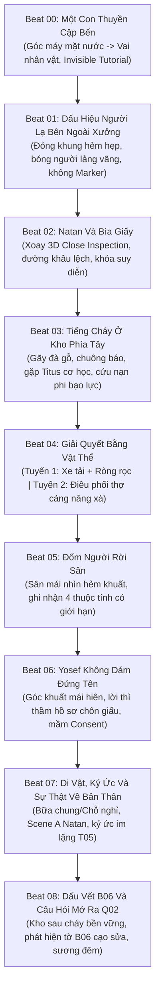
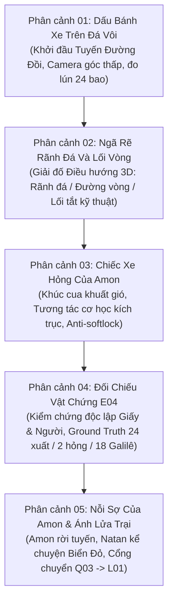
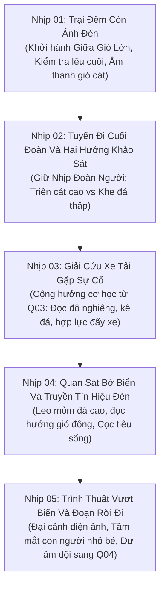

# 07 • Kịch bản Phân cảnh Vertical Slice 3A — Prologue Q01, Chapter Q03 & Legend L01

**Tác phẩm:** *Unsealed Witness: Legacy of the Covenant (Chứng Nhân: Di Sản Giao Ước)*  
**Phân đoạn:** Bộ Kịch Bản Phân Cảnh Chi Tiết Trục Mở Màn & Cổng Hồi I (Prologue Q01, Chapter Q03, Legend L01)  
**Thời lượng dự kiến:** Đây là bộ đặc tả đầy đủ Q01/Q03/L01 với ngân sách từng scene chưa playtest (tổng nhịp chi tiết: Q01 ~40–45 phút, Q03 ~36–46 phút, L01 ~48–58 phút, cộng 124–149 phút chưa tính Q02). Mục tiêu demo tuyển chọn khoảng 90 phút là một phương án biên tập riêng, chưa có scene selection và chưa xác nhận tính liên tục campaign. Không được bỏ Q02 hoặc tự cấp cổng để khớp thời lượng demo.
**Chuẩn mực thiết kế:** One-Shot Camera cho phân cảnh prologue, Khảo cổ Hiện trường Đa tầng, Không chiến đấu lấy mạng (Zero-Combat Tension), Tương tác Vật thể & Cơ học Thực tế, Canon Lock 100%. Vỏ kho, tuyến cửa–nội thất–18 bậc thang–mái đã tồn tại và từng được kiểm trong phạm vi G2/Phase 3 trên candidate tương ứng. Các mở rộng C1 gác lửng, C-1 rãnh bảo trì, cứu hộ và yêu cầu hình ảnh v6 chưa được nghiệm thu. G3 còn chờ duyệt trực quan, G4 còn đang thực hiện.

---

## 1. Thiết lập Bối cảnh & Định hướng Đạo diễn (Director's Vision)

### 1.1. Không gian & Thời gian
* **Địa điểm:** Cảng Sebastos (Xêdarê Maritima) — kỳ quan cảng nhân tạo La Mã bên bờ Địa Trung Hải.
* **Thời điểm:** Một buổi chiều muộn cuối thập niên 50 sau Công nguyên (~58–60 AD). Ánh nắng vàng rực của hoàng hôn Địa Trung Hải rọi nghiêng qua những trụ đá vôi xói mòn bởi muối biển, đổ bóng dài lên các tháp tời bốc dỡ hàng hóa, đường ray gỗ con lăn và những kho hàng phân tầng nồng mùi hắc ín, mạt cưa và cá khô.
* **Tôn chỉ Mở màn:** **Tuyệt đối không sử dụng đoạn chơi thử 6 phút của chương Biển Đỏ (L01) ở đầu game.** Việc mở màn bằng một lát cắt lịch sử hoành tráng sẽ làm phân tán và loãng đi trọng tâm tâm lý cốt lõi của tác phẩm: sự dằn vặt của Người Chứng về cái chết của người cha vừa qua đời và món nợ lương tâm của chính bản thân.

### 1.2. Trạng thái Tâm lý & Xuất phát điểm Nhân vật
* **Nhân vật chính (The Witness / Người Chứng):** Một người chuyển thư trẻ tuổi thuộc tầng lớp bình dân. Vừa rời con thuyền cập bến sau chuyến hải trình dài, trở về quê nhà sau khi nhận tin cha mình — Haddai — đã chết vì bạo bệnh trong cảnh bị bêu riếu vì cáo buộc ký khống hồ sơ thất thoát hàng hóa tại kho cảng.
* **Tảng đá trong tâm thức (T05):** Nhân vật không phải là một người quan sát vô can. Ký ức đau xót nhất đang dày vò Người Chứng là nhiều năm trước, chính mắt nhân vật đã thấy cha ký biên nhận "đã nhận đủ" khi hàng hóa chưa được kiểm tra xong; nhưng vì sợ cha mất việc và gia đình lâm vào cảnh khốn cùng, Người Chứng đã chọn im lặng.

### 1.3. Ngôn ngữ Điện ảnh & Giao diện (Cinematic & UX Rules)
1. **One-Shot Camera:** Toàn bộ Prologue từ lúc con thuyền cập bến đến khoảnh khắc nhìn ra vịnh sương đêm được ghi lại qua một cú máy duy nhất bám sát nhân vật (Over-The-Shoulder / Third-Person Immersive), không một lần cắt cảnh đen (no hard black cuts) hay nhảy góc máy kiểu phim truyền hình (no disjointed shot-reverse-shot cuts).
2. **Invisible Diegetic Tutorial:** Loại bỏ hoàn toàn pop-up hướng dẫn dạng chữ nổi, thanh máu hay vệt sáng dẫn đường (floating GPS waypoint marker). Mọi kỹ năng di chuyển, xoay góc nhìn, kiểm tra vật phẩm và tương tác vật lý đều được hướng dẫn thông qua kiến trúc không gian, âm thanh môi trường và phản xạ hành vi tự nhiên của các nhân vật phụ (NPC).
3. **Observation-First Investigation:** Nghiêm cấm cơ chế "giác quan thám tử" (Detective Vision / Eagle Vision) làm nổi màu đồ vật. Người chơi chỉ có thể phát hiện bất thường qua ánh sáng xiên, âm thanh cót két, độ nghiêng sàn nhà và vết rách cơ học thực tế.

---

## 2. Kịch bản Phân cảnh Chi tiết 9 Nhịp (Beats 00–08)



---

### Phân cảnh 00: Một Con Thuyền Cập Bến (Góc máy Liền mạch & Hướng dẫn Ẩn)
* **Thời lượng:** ~3–4 phút
* **Không gian:** Cầu tàu số 4, Cảng Sebastos.
* **Hình ảnh & Âm thanh mở màn:**
  Khung hình mở ra ở tầm cực thấp, sát mặt nước biển biếc xanh đang dập dềnh phản chiếu ráng chiều Địa Trung Hải. Không có âm nhạc dàn dựng phô trương; không gian chỉ tràn ngập âm thanh thực địa sống động: tiếng sóng vỗ ì oạp vào chân kè đá vôi phủ rêu, tiếng gỗ mạn thuyền va chạm êm ái vào thanh chắn cảng, tiếng dây neo thừng lớn căng kẽo kẹt rợn người khi thủy thủ quăng dây vào cọc bích bằng đá.
* **Chuyển giao điều khiển tức thì:**
  Mũi thuyền chầm chậm chạm gờ bến. Tiếng "rầm" chắc nịch của tấm ván gỗ lớn được hai thủy thủ hạ xuống mặt cầu đá. Máy quay từ mặt nước lướt mượt mà hướng lên, lượn ra sau lưng Người Chứng khi nhân vật nhấc bước chân đầu tiên đạp lên tấm ván. Ngay giây phút mũi hài chạm vào mặt đá ướt của bến cảng, quyền điều khiển hoàn toàn thuộc về người chơi. Không có màn hình tải, không có cắt cảnh.
* **Cơ chế làm quen chuyển động (Diegetic Onboarding):**
  * *Xoay góc nhìn (Camera Control):* Người chơi tự nhiên đưa mắt quan sát khi nghe tiếng hò hét vang dội của các phu khuân vác đang vác các bao ngũ cốc lớn từ boong tàu xuống, và những cánh tay chỉ trỏ của đốc công cảng.
  * *Di chuyển & Điều hướng (Locomotion):* Lối đi thẳng phía trước bị một kiện hàng gỗ cẩu dở che khuất; người chơi tự động học cách luồn lách qua khe hẹp giữa các kiện hàng, lách qua tốp thợ đang cuộn lưới, nhìn theo tấm biển gỗ khắc ký hiệu xưởng mộc của Natan treo nghiêng ở đầu con hẻm lát đá dẫn vào thị trấn cảng.

---

### Phân cảnh 01: Dấu Hiệu Người Lạ Bên Ngoài Xưởng (Quan sát Không gian 3D)
* **Thời lượng:** ~3 phút
* **Không gian:** Hẻm Thợ Mộc nối cầu tàu và xưởng đóng tàu nhỏ.
* **Điểm nhấn thị giác tự nhiên:**
  Rẽ vào con hẻm đá hẹp dốc nhẹ lên trên, hai bờ tường đá vôi cao vút tạo thành hiệu ứng đóng khung thị giác (visual framing). Ánh hoàng hôn hắt nghiêng tạo mảng sáng tối tương phản gay gắt. Ngay trước lối vào xưởng Natan, một bóng người lạ mặt — khoác áo choàng len thô màu tro sẫm, trùm kín đầu — đang đứng bất động, chăm chú dò xét cánh cửa gỗ và cấu trúc khóa của xưởng.
* **Phản ứng AI và Giới hạn Thông tin:**
  Khoảnh khắc tâm nhìn (reticle/camera focus) của người chơi hướng thẳng về phía bóng người lạ và bước chân tiến lại gần khoảng 8 mét, nhân vật này khẽ giật mình, liếc mắt nhìn lại rồi lập tức quay ngoắt bước nhanh lẩn vào dòng người đang đổ xô ra chợ cá.
  * *Nguyên tắc thiết kế:* **Tuyệt đối không xuất hiện icon dấu hỏi, vệt đỏ hay marker xác nhận "Kẻ phóng hỏa / Địch thủ".** Người chơi chỉ biết đây là một người có hành vi lấm lét bất thường.
* **Quyền tự do phản ứng của người chơi (Player Agency):**
  * *Lựa chọn A (Bám theo):* Người chơi có thể chạy vội theo vài mét đến ngã rẽ góc tường, kịp nhìn thấy dáng đi vội vã hơi khập khiễng của hắn trước khi bị đám đông thương nhân che khuất hoàn toàn.
  * *Lựa chọn B (Điều tra tại chỗ):* Người chơi dừng lại bắt chuyện với hai người thợ đang cưa thân gỗ bá hương cạnh đó: *"Người lúc nãy là ai thế?"* — Thợ cảng gạt mồ hôi đáp: *"Chẳng biết, nhưng hắn lảng vảng quanh xưởng bác Natan từ trưa đến giờ, cứ ngó nghiêng mấy cái then cửa."*

---

### Phân cảnh 02: Natan Và Bìa Giấy (Tương tác Vật chứng Xúc giác)
* **Thời lượng:** ~5 phút
* **Không gian:** Bên trong xưởng mộc Natan — không gian mờ tối, ấm áp, nồng đượm mùi mạt cưa thông và dầu thắp ô-liu.
* **Cuộc gặp tại xưởng gỗ:**
  Người Chứng bước qua ngưỡng cửa gỗ thấp. Natan — người bạn thợ lâu năm của người cha quá cố Haddai — đang ngồi trầm ngâm bên bàn thợ, tay vân vê một chiếc bào gỗ đã sứt mẻ. Nghe tiếng bước chân, ông ngẩng đầu lên, ánh mắt đượm vẻ xót xa nhưng đầy cảnh giác.
  Natan đứng dậy, không vội vàng ôm ấp than khóc, mà bước tới một hốc tường bí mật sau giá gỗ, rút ra một cuốn sổ bọc da dê bị quăn mép: cuốn sổ ghi chép hộ gia đình của Haddai.
  * NATAN: *"Cha con bảo giao lại cuốn này tận tay con nếu ông ấy không kịp qua mùa gió bấc. Cầm lấy đi. Giữ cho kỹ, đừng để ai thấy con mang nó ra khỏi cửa này."*
* **Giải đố Quan sát Vật lý (Tactile 3D Close Inspection):**
  Hệ thống kích hoạt góc nhìn cận cảnh vật thể 3D tương tác tự do:
  * Người chơi dùng tay xoay cuốn sổ dưới ánh sáng xiên hắt vào từ khung cửa sổ nhỏ.
  * *Cảm nhận xúc giác:* Bìa da phía sau có mảng ẩm lạnh và bị biến màu do ngấm nước biển lâu ngày.
  * *Phát hiện vật lý:* Khi xoay gáy sổ về phía nguồn sáng, người chơi phát hiện một đường chỉ cước gai khâu lại bị xô lệch bất thường — các lỗ đục cũ vẫn còn dấu vết sợi chỉ tơ đỏ bị cắt đứt vội vàng trước khi bị đè lên bởi một đường khâu thô ráp mới.
  * *Cơ chế ghi nhận (Observation Lock):* Nhật ký chỉ ghi lại sự kiện khách quan: *"Đường chỉ khâu gáy sổ bị lệch và có dấu chỉ bị thay mới."* **Khóa chặt tuyệt đối không cho phép nhân vật tự suy diễn hay kết luận** rằng cuốn sổ đã bị đánh cắp ruột hay làm giả tại thời điểm này (manh mối này chỉ được giải mã hoàn toàn ở Q10 khi có phương pháp bảo tồn và đối chiếu mẫu chỉ).

---

### Phân cảnh 03: Tiếng Cháy Ở Kho Phía Tây (Bùng phát Biến cố)
* **Thời lượng:** ~4 phút
* **Không gian:** Lối thông từ xưởng Natan sang kho bến phía tây (West Harbor Warehouse).
* **Chuyển nhịp khẩn cấp (Pacing Shift):**
  Ngay khi Người Chứng cất cuốn sổ vào túi ngực, một tiếng "RẮC... RẦM!" xé toạc bầu không khí từ hướng bến cảng, tiếp nối là tiếng đà gỗ lớn gãy đổ, tiếng chuông đồng báo động dập dồn và tiếng thét hoảng loạn: *"LỬA! Lửa cháy ở kho phân tầng phía tây rồi!"*. Khói đen mù mịt mang theo mùi dầu hắc cháy khét lẹt cuồn cuộn bốc lên che khuất cả bầu trời hoàng hôn.
* **Sự xuất hiện của Titus (Companion Mechanics Introduction):**
  Người Chứng lao ra khỏi xưởng. Giữa đám đông đang chạy ngược chiều tán loạn, **Titus** — người thợ cơ khí phụ trách hệ thống cáp trục và ròng rọc của cảng — đang cố sức chặn một toán thợ lại:
  * TITUS: *"Kho chưa kiểm hết người! Còn lão Simeon và thằng bé học việc bị kẹt trên sàn gác lửng tầng hai! Cầu thang chính bị xà gãy đè sập rồi! Này anh bạn trẻ, lại đây giúp tôi một tay!"*
* **Định hướng Đạo diễn:**
  **Kiên quyết loại bỏ mọi yếu tố chiến đấu giả tạo (No Combat).** Không có kẻ địch nào nhảy ra chặn đường rút kiếm. Căng thẳng tột độ được tạo nên hoàn toàn từ hiểm họa môi trường: sức nóng của lửa, khói ngạt làm mờ tầm nhìn, và thời gian trôi qua đè nặng lên sinh mạng của người mắc kẹt.

---

### Phân cảnh 04: Giải Quyết Bằng Vật Thể (Gameplay Môi trường Đa tuyến)
* **Thời lượng:** ~8–10 phút
* **Cấu trúc Hiện trường Bốn Vùng Chức Năng Cao Độ (Four Functional Elevation Zones):**
  Kho phía tây được tổ chức theo 4 vùng chức năng cao độ (không phải bốn tầng nhà độc lập xếp chồng). Vỏ kho, tuyến cửa–nội thất–18 bậc thang–mái đã tồn tại và từng được kiểm trong phạm vi G2/Phase 3 trên candidate tương ứng. Các mở rộng C1 gác lửng, C-1 rãnh bảo trì, cứu hộ và yêu cầu hình ảnh v6 là thiết kế đề xuất chưa được nghiệm thu hình học hay va chạm (G3 còn chờ duyệt trực quan, G4 còn đang thực hiện):
  1. `C0 · Cầu cảng & Sân hàng:` Dốc xe hàng Q01.LOAD, đường bánh xe, thợ bốc dỡ ngoài trời.
  2. `C1 · Kho trệt & Gác lửng cứu hộ:` Ngăn chứa trệt ngổn ngang kiện hàng và thùng dầu, gác lửng gỗ bị khói bao vây cục bộ có Simeon và phụ việc mắc kẹt.
  3. `C-1 · Rãnh bảo trì ngầm:` Rãnh tiêu nước đá dưới nền có nắp kiểm tra nối sang khu cảng, bùn nước đọng và vết xước vật nặng (lối ngầm khảo sát và đường luồn cáp).
  4. `C+1 · Sàn tời và Sân mái (Roof Terrace):` Giàn tời chịu tải chữ A, trục quay đối trọng trên cao, chiếu nghỉ và cầu thang 18 bậc dẫn ra sân mái lộng gió.
  
  Khói đen dày đặc cuộn tròn sát trần nhà, buộc người chơi phải cúi thấp người để quan sát và di chuyển. Lối cầu thang chính lên gác lửng bị một thanh đà chịu lực bằng gỗ sồi đang cháy sém đè ngang.

```
       [C+1: SÀN TỜI & SÂN MÁI PHẲNG]  <--- Quan sát bóng người tháo chạy (Beat 05)
                     ^
       [CẦU THANG 18 BẬC (ĐOẠN TRÊN)]
                     ^
  +-------------------------------------+
  |   C1: GÁC LỬNG CỨU HỘ BÊN TRONG     |  <--- Người mắc kẹt (Simeon & phụ việc)
  +-------------------------------------+
        /                         \
  [TUYẾN 1: CƠ HỌC]            [TUYẾN 2: SỨC NGƯỜI]
  Tháo chốt xe hàng nặng C0     Gọi 2 thợ cảng ở cửa ngách
  Lợi dụng sàn trệt nghiêng 5°  Hợp lực đòn bẩy gỗ dài
  Kích hoạt ròng rọc C+1        Dọn thanh xà sồi chắn thang
        \                         /
  +-------------------------------------+
  |   C1: MẶT SÀN TRỆT KHO CHỨA HÀNG    |  <--- Bắt đầu cứu hộ cùng Titus
  +-------------------------------------+
                     ^
    (Lối cửa chính thông ra mặt bằng cảng)
                     v
  +-------------------------------------+
  |   C0: CẦU CẢNG & SÂN HÀNG NGOÀI TRỜI|  <--- Xe hàng Q01.LOAD, dốc bốc dỡ
  +-------------------------------------+
                     |
  [C-1: RÃNH BẢO TRÌ TIÊU NƯỚC DƯỚI NỀN]|  <--- Lối rãnh ngầm, vết xước kéo hòm
```

* **Tuyến giải quyết 1 — Tương tác Cơ học & Đối trọng (Phối hợp cùng Titus):**
  * Người chơi quan sát độ dốc mặt sàn kho lát đá hướng về phía khung cửa sập phụ (thông số thiết kế đề xuất sàn nghiêng ~5°, chưa xác minh qua đo đạc geometry).
  * Tiếp cận chiếc xe thồ bánh sắt chất đầy bao cát dằn tàu: người chơi dùng xà beng nạy chốt hãm bánh xe gỗ.
  * Tận dụng gia tốc trọng trường, Người Chứng và Titus cùng dùng vai tì đẩy chiếc xe lao xuống rãnh trượt, chèn cứng chiếc xe vào khung cửa đang có nguy cơ sập, tạo thành một bệ đỡ chịu lực kiên cố (cơ cấu cơ học đề xuất, cần kiểm thử va chạm capsule và khả năng di chuyển).
  * Titus móc sợi dây cáp tời vào dầm trên, người chơi kéo ròng rọc dây thừng kéo tung cửa thoát hiểm phụ dẫn thẳng lên chiếu nghỉ cầu thang gác lửng (đường nối gác lửng–mái và thoát khói là giả định thiết kế chưa đo line-of-sight).
* **Tuyến giải quyết 2 — Điều phối Sức người & Đòn bẩy (Social/Manual Coordination):**
  * Thay vì vận hành ròng rọc, người chơi quay ra cửa ngách hô hoán, dùng uy tín gia đình Haddai để thuyết phục hai người phu khuân vác đang chần chừ chạy vào trợ giúp.
  * Ba người cùng lách qua làn khói, dùng một thanh gỗ chốt dài luồn dưới thanh xà đang đè, cùng ghé vai hô nhịp *"Một... Hai... Nâng!"* để nhấc bổng thanh đà nghiêng sang một bên, giải phóng lối đi cầu thang bộ.
* **Kết quả:** Cả hai phương án đều giải cứu thành công người thợ già và đứa bé thoát ra hành lang thông lên sân mái mà không bên nào bị thương tổn (tuyến thoát ra sân mái ngoài trời là đề xuất thiết kế, cần xác minh kết nối hình học).

---

### Phân cảnh 05: Đốm Người Rời Sân (Góc nhìn Giới hạn Từ Sân Mái)
* **Thời lượng:** ~3 phút
* **Không gian:** Sân mái hở (Roof Terrace) nhìn bao quát ra con hẻm phía sau kho bến và khu bến thuyền nhỏ.
* **Khoảnh khắc trên cao:**
  Đẩy cánh cửa gỗ bung ra sân mái lộng gió biển, làn không khí mát lạnh xua tan khói ngạt. Người già và đứa trẻ được Titus dìu ra vị trí an toàn.
  Người Chứng tiến lại gần lan can đá ở mép sân mái nhìn xuống con hẻm khuất phía sau kho chứa ngay trước khi tiếng chuông đội cứu hộ dập lửa của cảng xông tới.
* **Ghi nhận Hiện trường Khách quan (Limited Field Observation):**
  Từ điểm nhìn sân mái (cao độ thiết kế ước tính ~8m, chưa đo line-of-sight thực tế), nhìn xuyên qua làn khói xám bốc nghi ngút và ánh lửa bập bùng:
  * Một bóng người đang vội vã chạy lướt qua góc hẻm, trèo qua hàng rào cọc gỗ dẫn ra phía mạn tàu nhỏ của đội thuyền tuần.
  * **Sự thật tác giả (T10):** Vụ cháy phát sinh ngoài dự tính trong lần thu hồi hồ sơ vội của người thuộc mạng lưới Rufus; chưa có bằng chứng tại Q01 cho phép người chơi xác định thủ phạm.
  * **Giới hạn nhận thức người chơi:** Trò chơi không hiện tên thủ phạm, không có "phân tích khuôn mặt". Người chơi chỉ có thể ghi lại vào sổ tay bốn thuộc tính quan sát có giới hạn:
    1. *Hướng di chuyển:* Thoát về phía bến tàu tuần phía bắc.
    2. *Thời điểm rời đi:* Ngay trước khi đội chữa cháy xông vào cửa trước 2 phút.
    3. *Trang phục:* Áo choàng ngắn viền da thuộc của nhân viên hành chính cảng, không phải y phục phu khuân vác.
    4. *Tầm nhìn bị nhòe:* Khoảng cách xa và khói mù khiến không thể nhận diện khuôn mặt hay độ tuổi chính xác.

---

### Phân cảnh 06: Yosef Không Dám Đứng Tên (Hạt mầm của Cơ chế Consent)
* **Thời lượng:** ~4 phút
* **Không gian:** Chân cầu thang ngoài nhà kho, mặt đất ẩm ướt đầy tro tàn và vũng nước cứu hỏa.
* **Hậu quả hiện trường:**
  Người Chứng bước xuống mặt đất. Đám cháy đã được đội dập lửa của cảng khống chế cục bộ, nhưng khu vực kho phía tây vẫn ngổn ngang tro bụi, lính tuần tra cảng bắt đầu chăng dây cô lập hiện trường. Phu khuân vác và thợ thuyền đứng xì xầm to nhỏ trong tâm trạng căng thẳng, đưa những ánh mắt dò xét lẫn nhau.
* **Cuộc tiếp xúc kín đáo:**
  Giữa đám đông đang lộn xộn, **Yosef** — một phu khuân vác với đôi bàn tay chai sần rớm máu — len lén bước tới gần Người Chứng, nép mình vào bóng tối dưới mái hiên của xưởng thuộc da:
  * YOSEF (thì thầm gấp gáp, mắt đảo quanh đầy sợ hãi): *"Cậu... cậu là con trai của bác Haddai đúng không? Bác ấy mất rồi... nhưng chuyện ở bến này chưa hết đâu."*
  * NGƯỜI CHỨNG: *"Anh biết chuyện gì vừa xảy ra trong kho?"*
  * YOSEF: *"Đám cháy này không phải do tàn thuốc. Có những cuộn hồ sơ kiểm kho... những kẻ ngồi trên lầu cao kia tuyệt đối không bao giờ muốn ai mở ra xem lại. Bác Haddai năm xưa cũng vì đụng vào những cuộn ấy mà..."* (Yosef khựng lại, hoảng hốt khi thấy một toán lính tuần đi ngang).
  * YOSEF (nắm chặt cổ tay Người Chứng, khẩn thiết): *"Tôi nói cho cậu vì mang ơn bác Haddai từng chia bánh cho mẹ tôi. Nhưng xin cậu... lạy Chúa tôi van cậu, đừng bao giờ xướng tên tôi ra trước quan chức hay giữa đám đông! Chúng mà biết tôi hé răng, ngày mai xác tôi sẽ nổi ở ngoài đê chắn sóng!"*
* **Ý nghĩa Hệ thống (Systemic Seed):**
  Đây là **hạt mầm đầu tiên của Cơ chế Đồng thuận (Witness Consent Contract)** xuyên suốt game: Người chơi thu thập được một đầu mối thông tin cực kỳ quan trọng, nhưng đồng thời bị trói buộc bởi trách nhiệm đạo đức và tính mạng của nhân chứng — tuyệt đối không được tự tiện công khai tên họ Yosef nếu chưa có phương án bảo hộ an toàn.

---

### Phân cảnh 07: Di Vật, Ký Ức Và Sự Thật Về Bản Thân (Cao trào Nội tâm)
* **Thời lượng:** ~6–8 phút
* **Không gian:** Xưởng Natan lúc nửa đêm — ngọn đèn dầu liu riu, gió biển rít qua khe cửa gỗ.
* **Quản lý Sinh hoạt & Quyết định Tài nguyên (Lodging vs Meal):**
  Trước khi bước vào cuộc trò chuyện cuối ngày, người chơi phải đưa ra lựa chọn phân bổ sinh hoạt thiết yếu (mở ra callback cho các chương sau):
  * *Lựa chọn `lodging`:* Trả tiền thuê một góc bàn riêng tại quán trọ gần cảng để có nơi an toàn sao chép tài liệu và phân loại hồ sơ (tạo lợi thế nghiên cứu cho Q03).
  * *Lựa chọn `meal`:* Đóng góp phần tiền mua dầu và bánh dự trữ cho bếp chung của xóm thợ nghèo, chấp nhận ngủ tạm trên sàn rơm của xưởng Natan (tạo mối liên kết cộng đồng, có người hỗ trợ canh gác ở Q04).
* **Đối diện Quá khứ tại Xưởng Natan (Diễn xuất Cận cảnh — Cảnh thoại Mẫu A):**
  Natan rót một chén rượu hạt thông nhỏ, ngồi đối diện Người Chứng. Ngọn đèn dầu hắt bóng hai người lên vách gỗ sực mùi mạt cưa. Natan nhìn sâu vào mắt nhân vật chính:
  
  > **NATAN**  
  > *(ngón tay chai sần chạm nhẹ vào cuộn dây thừng bện ba tao trên bàn)*  
  > Cha con sửa dây neo hai lần, kể cả khi người khác bảo đã chặt. Nhưng có một thứ ông ấy đã ký quá sớm.  
  >  
  > **NGƯỜI CHỨNG**  
  > *(khựng lại, ánh mắt phản chiếu ngọn đèn dầu chập chờn)*  
  > Chú... chú biết chuyện ấy?  
  >  
  > **NATAN**  
  > *(ngước lên nhìn thẳng, giọng trầm và chắc nịch)*  
  > Chú chỉ biết thứ ông ấy để lại ở đây. Phần còn lại, chú không thể nói thay người đã thấy.  

* **Nỗi đau của Sự Im lặng (Core Revelation — Không Twist Giả tạo):**
  Trò chơi không hề "lừa dối" người chơi bằng một màn lật kèo tréo ngoe của kịch bản phim hạng B. Ngay tại phân cảnh này, hồi ức chân thực nhất của Người Chứng được mở ra:
  * Nhân vật nhớ lại chính xác buổi chiều định mệnh 3 năm trước: Cha mình — già yếu và mỏi mệt — run rẩy cầm que lau chấm mực ký vào bản biên nhận *"Đã tiếp nhận đủ hàng"* khi các bao tải ngoài bến còn chưa được tháo niêm kiểm kê.
  * Người Chứng khi ấy đã đứng ngay cạnh cha, nhìn thấy rõ sự vội vã bất thường đó nhưng đã chọn **giữ im lặng** vì sợ cha bị cắt hợp đồng khuân vác của cảng.
  * Điều duy nhất Người Chứng chưa biết: Số hàng bị thất thoát ấy thực sự đã đi đâu, và ai là kẻ hưởng lợi sau lưng bức màn giấy tờ đó?

---

### Phân cảnh 08: Dấu Vết B06 Và Câu Hỏi Mở Ra Q02 (Trạng thái Thế giới Bền vững)
* **Thời lượng:** ~4 phút
* **Không gian:** Hiện trường kho phía tây lúc rạng sáng, khi tàn tro đã nguội.
* **Trạng thái Thế giới Bền vững (Persistent World State):**
  Nhà kho không hề bị reset hay biến mất. Khi người chơi quay trở lại hiện trường, thế giới 3D giữ nguyên vẹn mọi dấu vết vật lý từ vụ cứu hộ ở Beat 04:
  * Chiếc xe hàng bánh sắt vẫn nằm chèn cứng ở khung cửa ngách.
  * Cột xà gãy cháy sém nằm nghiêng đúng vị trí đã bị đòn bẩy nhấc qua.
  * Mặt sàn đá loang lổ vết bồ hóng đen và những vũng bùn tro đã đông cứng.
* **Phát hiện Dấu vết Chuyển tiếp (Preliminary B06 Observation):**
  Timeline ánh sáng tiến triển theo nhịp kịch bản: Beat 00–02 chiều muộn/hoàng hôn (cần kiểm tra khả năng biểu đạt bằng preset hiện có) → Beat 03–06 chạng vạng/tối khi cháy kho (preset `q01-evening` chỉ là mốc kỹ thuật đại diện) → Beat 07 đêm tại xưởng Natan (chưa có preset `night` được xác minh) → Beat 08 rạng sáng hôm sau (chưa có preset `dawn` được xác minh). Engine (`witness-q01.js`) hiện chỉ có hai preset kỹ thuật `q01-day` và `q01-evening` với dữ liệu GI nướng tĩnh; các trạng thái ban đêm và rạng sáng là yêu cầu mỹ thuật cho tương lai, chưa phải tính năng runtime đã nghiệm thu.
  Người chơi soi đèn dầu vào góc bàn kiểm nhận bị lửa táp sém một góc. Dưới đáy một khay gỗ bị lật úp, người chơi phát hiện một mảnh giấy da ghi nhận xuất kho mang mã hiệu **B06**:
  * Mặt giấy có vết cạo cơ học rõ rệt: con số lượng hàng đã bị cạo mỏng bề mặt bột đá vôi để viết đè lên.
  * *Giới hạn chứng cứ nghiêm ngặt:* Quan sát này chỉ là ghi nhận hiện tượng vật lý sơ bộ tại hiện trường Q01, **chưa cấp vật chứng E02 vào sổ tay điều tra**. Việc thu thập, kiểm tra mép dán và thẩm định chính thức E02 thuộc phạm vi Q02. Mệnh đề P01 yêu cầu đủ cả E02 và E03, tuyệt đối không tự suy đoán nguyên nhân hay quy kết thủ phạm. B06 hoàn toàn tách biệt với G17.
* **Khép lại Trường đoạn (Cinematic Outro):**
  Máy quay từ từ nâng cao dần, lướt qua khung vì kèo mái kho bị cháy thủng toang hoác, bay vút lên bầu trời sớm mai ửng hồng ánh bình minh nhìn bao quát toàn cảnh vịnh cảng Sebastos. Cảng biển thức giấc trong làn sương sớm tinh khôi, ánh nắng đầu ngày rọi chiếu lên những vết cháy đen còn bốc khói mỏng và mặt nước vịnh phẳng lặng.
  Âm thanh lắng lại chỉ còn tiếng chuông xa xăm và câu hỏi trọng tâm dẫn dắt bước sang Q02:  
  **"Ai đang làm hồ sơ thay đổi, và vì sao nhân chứng sợ nói?"**

---

## 3. Kịch bản Phân cảnh Chi tiết Q03: Con Đường Biến Mất (Đường Đồi / Antipatris)

### 3.1. Thiết lập Bối cảnh & Mục tiêu (Scene Context & Objectives)
* **Bối cảnh Không gian:** Tuyến đường đồi gập ghềnh từ đồng bằng ven biển Xêdarê leo dần lên sườn đồi đá vôi khô cằn hướng về Antipatris. Địa hình đặc trưng bởi các dốc đá vôi trắng bị gió cát bào mòn, đất nén lẫn đá dăm và các rãnh xói lở tự nhiên của thung lũng Sharon.
* **Thời điểm:** Ban trưa oi ả, ánh nắng mặt trời gắt gao làm rung rinh ảo ảnh nhiệt trên mặt đá, tiếng ve sầu khô khốc và tiếng gió đồi rít qua các khe nứt địa hình.
* **Mục tiêu Trọng tâm:** Rời bến cảng Xêdarê sau các biến cố mở màn và cuộc gặp Yosef tại Q02, Người Chứng lên đường lần theo dấu vết tuyến vận chuyển lô hàng G17 qua khu vực đường đồi hướng về Antipatris để tìm hiểu nguyên nhân cốt lõi gây thiếu hụt hàng hóa. Mục tiêu tối hậu là tìm gặp người đánh xe Amon, trực tiếp kiểm tra hiện trường vận chuyển và thu thập chứng cứ độc lập E04.
* **Tôn chỉ Đạo diễn:** Tuyệt đối không dùng bản đồ GPS hay vệt sáng dẫn đường nổi. Toàn bộ hành trình truy vết vận hành bằng cơ chế **Khảo cổ học Hiện trường 3D (Forensic Environmental Navigation)**: đọc dấu bánh xe lún bùn, phân tích độ mẻ của đá, lắng nghe tiếng gió rít qua rãnh nứt và đo đạc tỷ lệ cơ học thực tế.



---

### Phân cảnh 01: Dấu Bánh Xe Trên Đá Vôi (Khởi đầu Tuyến Đường Đồi)
* **Thời lượng:** ~6–8 phút
* **Không gian:** Chân dốc đồi Antipatris, ranh giới chuyển tiếp giữa đất cát ven biển và cao nguyên đá vôi.
* **Hình ảnh & Ngôn ngữ Điện ảnh:**
  * Khung hình mở rộng (Wide Establishing Shot) từ góc thấp dưới chân đồi nhìn ngược lên con đường đá uốn lượn gập ghềnh qua những sườn đồi khô cằn. Ánh nắng rực rỡ hắt bóng đổ gắt gao của những khối đá vôi cổ đại.
  * Máy quay từ từ hạ thấp bám sát bước chân Người Chứng khi nhân vật bắt đầu bước vào địa hình dốc. Người chơi tự tìm đường qua mạng lưới điều hướng địa hình (navigation graph) tự nhiên của thế giới thay vì đi theo bất kỳ mũi tên chỉ sẵn nào.
* **Cơ chế Khảo sát Hiện trường (Diegetic Environmental Forensic):**
  * *Phát hiện Địa hình Khắc nghiệt:* Tiến đến đoạn dốc đầu tiên, người chơi đối diện các bậc đá tự nhiên có khoảng cách và chiều cao hiểm trở. Khổ hẹp giữa hai trụ đá chỉ đạt 1.05m, hoàn toàn không tương thích với khổ trục xe thồ hàng tiêu chuẩn (1.75m), khiến các xe thồ nặng nếu cố tình đi qua đây sẽ bị mắc kẹt hoặc va quẹt dữ dội làm mẻ đá góc.
  * *Quan sát Góc thấp (Close Surface Inspection):* Bằng cách hạ thấp góc nhìn camera sát mặt đất (nhấn phím V chuyển góc nhìn thứ nhất hoặc cúi người quan sát), người chơi phân biệt rõ ràng hai lớp vết tích:
    1. *Lớp dấu bánh xe cũ:* Các vệt mòn nông, phân tán, đã bị gió sa mạc phủ một lớp bụi mờ mịn màng.
    2. *Vệt bánh xe mới lún sâu bất thường:* Rãnh bánh xe hằn sâu vào dải đất bùn pha sỏi nén chặt ven gờ đá, các thớ đất còn ẩm và thành rãnh bị nén đứng thẳng — bằng chứng cơ học không thể chối cãi của một chuyến xe chở tải trọng cực lớn (tải trọng nặng của toàn bộ 24 bao hàng) vừa mới đi qua cách đây không lâu.

---

### Phân cảnh 02: Ngã Rẽ Rãnh Đá Và Lối Vòng (Giải đố Điều hướng Địa hình)
* **Thời lượng:** ~8–10 phút
* **Không gian:** Ngã ba hẻm đá chia cắt sườn đồi, nơi có một bờ vực sạt lở cục bộ.
* **Thử thách Điều hướng Không gian Thực tế:**
  Lần theo vệt bánh xe sâu, người chơi chạm trán một chướng ngại vật tự nhiên chia con đường thành hai ngả: một rãnh đá hẹp bị đá tảng sạt lở chắn ngang và một lối mòn đi vòng men theo sống lưng sườn đồi. Trò chơi đặt ra bài toán giải đố không gian thực tế với 3 phương án tiếp cận hoàn toàn hợp lệ:
  * **Tuyến 1 — Vượt rãnh đá (Tuyến Cơ học & Dấu vết Ma sát):**
    * *Khảo sát:* Người chơi tiến sát mép rãnh, đo đạc độ rộng của khe nứt và tự tay dọn dẹp các tảng đá rơi chắn ngang lối.
    * *Manh mối Xúc giác:* Trên vách đá vôi dựng đứng tại điểm đổi dây kéo, người chơi phát hiện những rãnh cứa sâu bóng loáng do ma sát của sợi thừng gai chịu tải nặng khi tời xe qua dốc. Dấu vết này xác nhận đây chính là nơi chuyến xe tải nặng từng phải dùng tời kéo vượt dốc.
  * **Tuyến 2 — Tuyến đường vòng thực tế (Tuyến Đi bộ An toàn):**
    * *Khảo sát:* Người chơi lựa chọn đi vòng qua sườn đồi thoai thoải hơn để giữ an toàn cho bản thân.
    * *Dấu vết Trạm nghỉ:* Tuyến đường vòng này lưu lại rõ nét dấu tích của một trạm dừng chân dã chiến: tro bếp nguội của những người đánh xe, vài mẩu dây thừng gai bị đứt bỏ lại và vệt đất bị xới tung nơi bánh xe từng dừng bánh để chằng buộc lại các kiện hàng bị xô lệch.
  * **Tuyến 3 — Lối tắt Kỹ thuật (Technical Shortcut):**
    * *Điều kiện Kỹ thuật:* Nếu người chơi đã chuẩn bị kỹ lưỡng từ trước tại kho cảng Xêdarê (mang theo bộ đồ nghề công cụ `tools` từ lựa chọn Q01/Q02), người chơi có thể sử dụng nêm sắt và búa gỗ kích đòn bẩy mở bung một lối đi ngắn vượt qua ghềnh đá cao, giúp rút ngắn đáng kể hành trình leo dốc.

---

### Phân cảnh 03: Chiếc Xe Hỏng Của Amon (Tương tác Cơ học & Lựa chọn Mở)
* **Thời lượng:** ~10–12 phút
* **Không gian:** Khúc cua gắt khuất gió sau rặng đá vôi, nơi trũng xuống tránh được gió lốc sa mạc.
* **Gặp gỡ Hiện trường:**
  Vượt qua đoạn địa hình hiểm trở, âm thanh đầu tiên người chơi nghe thấy không phải tiếng người mà là tiếng kim loại gõ lách cách vào trục gỗ kèm theo tiếng thở dốc bực dọc. Máy quay lướt qua gờ đá, bắt trọn cảnh Amon — người đánh xe dày dạn kinh nghiệm — đang toát mồ hôi loay hoay bên chiếc xe vận chuyển hạng nặng bị gãy trục đỡ và kẹt cứng một bánh vào khe đá nứt.
* **Tính Bền Vững của Thế Giới (World State Persistence):**
  Mọi dấu vết sửa chữa, sắp đặt đá kê hay thanh đòn bẩy tại hiện trường này đều được hệ thống lưu giữ lâu dài vào trạng thái thế giới (world state). Nếu người chơi quay trở lại khu vực này ở các chương sau, hiện trường vẫn giữ nguyên trạng thái đã được can thiệp.
* **Hai Phương án Tiếp cận Sổ Ghi Chép (Dual-Branch Gameplay):**
  Để tiếp cận cuốn sổ ghi chép vận chuyển của Amon nhằm xác minh sự thật về lô hàng G17, trò chơi mở ra hai hướng giải quyết độc lập:
  * *Lựa chọn A (`paid` — Trả công tài chính):*
    Người chơi trả một khoản tiền công hợp lý để Amon mở ngay cuốn sổ hành trình cho xem tại chỗ. Amon nhận tiền và ngồi xuống gờ đá mở sổ, giúp người chơi tiết kiệm thời gian thể lực để dành cho các cuộc gặp tiếp theo.
  * *Lựa chọn B (`worked` — Tương tác Cơ học Đòn bẩy):*
    Người chơi trực tiếp xắn tay áo lao vào hỗ trợ Amon: tìm đá hộc kê chèn bánh xe chịu lực, dùng một thanh gỗ dài làm đòn bẩy kích nâng trục xe bị gãy, và cùng Amon đóng chốt hãm thay thế. Sau khi phương tiện được giải cứu, Amon cảm kích và tự nguyện trao sổ hành trình cho Người Chứng kiểm tra.
* **Quy tắc Chống Khóa Cứng (Anti-Softlock Guarantee):**
  Hệ thống đảm bảo nguyên tắc vàng: ngay cả khi người chơi không còn một đồng xu nào trong túi, lựa chọn lao động cơ học (`worked`) luôn sẵn sàng để hoàn thành nhiệm vụ mà tuyệt đối không bao giờ làm nghẽn mạch game.

---

### Phân cảnh 04: Đối Chiếu Vật Chứng E04 (Kiểm chứng Độc lập Giấy và Người)
* **Thời lượng:** ~6–8 phút
* **Không gian:** Bên thùng xe hàng đã được kê nêm vững vàng, dưới bóng râm của vách đá.
* **Màn Đối Chiếu Độc Lập Giấy và Người (Forensic Cross-Examination):**
  Khi chiếc xe đã được cố định, người chơi bước vào màn đối chiếu trực tiếp giữa lời kể miệng của Amon và sổ chép hành trình vận chuyển thực tế để thu thập chứng cứ độc lập mang mã hiệu **E04** (Bản chép hành trình vận chuyển):
  * *Mắt xích Sự Thật Nền (Ground Truth):* Quá trình kiểm tra độc lập giữa tài liệu vận tải E04 và lời khai nhân chứng tại hiện trường xác nhận dữ liệu vận chuyển:
    1. **Xuất bến:** Dữ liệu vận chuyển E04 ghi nhận lô hàng G17 xuất **24 bao** tại kho cảng Sebastos (Xêdarê); việc xác thực biên nhận gốc và chữ ký của Haddai chỉ được tiến hành sau đó tại Q04 (vật chứng E01), avatar tại Q03 chưa thể biết trước tính xác thực của chữ ký.
    2. **Hư hại trên đường:** Trong quá trình vượt đèo đá hiểm trở, chính chiếc xe này đã gặp sự cố lật nghiêng làm rách vỡ đúng **2 bao** bột mì. Amon đã đích thân lập biên bản hư hại riêng biệt có xác nhận của trạm kiểm soát địa phương.
* **Kỷ Luật Suy Luận & Sơ Đồ Ranh Giới Tri Thức Q03 (E04, E01, E05):**
  Kịch bản giữ vững kỷ luật điều tra và ranh giới tri thức nghiêm ngặt:
  * Trò chơi tuyệt đối **không cho phép nhân vật tự suy diễn 4 bao thất lạc đi về đâu** vào thời điểm này.
  * Q03/E04: dữ liệu vận chuyển cho biết 24 bao xuất và 2 bao hỏng.
  * Q04/E01: xác thực biên nhận gốc và chữ ký Haddai (chưa có ở Q03).
  * Q05/E05: xác nhận 18 bao thực nhận tại Galilê (chưa có ở Q03).
  * Mệnh đề P02 chỉ có thể xác lập khi có đủ E04 và E05 độc lập: 24 xuất - 2 hỏng - 18 thực nhận = 4 bao chưa được giải trình.

```
  [DỮ LIỆU VẬN CHUYỂN (Q03/E04)]       [XÁC THỰC BIÊN NHẬN (Q04/E01)]       [XÁC NHẬN THỰC NHẬN (Q05/E05)]
  24 xuất bến, 2 hỏng có biên bản       Biên nhận gốc & chữ ký Haddai        18 bao thực nhận tại Galilê
                │                                     │                                    │
                └─────────────────────────────────────┼────────────────────────────────────┘
                                                      v
                                    [ĐIỀU KIỆN XÁC LẬP MỆNH ĐỀ P02]
                                    Cần E04 + E05 độc lập và đầy đủ:
                                    24 xuất - 2 hỏng - 18 thực nhận = 4 bao chưa giải trình
```

---

### Phân cảnh 05: Nỗi Sợ Của Amon Và Câu Chuyện Bên Ánh Lửa (Cổng Mở L01)
* **Thời lượng:** ~6–8 phút
* **Không gian:** Trạm nghỉ chân dã chiến bên đường đồi khi hoàng hôn tắt hẳn và màn đêm buông xuống.
* **Diễn biến Tâm lý & Nỗi sợ của Nhân chứng Bình dân:**
  Dù ban đầu Amon rất cởi mở và hứa sẽ hỗ trợ Người Chứng làm rõ các uẩn khúc của lô hàng, thái độ của anh nhanh chóng chuyển sang bất an, căng thẳng tột độ khi nhận ra những dấu hiệu lạ: các vệt móng ngựa tuần tra bất thường trên sườn đồi và lời cảnh báo ngầm từ những kẻ lạ mặt. Hiểu rằng tính mạng mình đang bị đe dọa bởi những thế lực ngầm muốn bưng bít vụ việc, Amon quyết định sẽ âm thầm rời bỏ tuyến vận chuyển Antipatris ngay trong đêm (sự kiện này mở ra tuyến cứu hộ và tìm lại Amon ở hẻm đá hiểm trở tại chương Q08).
* **Trường đoạn Ánh Lửa Trại & Sự Tiếp Nhận Truyền Thống:**
  Màn đêm buông xuống trạm nghỉ sau một ngày leo dốc vắt kiệt thể lực. Cả nhóm ngồi quây quần bên đống lửa trại bập bùng xua tan cái lạnh cắt da của vùng cao nguyên Sharon.
  * Natan nhìn tàn lửa bay vào màn đêm, chậm rãi thuật lại cho Người Chứng và nhóm bạn nghe trình thuật truyền thống ngàn đời của tiền nhân về **Cuộc Vượt Biển Đỏ năm xưa (Xuất Hành 14)**.
  * *Nguyên tắc Truyền tụng Tôn giáo:* Kịch bản nhấn mạnh Natan kể lại câu chuyện như một phần gia sản đức tin và truyền thống cộng đồng mà ông được cha ông truyền lại, hoàn toàn không tuyên bố bản thân tận mắt chứng kiến hay tự phong mình làm sứ giả thần bí.
* **Cú Chuyển Cảnh Liền Mạch (Seamless Narrative Transition):**
  Ánh lửa trại bập bùng đỏ rực phản chiếu trong đôi mắt đăm chiêu của Người Chứng. Tiếng củi nổ lách tách dần dần hòa quyện vào tiếng gió rít gầm rú dữ dội của cuồng phong sa mạc cổ xưa. Khung hình mờ dần trong làn khói lửa ấm áp và mở ra rực sáng giữa giông bão của bờ Biển Đỏ, chuyển cảnh mượt mà đưa người chơi bước qua cánh cổng chiến dịch **Q03 $\rightarrow$ L01**.

---

## 4. Kịch bản Phân cảnh Chi tiết Legend L01: The Path Through The Sea (Xuất Hành 14,1–31)

### 4.1. Thiết lập Quy tắc Nguồn & Tôn Chỉ Đạo Diễn (Canon Lock Charter)
* **Văn bản Nguồn:** Trình thuật Kinh Thánh chính thức [Xuất Hành 14,1–31](08-scripture-reference.md) [S05].
* **Bảo toàn Canon Lock 100%:** Tuyệt đối không hư cấu thêm phép lạ, không bóp méo thời gian, không thay đổi chủ thể hành động thiêng liêng. Biến cố biển rẽ và sự giải thoát hoàn toàn thuộc về quyền năng của Thiên Chúa thông qua cử chỉ giơ gậy vâng phục của Môsê.
* **Quyền Chủ Động của Người Chơi (Player Agency) — Nhân Chứng Vô Danh:**
  * Người chơi hóa thân thành một **Nhân Chứng Vô Danh đi ở khóa đuôi đoàn người** (Caravan Rearguard Defender) — một thanh niên thuộc chi tộc Giuđa làm nhiệm vụ bọc hậu.
  * Tuyệt đối không biến người chơi thành nhân vật chính xuyên không, không điều khiển Môsê và không có bất kỳ nút bấm "kích hoạt phép lạ rẽ biển" nào. Người chơi chỉ trải nghiệm sự kiện qua góc nhìn mặt đất của một con người bình thường giữa biến cố lịch sử vĩ đại.
* **Hỗ trợ Tiếp cận Toàn diện (Accessible Summary Mode):**
  Đối với những người chơi muốn tập trung hoàn toàn vào nhịp điều tra vụ án đương đại ở bến cảng, hệ thống cung cấp chế độ **Tóm tắt Tiếp cận (Accessible Summary)** gồm 6 trang tư liệu tương ứng 6 nhịp B01–B06 có đầy đủ thuyết minh và minh họa trung tính, giúp ghi nhận trọn vẹn sự kiện và mở khóa cổng sang Q04 một cách hoàn toàn hợp lệ mà không bị ép buộc chơi hành động.



---

### Nhịp 01: Trại Đêm Còn Ánh Đèn (Khởi hành Giữa Gió Lớn)
* **Thời lượng:** ~8–10 phút
* **Không gian:** Khu trại hậu phương của đoàn dân Israel tại Pi-Hahiroth, đối diện Baal-Zephon ven bờ Biển Đỏ.
* **Hình ảnh & Không khí Mở màn:**
  * Khung hình mở ra giữa một khu trại đêm rộng lớn đang hối hả thu dọn hành lý trong nỗi hoảng loạn tột độ dưới những ngọn đèn dầu chao đảo điên cuồng trước cơn gió lớn từ hướng đông thổi về.
  * *Thiết kế Âm thanh Chân thực (Diegetic Audio Design):* Kiên quyết loại bỏ nhạc nền giao hưởng phô trương kỹ xảo. Đạo diễn âm thanh đặt trọn trọng tâm vào âm thanh mộc của hiện trường: tiếng gió rít xé toạc các vách lều bằng vải thô, tiếng cát bay rào rạt táp vào da thịt, tiếng trẻ con khóc thét và tiếng người lớn gọi nhau í ới trong bóng tối mịt mùng.
* **Cơ chế Gameplay Làm quen:**
  * Người chơi điều khiển người hộ vệ khóa đuôi di chuyển qua đám đông được dàn dựng theo nhiều tầng chi tiết (Crowd LOD System).
  * Cầm ngọn đèn bão chắn gió, người chơi đi kiểm tra từng lều trại cuối cùng ở mép hậu phương, nhắc nhở các gia đình thu gom vật dụng thiết yếu, giúp dập tắt các đống lửa tàn để tránh hỏa hoạn lan rộng, và đảm bảo không một ai bị bỏ quên lại phía sau trước khi toàn bộ khu trại nhổ neo xuất phát.

---

### Nhịp 02: Tuyến Đi Cuối Đoàn Và Hai Hướng Khảo Sát (Giữ Nhịp Đoàn Người)
* **Thời lượng:** ~12–14 phút
* **Không gian:** Dải địa hình chia cắt phức tạp giữa sa mạc và đầm lầy ven biển.
* **Nhiệm vụ Khóa Đuôi (Rearguard Duty):**
  Khi toàn bộ đoàn người bắt đầu chuyển bánh, người chơi bọc lót ở phía sau cùng, hỗ trợ những người già yếu, phụ nữ mang thai hoặc những người kiệt sức không bị tụt lại khoảng cách quá xa trong màn đêm tăm tối.
* **Hai Tuyến Khảo Sát Đường Đi (Dual Exploration Path):**
  Tiến vào vùng địa hình hiểm trở chia cắt bởi các đụn cát và rãnh đá ven biển, người chơi đứng trước hai lựa chọn khảo sát thực địa nhằm tìm ra tuyến hành quân tối ưu:
  * *Tuyến Triền Cát Cao (The Ridge Route):*
    Người chơi leo dọc theo sống cát cao nhô ra bờ biển. Vị trí này cho phép phóng tầm mắt bao quát toàn thể trật tự di chuyển của đoàn người, đồng thời quan sát được từ rất xa ánh đuốc chập chờn của đạo quân chiến xa Ai Cập đang rầm rộ đuổi theo ở đường chân trời (được ngăn cách bởi cột mây chở che).
  * *Tuyến Khe Đá Thấp (The Gully Route):*
    Người chơi dẫn các nhóm gia đình đi men theo chân các khe đá thấp sát mép nước. Tuyến đường này tuy ẩm ướt nhưng có vách đá che chắn bớt sức gió cuồng phong, giúp những người đi bộ yếu sức và trẻ nhỏ giữ vững thân nhiệt và bước đi vững vàng hơn.
* **Bảo Toàn Kết Cục Lịch Sử:**
  Cả hai tuyến khảo sát đều mang lại lợi thế hỗ trợ thiết thực cho việc giữ nhịp đoàn người, hoàn toàn tôn trọng và không làm thay đổi bất kỳ tình tiết nào của bản văn Kinh Thánh.

---

### Nhịp 03: Giải Cứu Xe Tải Gặp Sự Cố (Sự Cộng Hưởng Cơ Học từ Q03)
* **Thời lượng:** ~10–12 phút
* **Không gian:** Vũng cát lún ngập nước triều ở khúc thắt cổ chai của tuyến đường bọc hậu.
* **Tình Huống Nguy Cấp:**
  Một chiếc xe thồ chở hành lý nặng của một đại gia đình ở cuối đoàn bất ngờ bị sụp bánh xuống một hố cát ướt sâu hoắm. Bánh xe gỗ bị chôn chặt ngập đến trục, trong khi cuồng phong gió đông tạt ngang dữ dội đe dọa lật nhào toàn bộ cỗ xe xuống triền dốc.
* **Sự Cộng Hưởng Cơ Học Thực Tế (Mechanical Resonance):**
  Tại đây, toàn bộ kỹ năng khảo sát độ nghiêng địa hình, tìm đá chèn bánh chịu lực và vận dụng đòn bẩy kích trục mà người chơi vừa thực hành cùng Amon ở chương Q03 được tái hiện dưới áp lực thời gian ngặt nghèo và điều kiện thời tiết khắc nghiệt gấp bội:
  * *Bước 1 — Đo Hướng Gió & Kê Đá:* Người chơi quan sát hướng gió tạt, nhanh chóng tìm các tảng đá san hô cứng chèn chặt phía sau bánh xe đối diện để ngăn xe bị trượt lùi theo trọng tâm nghiêng.
  * *Bước 2 — Huy Động Sức Người:* Người chơi chạy lại gọi 3 thanh niên đi gần đó cùng bám chặt vào dây chằng giữ cân bằng mui xe.
  * *Bước 3 — Hiệp Lực Kích Đòn Bẩy:* Đặt một thanh đòn gỗ dài vào dưới trục xe bị lún, người chơi cùng người dân đếm nhịp hô vang đồng thanh hiệp lực bẩy bổng chiếc xe thoát khỏi hố cát lún, đưa phương tiện trở lại dải đường cứng an toàn trước khi khoảng cách với đoàn chính bị kéo giãn.

---

### Nhịp 04: Quan Sát Bờ Biển Và Truyền Tín Hiệu Đèn (Giải đố Tầm nhìn)
* **Thời lượng:** ~8–10 phút
* **Không gian:** Mỏm đá vôi vươn ra mép nước biển gầm sóng dữ.
* **Thử Thách Mất Phương Hướng:**
  Sau khi giải cứu cỗ xe thành công, bão cát nổi lên dữ dội kết hợp với màn đêm dày đặc làm bụi bay mù mịt, che khuất hoàn toàn tầm nhìn của nhóm người đi cuối. Tiếng sóng biển ầm ầm át đi tiếng người, khiến nhóm có nguy cơ lạc bước đi chệch vào vùng đầm lầy chết người.
* **Thao Tác Cọc Tiêu Sống (Living Lighthouse Navigation):**
  * *Tìm Điểm Cao:* Người chơi nhanh nhẹn tìm đường bám vào các gờ đá trơn trượt để leo lên đỉnh một mỏm đá cao nhô hẳn ra mép biển.
  * *Đọc Hướng Gió Đông:* Đứng trên đỉnh cao lộng gió, người chơi cảm nhận rõ rệt luồng cuồng phong gió đông thổi bạt ngàn suốt đêm — luồng gió mà Thiên Chúa dùng để dồn nước biển lui lại và làm cạn khô lòng biển.
  * *Truyền Tín Hiệu Ánh Sáng:* Người chơi giơ cao ngọn đèn bão, xoay lồng kính chắn gió theo nhịp hiệu lệnh đã định. Ánh đèn dầu chao đảo rọi xuyên qua màn bụi cát đêm đen, trở thành ngọn hải đăng sống định vị phương hướng cho hàng trăm con người đang hoang mang phía dưới lần lượt chỉnh đốn hàng ngũ tiến thẳng về phía bờ biển an toàn.

---

### Nhịp 05: Trình Thuật Vượt Biển Và Đoạn Rời Đi (Đại cảnh Điện ảnh & Dư âm Q04)
* **Thời lượng:** ~10–12 phút
* **Không gian:** Lòng Biển Đỏ rẽ đôi mở ra hành lang cát khô giữa hai bức tường nước.
* **Đại Cảnh Điện Ảnh Thiêng Liêng (Sacred Cinematic Spectacle):**
  Khi người chơi hoàn tất việc dẫn những gia đình cuối cùng tới sát mép nước, trò chơi chuyển sang trường đoạn đại cảnh điện ảnh dàn dựng lại toàn bộ trình thuật vượt biển theo đúng khuôn khổ trang nghiêm của Xuất Hành 14:
  * *Tầm Mắt Nhân Chứng Nhỏ Bé:* Máy quay kiên định giữ vững góc nhìn ngang tầm mắt của một con người nhỏ bé bước đi trên nền đất khô ráo giữa lòng biển sâu. Hai bên tả hữu là hai bức tường nước khổng lồ sừng sững như vách thành dựng đứng, mặt nước cuộn sóng đen thẫm phản chiếu ánh sáng kỳ diệu từ cột lửa trên cao.
  * *Bản Giao Hưởng của Niềm Tin:* Âm thanh của phân cảnh là sự hòa quyện rung chuyển tâm can giữa tiếng sóng biển gầm vang dội trên đầu, tiếng bước chân hàng vạn con người bước đi trên cát khô, và tiếng thở phào nhẹ nhõm của những người vừa thoát khỏi ách nô lệ lầm than.
  * *Đoạn Rời Đi Bờ Bên Kia:* Đoàn người lần lượt bước lên bờ cát an toàn bên kia bờ biển khi ánh bình minh ló dạng. Nước biển ập lại vùi lấp toàn bộ chiến xa và kỵ binh đuổi theo phía sau.
* **Dư Âm Cơ Học Dội Thẳng Vào Chương Q04:**
  Chương Legend L01 khép lại một cách thiêng liêng mà tuyệt đối **không trao cho người chơi bất kỳ "vật phẩm thần bí" hay manh mối gian lận nào** liên quan đến vụ án lô hàng G17 ở thế kỷ I.
  Tuy nhiên, trải nghiệm cầm đèn bão giữ trật tự bọc hậu, kỹ năng xử lý đòn bẩy kích xe và tư duy phân bổ tuyến thoát hiểm trong giông bão sẽ dội thẳng vào chương **Q04 (Đêm Kho Đóng Cửa)** ngay sau đó:
  * Người chơi sẽ vận dụng chính tư duy phân bổ đèn hiệu chắn gió để rọi sáng kho hàng Sebastos trong đêm biến cố.
  * Vận dụng kỹ thuật tháo chốt then phụ và xử lý đối trọng cầu nổi đã được tôi luyện để bảo vệ tính mạng những người thợ cảng trước giờ kho bị niêm phong.

---

## 5. Hiện Thực Hóa 5 Trụ Cột Chiến Lược Trong Vertical Slice (Q01, Q03, L01)

> [!NOTE]
> Toàn văn đặc tả hệ thống và quy chuẩn kiến trúc của 5 Trụ cột Chiến lược thuộc quyền sở hữu duy nhất của **[03 Narrative Bible — Phần II: Scene Systems v6.0](03-narrative-bible.md#phan-ii-scene-systems-c-v60-thiet-ke-canh-co-che-moi-tich-hop)**.  
> Trong phạm vi 90 phút của Vertical Slice, 5 Trụ cột này được hiện thực hóa trực tiếp qua các cơ chế tương tác hiện trường cụ thể:

1. **Khảo Cổ Hiện Trường Đa Tầng (Trải nghiệm tại Q01 & Q03):**
   * *Tại Q01 (Cảng Sebastos):* Vận hành không gian 4 tầng (`C0` cầu cảng, `C1` kho cháy ám khói, `C-1` rãnh ngầm thoát nước, `C+1` sàn tời mái 18 bậc). Điều tra dựa trên vết cạo sửa cơ học của tờ B06 và hướng khói thực tế ([Doc 03 · Mục 14.2](03-narrative-bible.md#142-xedare--sebastos--bon-tang-tham-hiem-q01q04-tro-lai-q11q12)).
   * *Tại Q03 (Đồi Antipatris):* Giải đố điều hướng 3D dựa trên độ lún vệt bánh xe của tải trọng 24 bao; nhận diện bậc đá hẹp 1.05m không vừa khổ trục xe 1.75m có vết mẻ đá va quẹt ([Doc 03 · Mục 14.3](03-narrative-bible.md#143-tuyen-antipatris-q03--doc-hinh-hoc-thay-cho-di-toi-marker)).
2. **Khám Phá Đồng Hành (Thực hành cùng Titus & Amon):**
   * *Titus tại Q01:* Hợp lực tháo then cài, kê bánh xe chịu lực và kích đòn bẩy cứu người mắc kẹt theo đúng quy trình 6 bước `Spot → Propose → Prepare → Execute → Commit → Fallback` ([Doc 03 · Mục 15.1](03-narrative-bible.md#151-interaction-grammar-dung-chung)).
   * *Amon tại Q03:* Tương tác cơ học sửa trục xe bị gãy để mở khóa chứng cứ E04 chống softlock.
3. **Cộng Hưởng Cơ Chế Chơi (Sự Chuyển Giao Q03 $\rightarrow$ L01 $\rightarrow$ Q04):**
   * Kỹ năng kê đá chèn bánh và kích đòn bẩy trục xe cùng Amon ở Q03 được tái hiện với áp lực thời tiết khắc nghiệt hơn khi giải cứu xe thồ sụp cát lún ở L01.
   * Thao tác cầm đèn bão làm cọc tiêu sống ở L01 dội thẳng thành kỹ năng bố trí đèn hiệu và then cài cứu người ở Q04 ([Doc 03 · Mục 16.1](03-narrative-bible.md#161-bridge-echo-thanh-bon-lop-dong-bo)).
4. **World Callback Động Theo Áp Lực Hành Chính (Nền tảng Cấp 0):**
   * Q01–Q03 thiết lập trạng thái nền (Cấp 0). Quyết định chọn chỗ nghỉ (`lodging` vs `meal`) ở Q01 và cách tiếp cận sổ của Amon (`paid` vs `worked`) ở Q03 được lưu giữ bền vững (*World State Persistence*), kích hoạt các callback thực tế khi mở rộng sang Q04 ([Doc 03 · Mục 17](03-narrative-bible.md#17-dynamic-world-callback-ba-moc-ap-luc-hanh-chinh)).
5. **Mầm Mống Đối Chất Không Chiến Đấu (Tiền đề cho Q12):**
   * Màn kiểm chứng độc lập giấy tờ và nhân chứng (E04) tại Q03 cùng việc tôn trọng sự sợ hãi của Yosef (Q01/Q02) thiết lập chuẩn mực đạo đức điều tra cho trường đoạn đối chất P01–P05 tại Q12 ([Doc 03 · Mục 18](03-narrative-bible.md#18-q12-interactive-set-piece-da-tuyen)).

---

## 6. Hợp Đồng Đo Lường & Tiêu Chí Nghiệm Thu Vertical Slice (Slice Contract)

### 6.1. Hợp đồng Kỹ thuật & Trải nghiệm
* **Tỷ lệ Khám phá / Thoại:** Tối thiểu 70% thời lượng người chơi trực tiếp tương tác vật lý trong không gian 3D (di chuyển, kiểm tra vật phẩm, đẩy đòn bẩy, định hướng). Không vượt quá 30% thời lượng cho hội thoại tĩnh.
* **Seamless Streaming:** Chuyển dịch liền mạch giữa ngoại cảnh cầu tàu -> nội thất xưởng Natan -> nội thất kho cháy -> sân mái với độ trễ khung hình (0 hitching).
* **Kiểm soát Tương tác:** Không có quick-time-event (QTE) bấm nút vô nghĩa; mọi hành động cứu người đều dựa trên logic vật lý (đòn bẩy, trọng tâm, đối trọng).

### 6.2. Tiêu chí Playtest Đạt chuẩn
1. **P01 (Tự nhiên nhận thức):** 100% người chơi thử nghiệm tìm được đường tới xưởng Natan thông qua biển báo và tiếng gọi của thợ cảng mà không cần minimap hay mũi tên định vị.
2. **P02 (Cảm nhận xúc giác):** Người chơi phát hiện được đường chỉ khâu lệch trên bìa sổ bằng cách xoay vật thể 3D dưới nguồn sáng xiên.
3. **P03 (Tôn trọng nhân chứng):** Sau cuộc gặp ở Beat 06, người chơi hiểu rõ lý do vì sao Yosef không dám công khai tên họ và có ý thức giữ kín danh tính của anh.
4. **P04 (Hiểu rõ động lực nhân vật):** Người chơi nắm được sự thật: người cha Haddai đã ký biên nhận vội, chính Người Chứng từng im lặng, và mục tiêu tiếp theo là điều tra vì sao hồ sơ bị cạo sửa tại Q02.
