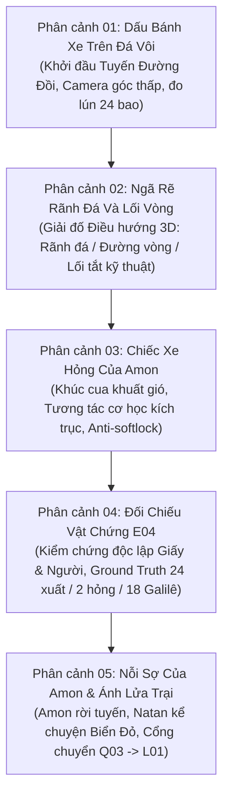
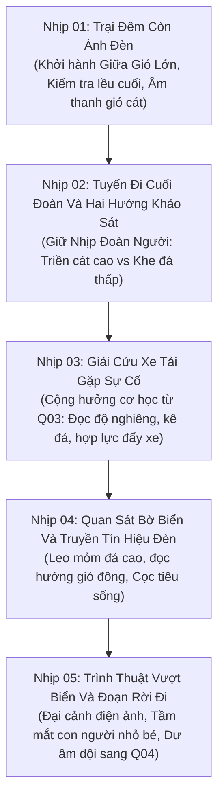

# 07 • Kịch bản phân cảnh trục mở màn — Prologue Q01, Chapter Q03 & Legend L01

**Tác phẩm:** *Unsealed Witness: Legacy of the Covenant (Chứng Nhân: Di Sản Giao Ước)*  
**Phân đoạn:** Bộ Kịch Bản Phân Cảnh Chi Tiết Trục Mở Màn & Cổng Hồi I (Prologue Q01, Chapter Q03, Legend L01)  
**Thời lượng dự kiến:** Bộ đặc tả đầy đủ Q01/Q03/L01 có Q01 ~40–45 phút, Q03 ~36–46 phút, L01 ~48–58 phút: cộng 124–149 phút, chưa tính Q02. L01 có đích biên tập 55 phút ở hồ sơ 14, nằm trong khoảng phân cảnh này. Đây không phải tổng của demo 90 phút. Hợp đồng v3 mô tả một mẫu khác, `SLICE.L01.SPINE`: trích L01 cùng phần cầu nối Q03/Q04, dùng preset đánh giá và không ghi completion vào save campaign. Cả hai ngân sách chưa qua playtest. Chơi campaign đầy đủ vẫn phải qua Q02 và các cổng; preset mẫu không là đường bỏ qua trong campaign.
**Chuẩn mực thiết kế:** One-Shot Camera cho phân cảnh prologue, Khảo cổ Hiện trường Đa tầng, Không chiến đấu lấy mạng (Zero-Combat Tension), Tương tác Vật thể & Cơ học Thực tế, Canon Lock 100%. Trạng thái triển khai/duyệt ở [STATUS](../STATUS.md#open); giới hạn ánh sáng của bản dựng ở [hồ sơ đồ họa](22-graphics-rendering.md#q01-lighting). Kịch bản này là đích dàn dựng, không là báo cáo nghiệm thu.

---

**Bàn giao Q01:** phần 1–2 là kịch bản thống nhất 42 phút đích, gồm thoại, camera, sáng/tối, tri thức và ánh xạ state; đọc từ [Q01 handoff](#q01-handoff). Q03/L01 ở phần 3–4 giữ phạm vi riêng.

<a id="q01-handoff"></a>
## 1. Q01 — Kịch bản thống nhất để giao triển khai

**Bản bàn giao biên tập ngày 11/11/2026, đã hiệu chỉnh theo góp ý Beat 02/03–04/06–07.** Đích thiết kế Q01 của truyện v6; mọi lời thoại, bố cục, nhân vật phụ và thao tác trong phần này là **[H] sáng tác**. Đây là nguồn duy nhất sở hữu phân cảnh/thoại Q01. Hồ sơ 03/06/11 dẫn về đây; hồ sơ 12 tiếp tục sở hữu sự thật và giới hạn tri thức. Phần state foundation PR-03 đã có; cảnh 3D, diễn xuất, camera và chuyển sáng theo kịch bản còn phải triển khai, kiểm và duyệt đúng phạm vi.

### 1.1. Mục tiêu, đầu vào và điểm ra

Người Chứng trở về Xêdarê sau khi Haddai mất vì một đợt bệnh thông thường. Người chơi tìm lại một quan hệ thân thuộc, cùng cứu hai người ở kho phía tây, nhận ra sự im lặng của mình và mang một câu hỏi cụ thể sang Q02. Không mở đầu bằng một đoạn L01, không biến Q01 thành cảnh phá án hoàn chỉnh.

Đầu vào là game mới hoặc save Q01 phù hợp. Đích ra: đã nhận sổ gia đình, hoàn tất một tuyến cứu hộ, tiếp nhận yêu cầu giữ kín của Yosef, nhớ T05, thấy sơ bộ B06 và thực hiện bàn giao theo lựa chọn `lodging` hoặc `meal`. Chỉ model hiện hành ghi `Q01.COMMITTED`; Q02 mở sau đó. Q01 không cấp E01/E02/E03, không xác lập P01, không nhận diện người gây cháy.

**Đích nhịp 42 phút, khoảng hiệu chỉnh 40–45 phút.** Đây là dự toán thao tác và trình bày lần đầu, không tính dừng menu, thử lại, đi vòng tự chọn hoặc thời gian ngủ trong truyện. Không khóa cổng bằng số phút. Thoại có phụ đề, đọc lại và nhịp tiếp tục do người chơi điều khiển; không bắt chờ đủ thời gian để chứng minh đã hiểu.

### 1.2. Không gian và vị trí nhân vật

Giữ bốn **vùng chức năng cao độ**, không dựng thành bốn tầng nhà độc lập:

- **C0 — Cầu cảng/sân hàng:** xuống thuyền, hẻm tới xưởng Natan, điểm thợ tập hợp, xe đối trọng của kho, sân bếp/góc bàn và nơi bàn giao cuối. `Q01.LOAD` là việc sửa khung hàng hiện hữu gần xưởng, tách khỏi xe dùng trong cứu hộ.
- **C1 — Kho trệt và gác lửng cứu hộ:** cửa kho, xà gãy chặn lối chính và chỗ Simeon cùng người học việc mắc kẹt. Lối phụ cơ học và lối chính sức người hội tụ ở chiếu nghỉ gác lửng.
- **C-1 — Rãnh bảo trì:** nhìn được miệng rãnh/đường dây từ C0. Chỉ là dấu không gian/nghề nghiệp và nhánh khảo sát, không bắt mọi người chui qua, không giấu một vật bắt buộc hoặc thêm tuyến cứu hộ thứ ba.
- **C+1 — Sàn tời và sân mái:** bộ tời đã lắp; đoạn cầu thang trên nối chiếu nghỉ với sân mái có chỗ đứng an toàn, điểm nhìn hẻm và đường xuống C0. Điều khiển dây tời phải tới được từ C0; không yêu cầu leo lên mái qua chính lối đang bị chặn.

Đồ thị đi lại cần dựng và kiểm bằng capsule thực:

```text
Cầu tàu -> C0 hẻm/xưởng -> Q01.LOAD -> bàn sổ Natan
                                |
                     C0 trước kho/Titus
                       /                 \
     cơ học: lối phụ C1                   sức người: lối chính C1
                       \                 /
                        chiếu nghỉ gác lửng
                                  |
                       cầu thang trên -> C+1 sân mái
                                  |
                     đường xuống an toàn -> C0 mái hiên Yosef
                                  |
                       xưởng Natan/đêm nghỉ
                                  |
            sáng hôm sau: bàn B06 ở vành kho an toàn
                                  |
               góc bàn/bếp C0 -> bàn giao -> Q02
```

Titus ở C0 khi giới thiệu hai phương án. Sau chuẩn bị, anh đi cùng avatar qua đúng tuyến tới gác C1 rồi cùng lên kiểm sân mái; Titus ở lại điểm nhận, avatar quay xuống C1 đón hai người. Chỉ chốt `exit` sau lượt đi/kiểm/quay xuống này. Vị trí và khôi phục theo bảng ở Beat 04, không tạo actor Titus thứ hai. Hai thợ sức người chỉ rời điểm nâng sau khi xà đã đặt ổn định. Natan không vào cứu hộ thay người chơi. Yosef đợi ở C0, không biết việc diễn ra trên mái. Những số 18 bậc trong kiến trúc hiện hữu là đầu vào phải đo lại khi nối gác lửng; không tự suy ra mái cao 8 m hoặc sàn nghiêng 5°.

<a id="q01-camera"></a>
### 1.3. Hợp đồng camera one-shot

**One-shot là quy tắc dàn dựng liền mạch mặc định.** Camera đi cùng hành trình nhân vật, không cắt qua một vị trí chưa đi tới để mở cổng. Dùng góc vai khi điều hướng; các cận cảnh tay/sổ/cơ cấu là dịch camera tại chỗ, giữ hướng không gian, có đường trả về góc chơi.

Mở màn chỉ có một động tác máy ngắn, đích tối đa khoảng sáu giây, từ mặt nước lên vai. Người chơi có thể nhận điều khiển sớm. Sau đó không tự quay đầu người chơi khi chuông reo, không cắt đối đáp qua lại, không bay qua tường/trần để nhìn người lạ. Khi người chơi bấm quan sát vật, camera mới tiến gần; luôn có hủy/lùi.

**Đêm sang sáng:** sau lựa chọn nghỉ ở cuối Beat 07, giữ nguyên khuôn hình cạnh chỗ nghỉ/cửa xưởng; nén thời gian bằng thay ánh đèn, âm bến và sắc trời trong cùng khung. Ghi rõ “Sáng hôm sau”. Đây là tỉnh lược thời gian có thông báo, không giả vờ một đêm là vài phút liên tục trong thế giới. Không dùng cắt đen để giấu đổi địa điểm. Mục tiêu chuyển cảnh khoảng 6–8 giây; giảm chuyển động dùng cùng góc tĩnh, thay trạng thái nhanh và cho bỏ phần chờ. Chỉ chốt sang Beat 08 khi đoạn chuyển hoàn tất.

First-person, giảm chuyển động, bảng thao tác thay thế và load save được ưu tiên khả năng tiếp cận. Sau chúng, trả về góc nhìn hợp lệ ở cùng vùng/sàn, không phát lại mở màn đã chốt. Vì vậy không dùng “một cú máy không bao giờ ngắt” làm tiêu chí loại những chế độ này. Outro mặc định giữ camera ở gần nhân vật; chỉ nâng nhẹ tại một vị trí nhìn được vịnh, không bay xuyên mái hoặc biến thành camera quảng bá toàn bản đồ.

<a id="q01-lighting-story"></a>
### 1.4. Mốc sáng/tối và nhịp toàn chương

| Beat | Việc trung tâm | Phút đích | Thời gian trong truyện | Dấu chuyển |
| --- | --- | ---: | --- | --- |
| 00 | Xuống thuyền, tìm hẻm | 3 | Chiều muộn | Mặt nước sáng, bến còn làm việc |
| 01 | Người lạ ở xưởng | 3 | Chiều muộn | Ánh xiên ở cửa/hẻm |
| 02 | Giúp Natan, nhận và xem sổ | 5 | Cuối chiều | Cửa xưởng còn đủ sáng xiên |
| 03 | Phát hiện cháy, gặp Titus | 4 | Chạng vạng | Chuông/khói đến trước ánh lửa |
| 04 | Một trong hai tuyến cứu hộ | 9 | Chạng vạng chuyển tối | Đèn công việc và vùng trời ở lối ra |
| 05 | Quan sát từ mái | 3 | Tối còn đủ phân biệt dáng áo | Mặt luôn không đọc được |
| 06 | Yosef xin giữ kín | 4 | Đầu đêm | Mái hiên ngoài đám đông, đèn ổn định |
| 07 | Đặt phần việc, Natan và T05 | 7 | Đêm -> sáng hôm sau | Chỉ nén đêm sau khi chọn nghỉ |
| 08 | B06, bàn giao, khép chương | 4 | Rạng sáng | Vành kho an toàn, tro không phát lửa |
| Tổng | 3 + 3 + 5 + 4 + 9 + 3 + 4 + 7 + 4 | **42** | Một chiều/tối, một đêm nghỉ, sáng kế tiếp | Chưa có số đo playtest |

State PR-03 có phase `afternoon` ở 00–02, `evening` ở 03–06, `night` ở 07, `dawn` ở 08. Đó là mốc logic, không phải tên preset render. Ở Beat 05 phải đọc được hướng/dáng áo bằng tương phản và mô tả tương đương, không tăng sáng để lộ mặt. Không tự nâng mốc tối/rạng sáng thành tính năng đã chạy; phần kỹ thuật và giới hạn GI ở hồ sơ 22.

<a id="q01-knowledge"></a>
### 1.5. Phần biết của nhân vật — hình chiếu từ hồ sơ 12

| Người | Được biết/nói trong Q01 | Đường tiếp nhận | Chưa được phép suy thành sự thật |
| --- | --- | --- | --- |
| Người Chứng | Cha đã mất/bị cáo buộc; đường khâu lệch; việc mình làm trong cứu hộ; quan sát trên mái; Yosef xin giữ kín; ký ức T05; dấu bề mặt B06 | Trực tiếp thấy/nghe; ký ức riêng của bản thân | Ai gây cháy; người ở hai hẻm là cùng một người; ai lấy hàng; lô B06 là G17; chữ ký gốc đã được xác thực |
| Natan | Haddai gửi vật gì về xưởng, tình bạn/công việc của họ, sự bất thường vật lý người chơi chỉ cho ông | Vật ông giữ và cuộc nói trực tiếp | Tự biết thời điểm ký trước; nội dung E08 ở Giêrusalem; avatar từng im lặng nếu chưa được kể |
| Titus | Vị trí có người, lối/xà/tời anh đã kiểm, các việc trong tuyến anh có mặt | Quan sát công việc và gọi đáp với người mắc kẹt | Công cụ mình có liên hệ âm mưu; ai phóng hỏa; nội dung sổ gia đình/B06 |
| Yosef | Cửa/chuyến anh đã khuân qua; anh thấy khói khi quay lại; nỗi sợ và yêu cầu giữ kín của mình | Trải nghiệm riêng | Loại trừ một nguyên nhân cháy; nói cha chết do điều tra; biết chủ mưu hoặc những gì avatar thấy trên mái |
| Hai thợ/Simeon/người học việc | Phần công việc và đường họ vừa đi | Có mặt tại chỗ | Tự biết sổ, T05 hoặc cuộc nói kín với Yosef |
| Rina/người giữ góc bàn | Phương án avatar đặt và bàn giao thật tới họ | Cuộc trao đổi/bàn giao tại C0 | Biết T05, toàn bộ lời Yosef hoặc thủ phạm chỉ vì Q01 đã xong |

Trong **bản mặc định này, T05 là hồi tưởng riêng, không phát thành lời cho Natan nghe**. Không sinh callback “Natan biết avatar im lặng” từ `t05Recalled`. Yêu cầu giữ kín của Yosef không tự tạo `private_group`, `anonymous_summary`, `public_named` hoặc bất kỳ quyền công bố nào. Tất cả xin phép/bảo vệ tiếp ở Q02 dùng cơ chế hiện hành.

### 1.6. Quy ước diễn xuất và giao diện

Natan xưng **Chú–Con**, chậm, có những lúc trở lại việc tay để người kia tự có khoảng nói. Titus dùng **Tôi–Bạn**, câu ngắn gắn với phần việc đang thấy; không giảng lý thuyết hệ thống. Yosef dùng **Tôi–Bạn**, ngập ngừng và nhìn người qua lại; không độc thoại kể toàn âm mưu. Người Chứng xưng Con với Natan, Tôi với người mới gặp. Các vai phụ không dùng “scope”, “checkpoint”, “callback”, “evidence”, “route” trong thoại.

Mặc định chỉ dẫn qua người/vật/âm thanh; phụ đề, mô tả chữ, trợ giúp thao tác và chỉ dẫn tùy chọn vẫn có. Không biến yêu cầu “hướng dẫn ẩn” thành cấm trợ giúp tiếp cận. Lửa không có đồng hồ giết người khi đọc lâu; nhạc/khói không tăng vô hạn theo thời gian ngoài đời. Thao tác thử sai có phản hồi tại chỗ và cách làm lại; không sinh kết canon người chết hoặc phạt đạo đức.

## 2. Kịch bản chín Beat 00–08

Mỗi mục ghi mục tiêu, dàn cảnh, thoại thực thi, thao tác, điều kiện chốt và giới hạn biết. Số Beat chỉ nhịp đang làm; sự kiện chốt thường đưa `sceneProgress.Q01.beat` sang số kế tiếp. Không suy đã hoàn tất một nhịp chỉ vì camera vừa tới điểm mở đầu.

<a id="q01-beat-00"></a>
### Phân cảnh 00 — Một con thuyền cập bến

**Đích:** cho người chơi đặt chân vào đời sống đang tiếp diễn, không bắt xem phim giới thiệu. **3 phút; chiều muộn; cầu tàu -> C0.**

**Hình/âm/camera.** Sóng dưới chân kè, thừng neo và ván đặt xuống bến. Máy từ mặt nước lên vai ngay ở cùng chiếc thuyền; người chơi đi trên ván thật có sàn đỡ. Một người khuân bao dừng nhường lối, tiếng bào gỗ từ hẻm và biển xưởng Natan cùng chỉ một hướng. Không treo một kiện hàng đang rơi làm đồng hồ giả.

**Thoại [H].**

> THỢ BẾN: “Chờ tôi đặt bao xuống… Rồi, bạn qua đi.”
>
> NGƯỜI CHỨNG: “Xưởng của chú Natan còn ở lối cũ chứ?”
>
> THỢ BẾN: “Theo tiếng bào, qua hẻm bên kia.”

**Việc chơi.** Đi khỏi ván, xoay nhìn nguồn tiếng, đi vòng kiện hàng đặt ổn định. Có mô tả chữ/chỉ dẫn tùy chọn cùng thông tin; không cần nghe mới qua. Người chơi nhận camera sớm hoặc bỏ động tác máy, vẫn phải đi qua điểm xuống bến.

**Chốt.** Khi capsule thực ở C0 ngoài ván, gọi `disembark`; lưu Beat 01. Không gọi vì intro đã chạy hết. Natan/Titus/Yosef chưa học được điều gì từ việc avatar xuất hiện.

<a id="q01-beat-01"></a>
### Phân cảnh 01 — Người đứng trước cửa xưởng

**Đích:** tạo một điều chưa rõ, không xác nhận địch thủ. **3 phút; cuối chiều; hẻm -> cửa xưởng.**

**Hình/âm/camera.** Người mặc áo thô đứng nhìn cửa rồi đi về đám đông. Khung hẻm làm họ dễ nhận thấy; không ép xoay đầu, không icon địch, không nhạc nhận diện phản diện. Chỉ bắt đầu chuyển động rời đi khi người chơi tới ngưỡng quan sát hoặc chọn mô tả tương đương; không đặt một cửa sổ nhìn cực ngắn.

**Hai phản ứng đã có.** `follow`: tự đi theo tới góc rẽ an toàn rồi mất tầm nhìn. `investigate`: quan sát chỗ đứng và hỏi người thợ. Cả hai trả người chơi về xưởng; không bắt/bắt kịp được người lạ, không sinh combat hoặc một vật chứng mới. Người không muốn rượt vẫn có đường hỏi/quan sát, không bị tự gán một lựa chọn.

**Thoại nhánh hỏi [H].**

> NGƯỜI CHỨNG: “Bạn có biết người vừa đứng trước cửa không?”
>
> THỢ CƯA: “Tôi chỉ thấy người ấy đứng đó một lúc. Gọi thì họ đi. Tôi không biết tên.”

Nhánh bám theo chỉ có tiếng bước chân khuất sau góc tường. Không thêm dáng khập khiễng thành dấu nhận diện duy nhất. Thợ cưa không tự biết người ấy đứng từ trưa, nghề nghiệp hoặc lý do đến nếu không có một nguồn khác đã được thiết kế.

**Chốt.** `stranger {response: 'follow'|'investigate'}` sau hành động tương ứng. Nhật ký chỉ giữ cách tiếp cận và sự hiện diện bất thường; không nối họ với người ở Beat 05.

<a id="q01-beat-02"></a>
### Phân cảnh 02 — Natan và cuốn sổ chưa khô

**Đích:** cho quan hệ Chú–Con hiện ra qua cùng làm, rồi gieo dấu đường khâu. **5 phút; cuối chiều; C0 gần xưởng -> bàn Natan.**

**Hình/âm/camera.** Natan đang giữ khung hàng cản lối chuyển bữa. Người Chứng giúp trước, ông mới rảnh tay đặt **bọc vận chuyển còn ẩm** lên bàn rồi mở nó trên một **tấm vải lót khô**. Bọc và vải lót là hai vật khác nhau; không đổi độ ẩm của cùng một bọc giữa hình và thoại. Không có hốc bí mật phát sáng hoặc cảnh tìm kho báu. Tiếng bào dừng khi ông nhận ra người về. Máy theo tay và mặt bàn, không cắt đi trong lúc chia vật.

<a id="q01-ledger-custody"></a>
**Vật được trao — theo [T06, chuỗi giữ vật](12-continuity-and-state.md#q01-book-custody).** Bọc chứa hai vật **đã rời nhau trước khi mở**, không phải một cuốn sổ bị xé làm đôi:

1. **Cuốn sổ gia đình đóng liền:** ruột sổ, bìa gắn vào sổ và gáy có đường khâu lệch là một khối. Bề mặt đủ khô để cầm, vết ố cũ vẫn thấy được. Avatar nhận nguyên khối này, gồm cả gáy/chỉ/lỗ cũ; không nhận riêng một tập ruột đã tháo bìa.
2. **Tờ bìa hồ sơ rời:** một tờ gấp kẹp biên nhận gốc E01, nằm ngoài cuốn sổ trong bọc và còn ẩm nhiều hơn. Nó không nối với gáy sổ bằng chỉ hoặc keo. Natan giữ nguyên gói gấp này ở xưởng để hong; Q01 chưa mở tới chữ ký hoặc xác thực E01. Q04 mới bàn giao phần giấy đã đủ điều kiện đọc.

Natan mở bọc trước mắt avatar, chỉ từng vật, đặt tờ bìa hồ sơ rời sang vải khô rồi đẩy **cả cuốn sổ** tới tay avatar. Hai người cùng nhìn và xác nhận việc chia giữ; không tự thêm Titus/người khác làm nhân chứng khi họ không có mặt. Camera liên tục phải thấy hai vật cùng ở trên bàn trước bàn giao. Người chơi mở cận cảnh gáy trên cuốn sổ còn nguyên, Natan chỉ nhìn dấu được chỉ cho mình. Không cắt chỉ, rút tờ khỏi gáy, bóc keo, khâu lại, hoặc “phục hồi” lỗ khâu giữa Q01 và Q10. Hai cách gọi *bìa sổ* và *tờ bìa hồ sơ rời* không dùng thay nhau trong prop, thoại hoặc journal.

**Việc chơi giữ từ runtime.** Hoàn tất hành động `brace` qua bàn `Q01.LOAD` hiện hữu: chèn bánh, hạ hai vò, kê/chằng theo tiền đề, thử tải, tháo chốt. Giữ các thứ tự hợp lệ của luật đang chạy. Sau đó `ledger` nhận sổ từ Natan. Xe/khung này phục vụ bữa ở C0; không mang nó đi làm xe đối trọng cứu hộ ở Beat 04.

**Thoại [H].**

> NATAN: “Con về rồi. Khoan, giữ giúp chú bên này.”
>
> NGƯỜI CHỨNG: “Chốt nứt rồi.”
>
> NATAN: “Ừ. Con xem phần nặng đang tựa vào đâu đã.”
>
> *(Sau thao tác thật; Natan buông tay, xoa vai.)*
>
> NATAN: “Chú đã hứa đưa tận tay người nhà. Khăn ngoài còn ẩm. Con cầm nguyên cuốn sổ này; tờ bìa gấp rời này chú giữ lại hong.”
>
> NGƯỜI CHỨNG: “Cuốn sổ đi với con. Tờ bìa rời ở lại đây với chú?”
>
> NATAN: “Ừ. Chú không tháo gì khỏi gáy sổ.”
>
> NGƯỜI CHỨNG: “Đường chỉ này không ăn vào lỗ cũ.”
>
> NATAN: “Chú thấy chỗ ấy rồi. Cứ giữ nguyên, đừng tháo thêm.”

**Quan sát.** Avatar tự xoay cuốn sổ đang cầm về ánh xiên, thấy vết ố, lỗ cũ và đường khâu không trùng. Camera cận cảnh do thao tác mở, có mô tả chữ cùng thông tin. Không bịa cảm giác xúc giác mà thiết bị không truyền được; chỉ hình/âm và mô tả vật. Không mở ruột sổ bí mật, không dùng màu chỉ như dấu của một thủ phạm. Khi thoát cận cảnh, sổ vẫn ở tay/túi avatar; tờ bìa hồ sơ rời còn trên vải ở phía Natan, không phát lại việc tách/trao để nhân đôi vật.

**Chốt.** Sau `brace`/`ledger` hợp lệ, bàn giao nguyên cuốn sổ và xác nhận quan sát hoặc mô tả tương đương, gọi `ledgerSeam`. Nhật ký: “Gáy cuốn sổ mình giữ có đường khâu lệch khỏi các lỗ cũ. Natan giữ tờ bìa hồ sơ rời còn ẩm.” `ledger` không cấp E01. Chuỗi giữ: trước Q04, avatar giữ sổ nguyên gáy/Natan giữ tờ bìa hồ sơ; sau bàn giao Q04, phần giấy ấy đi cùng hồ sơ của avatar. Tới Q10 đối chiếu đúng cuốn sổ nguyên gáy đã thấy, không thay bằng một prop vừa khâu lại hoặc một bản tái tạo. Natan không biết thêm về T05 từ việc nhìn con mình cầm sổ.

<a id="q01-beat-03"></a>
### Phân cảnh 03 — Tiếng cháy phía tây

**Đích:** chuyển từ điều tra sang trách nhiệm trước mắt. **4 phút; chạng vạng; xưởng -> C0 trước kho.**

**Hình/âm/camera.** Một tiếng gỗ gãy, người ở sân quay về phía kho, sau đó mới có chuông và dải khói. Người chơi tự đi theo đường còn thông; camera giữ hướng di chuyển. Natan ở xưởng giữ đồ, không teleport sang kho để bình luận. Tiểu cảnh báo cháy có thể trình bày lại nếu load trước khi chốt; không tạo hai vụ cháy.

Titus đã nghe Simeon và người học việc gọi đáp ở gác; anh biết có hai người còn ở đó, không đoán qua danh sách toàn cảng. Lối chính bị xà chắn. Anh chỉ hai lựa chọn từ nơi người chơi nhìn được chúng.

**Thoại [H].**

> TITUS: “Simeon! Còn nghe tôi không?”
>
> SIMEON, TỪ GÁC: “Còn. Có người học việc ở đây với tôi.”
>
> TITUS: “Tôi nghe hai người ở gác. Xà chặn thang rồi.”
>
> NGƯỜI CHỨNG: “Còn lối nào tới họ?”
>
> TITUS: “Bộ tời còn đường dây xuống sân. Hoặc gọi hai người nâng xà, rồi chèn nó lại. Bạn muốn bắt đầu bên nào?”

**Chốt.** Khi người chơi tới điểm làm việc, đã tiếp nhận tình thế và đường tiếp cận, gọi `fire` đúng một lần. World chuyển `burning`/`broken`, state sang Beat 04. Chỉ sau đó cho bắt đầu các thao tác cứu hộ bền vững. Trước chốt, hiệu ứng báo cháy là tiểu cảnh chưa xác nhận; load lại từ đầu Beat 03. Không cần biết/chọn một nguyên nhân cháy để được cứu người.

<a id="q01-beat-04"></a>
### Phân cảnh 04 — Một đường tới hai người

**Đích:** cho người chơi làm việc có tiền đề và nhận kết quả nhìn được. **9 phút; chạng vạng chuyển tối; C0 -> C1 -> C+1.**

Khảo sát cả hai phương án miễn phí trước khi chọn. Chọn `mechanical` hoặc `manual` ghi bằng `rescueRoute`; sau khi chọn không đổi/trộn bước. Giải thích ngay trên xác nhận đầu tiên: “Bắt đầu cùng Titus ở bộ tời” hoặc “Bắt đầu cùng nhóm nâng xà”. Không khóa phương án theo tiền, danh tiếng của Haddai, companion được tuyển hoặc bậc skill. Titus là người làm việc tại cảnh, chưa phải điều kiện phải tuyển vào đội.

**Ý nghĩa `world.sideExit` được khóa.** Giữ tên field cũ để tương thích; trong bản dàn dựng này, `open` nghĩa là **đường cuối từ gác C1 tới điểm nhận sân mái đã mở và kiểm xong**, chưa có nghĩa hai người đã được đưa qua. Đây là điều kiện chung của hai tuyến, không phải cờ mở cánh ngăn cơ học. Cánh ngăn lối phụ chỉ mở từ prefix `mechanical` đã có `pulley`; đường chính chỉ thông khi xà đã `moved` trong `manual`. Vì vậy ở `manual`, `world.sideExit='open'` mở/giữ đường chung gác–mái và **cánh ngăn cơ học vẫn đóng**. Renderer không được dùng riêng field này để mở mọi cửa; không đổi schema hoặc thêm route để chữa tên field.

**Tuyến cơ học `mechanical`:**

| Bước có sẵn | Hình/việc phải làm trong thế giới | Điều kiện ghi bước |
| --- | --- | --- |
| `cart` | Đưa xe đối trọng của kho trong rãnh dẫn có cữ, dây giữ và điểm chèn đã bố trí; chèn nó ở điểm làm việc để bộ dây có chỗ giữ tải. Tách khỏi Q01.LOAD; không thả xe lao tự do hoặc dùng vai chặn một xe đang tăng tốc | Xe ở cữ, bánh được chèn, Titus đã kiểm đường tải; `world.cart='chocked'` |
| `pulley` | Từ tay dây tới được ở C0, phối hợp Titus vận hành bộ tời trên C+1; mở cánh ngăn của lối phụ tới chiếu nghỉ C1. Người chơi thực hiện phần kéo/giữ qua tương tác hoặc thao tác thay thế; Titus không hoàn tất từ một câu chọn | Cánh ngăn đứng ở chỗ giữ, lối phụ có thể đi; không nâng xà lối chính |
| `exit` | Avatar và Titus đi lối phụ đã mở lên C1, cùng kiểm đoạn thang/cửa chung tới sân mái. Titus đi tới điểm nhận trên mái và ở lại; avatar quay xuống C1 đón hai người | Chỉ ghi khi đường chung mở/đã kiểm, Titus ở điểm nhận, avatar đã về C1; `world.sideExit='open'` |
| `extract` | Gọi đáp, đi cùng Simeon và người học việc theo lối đã kiểm tới điểm nhận ngoài khói trên sân mái; Titus nhận cả hai | Cả hai actor đã ở điểm nhận, không chỉ avatar đã tới mái; `peopleSafe=true`, lửa được khống chế, sang Beat 05 |

**Thoại tuyến cơ học [H].**

> TITUS: “Tôi giữ dây. Bạn đưa xe tới cữ ấy, rồi chèn bánh.”
>
> *(Khi chuẩn bị chưa đủ.)* TITUS: “Khoan kéo. Chỗ giữ tải chưa đứng yên.”
>
> *(Sau kiểm.)* TITUS: “Được. Mình mở cánh ngăn bên kia.”

**Tuyến sức người `manual`:**

| Bước có sẵn | Hình/việc phải làm trong thế giới | Điều kiện ghi bước |
| --- | --- | --- |
| `workers` | Tới hai thợ đang ở sân, nói còn hai người trên gác; họ tự nhận giữ một đầu đòn và một chỗ kê. Người chơi/Titus nhận phần còn lại | Cả hai có mặt ở chỗ làm; không gọi từ xa rồi cho họ tự tới trước mọi vật cản |
| `lever` | Bố trí đòn kê và nâng theo nhịp đã thống nhất; dịch xà sang chỗ tựa ổn định rồi chèn lại. Khóa kết quả cơ học trước khi mọi người buông | Xà nằm ở chỗ đã chèn, lối chính thông; `world.beam='moved'`; xe đối trọng không đổi |
| `exit` | Avatar và Titus đi qua lối chính đã dọn tới C1 rồi cùng kiểm đường chung lên mái. Titus ở lại điểm nhận; avatar quay xuống C1, không dùng cánh ngăn cơ học | Cùng điều kiện vị trí như tuyến cơ học; `world.sideExit='open'`, cánh ngăn cơ học vẫn đóng |
| `extract` | Cùng hai người mắc kẹt đi tới Titus ở điểm nhận sân mái | Điều kiện hai actor an toàn như tuyến cơ học; không tạo một ending cứu hộ khác |

**Thoại tuyến sức người [H].**

> NGƯỜI CHỨNG: “Còn hai người ở trên gác. Hai bạn giữ giúp đầu đòn này được không?”
>
> THỢ BẾN: “Được. Cho chúng tôi thấy chỗ đặt nó.”
>
> TITUS: “Nâng một nhịp. Giữ… Đặt nêm vào rồi mới buông.”

<a id="q01-titus-path"></a>
**Choreography Titus — một actor, một đường đi.** Sau `pulley` hoặc `lever`, Titus và avatar cùng còn ở C0; không đặt sẵn một Titus khác trên mái. Bước `exit` gồm: (a) cùng đi tuyến đã mở tới chiếu nghỉ C1, gọi đáp để hai người chờ tại đó; (b) avatar mở cửa chung, cả hai đi đoạn thang trên tới C+1 và kiểm điểm nhận; (c) Titus đi vài bước tới điểm nhận, nói “Tôi nhận họ ở đây. Bạn xuống đi cùng họ lên”; (d) avatar tự quay đúng đoạn thang về C1. Lúc này mới ghi `exit`, rồi người chơi thực hiện `extract` để đi cùng hai người lên gặp Titus. Camera luôn theo avatar; không cắt tới mái để giả rằng Titus đã đi xong.

| Prefix đã lưu | Titus ở checkpoint nào | Avatar/người mắc kẹt và việc còn phải làm |
| --- | --- | --- |
| Chưa chọn tuyến; `cart`/`workers`; hoặc đã `pulley`/`lever` nhưng chưa `exit` | C0, cùng điểm bắt đầu phần đi kiểm đường | Hai người còn ở C1; khôi phục phần `exit` chưa chốt từ checkpoint trước khi đi kiểm |
| Đã `exit`, chưa `extract` | Điểm nhận sân mái C+1 | Avatar ở C1 cùng Simeon/người học việc; còn hộ tống thật lên mái |
| Đã `extract` | Cùng hai người ở điểm nhận C+1 | Avatar ở vùng nhận; không còn ai mắc kẹt trong gác; tới Beat 05 |

Nếu thoát khi Titus đang đi lên hoặc avatar đang quay xuống mà `exit` chưa chốt, load trở lại checkpoint C0 của phần chưa chốt, không hứa tiếp đúng vị trí giữa đường. Nếu thoát giữa hộ tống mà chưa `extract`, load checkpoint C1, Titus đã ở C+1 vì `exit` đã lưu. Chỉ dựng lại checkpoint khi load/bắt đầu lại phần chưa chốt; không snap vị trí theo prefix ở mỗi frame trong một lần chơi. Dùng cùng actor Titus qua C0–C1–C+1; không tạo “Titus đón người” như một bản sao. Sai/vướng navigation phải dừng chờ hoặc báo lỗi kiểm, không teleport. Sang Beat 06, Titus thật sự dẫn hai người xuống C0 theo lối đã mở trước/đi cùng lượt avatar xuống, không đồng thời đứng trên mái và dưới sân.

**Phản hồi và camera.** Nhìn được vật đang chịu tải, tay người và đường đi; không rung camera che lỗi. Thử hụt không làm người chết hoặc tự chuyển route. Cúi/đi chậm có mô tả và phương án thao tác thay thế; khói không thành bài kiểm đòi nghe/nhìn màu. Không gọi `rescueStep` vì một animation đã bắt đầu; chỉ gọi sau điều kiện vật/người thực thỏa. Không thưởng lại khi tải cảnh hoặc bấm lặp.

**Kết sau hai tuyến.** Người được cứu ở sân mái ngoài vùng khói, Titus ở đó cùng họ. Chỗ an toàn này nối được đường xuống mặt đất; mái không phải một nền không có lối thoát. Nhóm chữa cháy mới kiểm soát phần cháy cục bộ; avatar không tự dập tắt toàn kho. Ở `mechanical`, xà lối chính vẫn gãy/chặn; ở `manual`, xe đối trọng vẫn ở vị trí ban đầu. Cả hai giữ cùng cổng và quyền tiếp tục, nhưng dấu thế giới khác nhau.

<a id="q01-beat-05"></a>
### Phân cảnh 05 — Một người rời hẻm

**Đích:** nhìn một sự kiện có giới hạn từ đúng nơi mình đã tới. **3 phút; tối còn đọc được dáng áo; C+1.**

**Hình/âm/camera.** Titus đưa hai người được cứu tới chỗ đứng an toàn rồi kiểm họ. Avatar đi tới điểm nhìn có lan can. Camera ở cùng sàn, không dùng một cú máy cận mặt người bên dưới. Người chơi chủ động mở quan sát; việc phát cảnh chỉ bắt đầu khi điểm nhìn/mô tả tương đương đã sẵn sàng. Không phát cảnh này ở xa trong khi người chơi vẫn bận hộ tống.

Một người rời hẻm sau kho về phía bến thuyền nhỏ. Tiếng nhóm chữa cháy tới cửa trước đến sau đó. Không có nhãn “nhân viên hành chính”, không đoán nghề từ viền áo, không ghi một khoảng đúng hai phút khi avatar không có phép đo.

**Thoại ngắn [H].**

> NGƯỜI CHỨNG, KHẼ: “Có người vừa ra phía sau kho.”
>
> TITUS, VẪN Ở ĐIỂM NHẬN: “Bạn thấy gì?”
>
> NGƯỜI CHỨNG: “Một dáng áo. Xa quá, tôi không thấy mặt.”

Titus chỉ biết phần avatar vừa nói; anh không tự kể bốn chi tiết như người đã nhìn. Nhật ký riêng có đúng bốn mục: **hướng** về phía bến nhỏ; **thứ tự** trước nhóm chữa cháy tới; **dáng áo** ngắn có đường viền sẫm; **giới hạn** mặt/tuổi không đọc được vì cự ly và khói. Chưa gọi người này là người ở Beat 01, người của Rufus, người đốt kho hoặc người đang mang giấy.

**Tiếp cận.** Khi đang mở quan sát, cho dừng/giảm tốc phần trình bày để đọc; người chỉ dùng mô tả chữ nhận cùng bốn mục. Không cho NPC chạy lặp vòng trong hẻm. Nếu rời/thoát trước xác nhận, cảnh giữ ở đầu phần chưa chốt để trình bày lại khi tiếp tục; không ghi một cuộc chạy trốn thứ hai vào lịch sử.

**Chốt.** Gọi `rooftop` sau khi trình bày đủ phần quan sát và người chơi chọn tiếp tục; không gọi vì avatar chỉ đứng trên mái. State sang Beat 06, giữ riêng phần nhìn trực tiếp và phần đã nói với Titus.

<a id="q01-beat-06"></a>
### Phân cảnh 06 — Yosef xin một chỗ nói nhỏ

**Đích:** gặp một người có nhu cầu tự bảo vệ, không nhận lời giải về vụ cháy. **4 phút; đầu đêm; đường xuống C0 -> mái hiên.**

**Hình/âm/camera.** Avatar đi xuống tuyến đã mở. Người được cứu theo Titus tới chỗ nghỉ ngoài kho; không spawn lại trong gác. Nhóm chữa cháy kiểm soát khu cháy, người đi đường tập hợp ngoài ranh giới. Yosef đứng ở mái hiên, có đường rời; không lôi cổ tay hoặc ép avatar vào một góc. Camera giữ cự ly đối thoại, không phóng gần vào mặt sợ hãi như một phép kiểm nói dối.

**Thoại thực thi [H].**

> YOSEF: “Bạn vừa từ xưởng Natan sang phải không?”
>
> NGƯỜI CHỨNG: “Tôi là con Haddai. Bạn cần gặp tôi?”
>
> YOSEF: “Tôi từng khuân hàng qua cửa này. Mình nói ở dưới hiên được không?”
>
> *(Người chơi đi tới khoảng nói yên; đám đông không đi xuyên cuộc nói.)*
>
> NGƯỜI CHỨNG: “Bạn có thấy lửa bắt đầu ở đâu không?”
>
> YOSEF: “Không. Lúc tôi quay lại đã có khói rồi. Tôi chỉ biết những chuyến mình đã khuân. Cuốn sổ bên trong, tôi không cầm.”
>
> NGƯỜI CHỨNG: “Nếu sáng mai tôi cần hỏi một chuyến hàng?”
>
> YOSEF: “Hỏi tôi trước. Nhưng xin đừng gọi tên tôi giữa sân, hay đưa tên tôi cho người khác. Tôi còn phải trở lại làm ở đây.”
>
> *(Yosef sửa lại nút buộc áo để đi, rồi dừng. Đây là lần anh nói một điều không thuộc chuyến hàng.)*
>
> YOSEF: “Mẹ tôi vẫn để mấy chậu cây ngoài bậc cửa, đợi tôi về mới chịu mang vào. Tôi không muốn tối nay bà phải ra bến tìm.”
>
> *(Người Chứng hạ tay đang định hỏi tiếp, bước sang bên chừa lối ra.)*
>
> NGƯỜI CHỨNG: “Tôi nghe rồi. Tối nay mình dừng ở đây. Bạn về đi.”
>
> YOSEF: “Mai… nếu bạn còn cần hỏi, cứ nói nhỏ như thế này.”

**Dư âm cá nhân.** Chi tiết mẹ/chậu cây nối với đời sống đã có ở Q02 của hồ sơ 11; không thêm một biến cố gia đình hoặc nguồn điều tra. Yosef muốn được về nhà làm nốt một việc nhỏ, không chỉ tồn tại như người giữ đầu mối. Để một khoảng im sau câu ấy; không tăng nhạc bi thương hay bắt anh chứng minh lòng tốt để được giữ kín. Việc avatar ngừng hỏi và nhường đường là phản hồi nhìn thấy được cho giới hạn anh vừa đặt. Câu hẹn hỏi ngày mai chỉ mở khả năng gặp lại, không là quyền trích lời hoặc công khai tên; chưa chọn thay `shelter/anonymous/consented` của Q02.

Nếu người chơi mở lời khi có người đi ngang, Yosef nói: “Chờ họ qua đã.” rồi im; chuyển sang vị trí kín hơn hoặc đợi. Không dùng bấm dồn để buộc khai. Không viết câu loại trừ nguyên nhân cháy, đe dọa xác nổi ngoài biển hoặc hàm ý Haddai bị giết vì điều tra. Nỗi sợ của Yosef là thật trong trải nghiệm của anh; nó không chứng minh chủ mưu.

**Chốt.** Sau khi yêu cầu giữ kín đã được trình bày đầy đủ, gọi `yosefPrivacy`. Trường này chỉ ghi yêu cầu, **không cấp lời chứng chính thức, consent hoặc tình trạng Yosef đã an toàn**. Không có nút ở Q01 cho chọn công khai tên. Nhật ký nhắc “Yosef yêu cầu được hỏi trước và giữ kín tên”; không tự phát nội dung ấy vào bếp/xưởng.

<a id="q01-beat-07"></a>
### Phân cảnh 07 — Một chỗ đặt cuốn sổ

**Đích:** cho việc đời thường và ký ức im lặng chạm nhau, không để Natan đọc hộ bí mật. **7 phút; đêm ở C0/xưởng -> sáng hôm sau trong cùng góc nghỉ.**

**Phần việc sinh hoạt.** Theo chuỗi cũ, hoàn tất việc nghe nhu cầu bữa `meal`, rồi dùng `choose` đặt `lodging` hoặc `meal`. Đây là **đặt phần việc**, chưa chạy `pay-lodging`/`give-oil`, chưa trừ tài nguyên. `lodging` dành góc bàn riêng để chép/gửi thư kín từ sáng; `meal` nhận việc góp phần cho bếp chung. Cả hai vẫn có chỗ nghỉ cơ bản trong đêm ở xưởng/khu chung, không cần đưa camera tới một quán trọ mới.

**Thoại Rina và nhắc việc [H].**

> RINA: “Đêm nay vẫn có chỗ nằm ở xưởng. Lượt bếp sáng cần thêm phần dầu.”
>
> NGƯỜI CHỨNG, NHÁNH `lodging`: “Tôi xin để dành góc bàn có đèn. Sáng mai tôi quay lại bàn giao.”
>
> NGƯỜI CHỨNG, NHÁNH `meal`: “Để tôi nhận phần góp cho lượt bếp sáng. Tôi sẽ mang tới.”
>
> RINA, NHÁNH `meal`: “Được. Tôi ghi phần bạn nhận; chưa tính là đã trao.”

Chỉ bày phương án `Model.planAllowed` cho phép. Không đổi cứu hộ thành cách kiếm tiền/food, không thêm trừ dầu riêng vì câu thoại; chi phí vẫn là money/food của model lúc commit. Chưa có schema lưu “đã trả một nửa”, vì vậy không diễn tay đã trao tiền/dầu từ tối.

**Cảnh Natan [H] — hai người đang thiếu cùng một người, nhưng mang hai điều chưa nói khác nhau.** Avatar mang nguyên cuốn sổ của mình tới bàn, định tìm một việc cụ thể để làm; tờ bìa hồ sơ rời vẫn ở chỗ Natan hong, không bị lấy ra thành lời giải. Natan chừa ghế, se đi se lại cùng một đoạn đầu dây mà chưa tiến thêm. Máy ở cùng bàn, để thấy cả đôi tay và khoảng ngồi; đèn ổn định, không cắt đối đáp cận mặt.

> NATAN: “Con ngồi đi. Cha con hay để mái chèo ở phía ấy.”
>
> *(Natan quay sang nửa nhịp như định hỏi người ngồi cạnh, rồi nhìn lại đầu dây.)*
>
> NGƯỜI CHỨNG: “Chú vẫn quen có cha ở đây.”
>
> NATAN: “Mấy hôm nay chú cứ quay sang hỏi ông ấy một câu. Hỏi xong mới nhớ ra.”
>
> NGƯỜI CHỨNG: “Con cứ nghĩ, về tới cửa này thì vẫn còn kịp.”
>
> *(Natan đặt đoạn dây chưa se xong xuống; lần này ông ngồi cùng, không lấp khoảng im bằng lời khuyên.)*
>
> NATAN: “Chú cũng chưa quen.”
>
> NGƯỜI CHỨNG: “Con còn một chuyện chưa nói với cha.”
>
> NATAN: “Nếu con muốn nói, chú nghe.”
>
> NGƯỜI CHỨNG: “Con chưa biết nói thế nào.”
>
> *(Natan gật, đẩy chén nước tới gần hơn. Ông không hỏi dồn.)*
>
> NATAN: “Đèn còn dầu. Con cứ ngồi.”

**Ký ức T05, chỉ người chơi tiếp nhận.** Avatar đặt ngón tay cạnh gáy sổ rồi rút lại. Âm xưởng lùi nhẹ, còn tiếng bút trong đoạn nhớ hoặc mô tả chữ riêng: **“Chỉ cần nói: ‘Chưa kiểm xong.’ Mình đã không nói.”** Chỉ tái hiện phần avatar từng thấy: Haddai ký khi chưa kiểm hàng, bản thân đã im vì sợ mất việc. Không thêm một cái nhìn kết tội/tha thứ của cha, lời chưa từng nghe, số hàng về sau, ba năm hoặc động cơ toàn tri. Nếu dùng hình, ở với bàn tay và mép giấy trong giới hạn ký ức, không cắt sang cảnh thủ phạm. Đây là nhớ lại T05, không thu được E08 hay một nguồn mới.

**Hành động nhỏ sau đoạn nhớ.** Avatar có thể khép sổ, đặt nguyên cuốn lên vải hoặc tiếp tục giữ trong tay. Cử chỉ chỉ thay diễn xuất tại chỗ, không là đáp án đạo đức hoặc field hoàn tất mới. Natan chỉ nghe “còn một chuyện chưa nói”, không nghe nội dung hồi tưởng và không suy ra việc ký trước/im lặng. Không cho ông tuyên bố cha đã tha thứ. Khoảng yên để hai người chưa giải quyết xong điều ấy mà vẫn có thể ngồi cạnh nhau; đoạn dây cũng chưa cần được se xong. Người chơi được ở lại/đọc lại hoặc chọn nghỉ; không buộc chờ đủ một khoảng im để khép Beat.

**Nghỉ/chuyển sáng.** Nút ngữ cảnh “Nghỉ, sáng mai trở lại kho” xác nhận chuyển thời gian; có thể ở lại trước khi bấm. Giữ khung cửa/chỗ nghỉ, thay đèn và âm bến theo hợp đồng camera 1.3. Sau khi ký ức và đoạn sáng hôm sau đã trình bày xong, mới gọi `recallT05`; state chuyển 08/`dawn`. Không gọi ngay câu đầu của hồi tưởng rồi bật trời sáng khi cuộc nói vẫn còn diễn ra. Load trước chốt quay về đầu Beat 07, giữ phương án đã đặt và không diễn lại một lần trả phí chưa có.

<a id="q01-beat-08"></a>
### Phân cảnh 08 — Điều còn đọc được sáng hôm sau

**Đích:** đi từ hiện trường có dấu thật sang một việc cần xác minh tiếp. **4 phút; rạng sáng; vành kho C1 -> điểm bàn giao C0.**

**Trở lại và giữ hậu quả.** Người chơi tự đi từ xưởng tới vành an toàn của kho, không bước vào một vùng cháy lại. Người kiểm kho địa phương chỉ lối: “Bàn kiểm nhận bên này đi được rồi. Phần trong kia còn rào lại.” Đây là lối của chủ kho/người làm việc tại chỗ, không tạo một phiên khám nghiệm pháp lý lịch sử.

**Dấu theo đúng tuyến.**

| Save cứu hộ | Khi trở lại phải thấy | Không được tự dựng |
| --- | --- | --- |
| `mechanical` | Xe đối trọng ở cữ đã chèn; bộ tời/lối phụ giữ kết quả; xà lối chính vẫn gãy tại chỗ; lối sân mái mở | Xà đã nâng/di chuyển bằng đòn bẩy dù không làm tuyến manual |
| `manual` | Xà đã đặt sang chỗ tựa có nêm; lối chính thông; xe đối trọng vẫn ở điểm ban đầu; đường chung lên mái mở nhưng cánh ngăn cơ học vẫn đóng | Xe cứu hộ đã chèn hoặc cánh ngăn cơ học mở chỉ vì `sideExit='open'` |
| Cả hai | Vết cháy cục bộ, đồ và người theo kết quả đã làm; người đã cứu không trở lại gác; `Q01.LOAD` giữ việc sửa riêng của nó | Reset sạch kho, nhân đôi người/đồ, biến cuộc cứu hộ thành nguyên nhân biết thủ phạm |

**Quan sát B06.** Một phần giấy nhô dưới khay ở bàn kiểm nhận. Người chơi nghiêng góc nhìn/nguồn đèn sẵn có, nhận mã **B06** cùng vùng bề mặt xơ/cạo và nét ghi chồng. Không kết luận phương pháp hóa học, lớp bột cụ thể hoặc người đã sửa từ một ảnh. Không lấy mảnh giấy vào inventory; nó ở đúng bàn để Q02 kiểm tiếp với nguồn khác.

> NGƯỜI CHỨNG, NHỎ VỚI MÌNH: “B06… Chỗ này có nét ghi đè.”
>
> *(Nhật ký riêng.)* “Có dấu bề mặt bị can thiệp. Chưa biết ai làm và lượng nhận có khớp không.”

**Chốt quan sát.** Gọi `observeB06` sau khi trình bày quan sát/mô tả tương đương và người chơi tiếp tục. PR-03 ghi `b06PreliminaryObserved=true`, `world.fire='cold'`; không cấp E02/P01. Khi vừa vào sáng, bộ dựng có thể biểu đạt khu cháy đã được khống chế và nguội theo phase `dawn`; không tự ghi `cold` ngoài reducer trước event này.

**Bàn giao và commit.** Người chơi quay tới đúng điểm C0. `lodging`: tới góc bàn đã đặt, thực hiện `pay-lodging`, bàn giao phần tiền và nhận chỗ làm việc. `meal`: tới Rina, thực hiện `give-oil`, bàn giao phần góp và xác nhận người nhận ca. Đây là animation/hành động qua model của chi phí hiện hành, không thêm một khoản dầu ngoài food. Chỉ khi `q01SceneReady` và tiền đề quest cũ đủ, model ghi `Q01.COMMITTED`, trừ một lần đúng money hoặc food, giữ callback và mở Q02.

> NGƯỜI GIỮ BÀN, NHÁNH `lodging`: “Tôi nhận phần bạn gửi. Góc bàn ấy để bạn làm việc.”
>
> RINA, NHÁNH `meal`: “Tôi nhận rồi. Người tới ca sau biết phần này ở đâu.”

**Outro.** Camera vẫn cạnh avatar, từ giấy/đồ bàn giao nhìn ra khoảng vịnh thấy được qua lối mở. Đèn công việc hạ vai trò khi trời sáng; âm bến bắt đầu lại. Không cần một chuyến bay quảng bá để hoàn tất. Journal gợi việc kế: “Đối chiếu B06 tại bàn ghi và hỏi nơi thực nhận ở bữa chung”; câu hỏi kịch giữ ở người chơi: **“Ai đang làm hồ sơ thay đổi, và vì sao nhân chứng sợ nói?”** Natan/Rina không được tự trả lời vì đã thấy chương khép.

<a id="q01-event-map"></a>
### 2.9. Bảng chốt sang state hiện hữu

Đây là ánh xạ bàn giao, không phải schema mới. Caller dùng `Model.beginQ01Scene` và `Model.q01SceneEvent`; không ghi trực tiếp `sceneProgress`, không gọi `Q01.reduce` từ UI để tự gán state. Kiểm tra khoảng cách/sàn/vật/người thực ở phía model/interaction có thẩm quyền khi triển khai, không chỉ ẩn nút trong UI.

| Nhịp đang làm | Event chốt có sẵn | Payload | Kết quả để dựng tiếp |
| --- | --- | --- | --- |
| 00 | `disembark` | Không thêm trường | Beat 01, `afternoon` |
| 01 | `stranger` | `response='follow'` hoặc `'investigate'` | Beat 02, giữ phản ứng đã chọn |
| 02 | `ledgerSeam` | Không thêm trường | Beat 03, `ledgerSeamObserved=true`, phase `evening` |
| 03 | `fire` | Không thêm trường | Beat 04, `world.fire='burning'`, `world.beam='broken'` |
| 04, bắt đầu | `rescueRoute` | `route='mechanical'` hoặc `'manual'` | Giữ Beat 04, khóa một phương án |
| 04, làm việc | `rescueStep` | `step` đúng chuỗi bốn bước của tuyến | Lưu prefix thật; `extract` cuối đưa tới Beat 05/`peopleSafe` |
| 05 | `rooftop` | Không thêm trường | Beat 06, `rooftopSeen=true` |
| 06 | `yosefPrivacy` | Không thêm trường | Beat 07, `night`; không cấp consent |
| 07, sau nghỉ/chuyển sáng | `recallT05` | Không thêm trường | Beat 08, `dawn`; chỉ flag hồi tưởng riêng |
| 08, sau xem B06 | `observeB06` | Không thêm trường | Vẫn Beat 08, B06 sơ bộ đã ghi, lửa `cold` |
| 08, sau bàn giao | `Model.act` với `pay-lodging`/`give-oil` hiện hữu | Theo action hiện hành | Model cũ sở hữu route, chi phí và `Q01.COMMITTED` |

Chuỗi task quest cũ vẫn là `brace -> ledger -> meal -> choose -> execution`; `Q01.LOAD` nằm ở `brace`. Mốc presentation mới đặt ba task đầu ở Beat 02/07 như trên, không đổi ID, tiền đề hoặc phần thưởng. `choose` lưu ý định tại Beat 07; `execution` chờ Beat 08 đủ scene. Phần binding này chưa có trong gameplay 3D: AI phải triển khai kiểm tiền đề vị trí/Beat ở đúng owner, không coi bảng này là bằng chứng code đã làm.

Khi dựng v6, giữ ID/luật task nhưng dùng đúng tên vật của T06 trong lời trình bày: *bìa sổ* gắn nguyên với cuốn sổ, *tờ bìa hồ sơ rời* kẹp E01 ở Natan. Không nạp lại câu v3 mơ hồ về “tờ bìa” rồi cho prop tách gáy trái kịch bản. Quyền giữ cuốn sổ suy từ task `ledger` đã hoàn tất, còn `ledgerSeamObserved` chỉ xác nhận đã quan sát đường khâu; không dùng hai điều ấy thay cho nhau.

<a id="q01-restore"></a>
### 2.10. Thoát, khôi phục và giới hạn của foundation

- Chỉ gọi `beginQ01Scene` cho Q01 chưa commit, theo điều kiện bật v6; scene `null` của save cũ giữ tuyến v3. Không bật v6 giữa một Q01 đã đi dở rồi bắt người chơi trả/nhận lại. Chọn chính sách tương thích rõ trong tác vụ triển khai.
- Save sau mỗi event được model chấp nhận và sau task/plan cũ. Nếu lưu trữ thất bại, báo đúng cơ chế đang có, không nói “đã lưu”. Không đưa token/account/save thật vào báo cáo.
- Foundation lưu Beat và prefix việc cứu hộ, không lưu từng khung camera, nét mặt hoặc câu thoại. Thoát giữa tiểu cảnh chưa chốt trở lại đầu nhịp/phần việc chưa chốt; không hứa tiếp đúng một frame. Không phát lại thao tác, chi phí hoặc event đã ghi.
- Nếu đã hoàn tất task `ledger` nhưng chưa `ledgerSeam`, load giữ nguyên cuốn sổ ở avatar và tờ bìa hồ sơ rời ở Natan, chỉ tiếp phần quan sát chưa chốt. Không lặp bàn giao, không rút gáy để tạo hai vật. T06/Q04 quyết định lúc gói chứng từ đổi người giữ; không suy đổi chủ từ camera hoặc một lần mở inspector.
- Sau `cart` dựng xe đã chèn; sau `lever` dựng xà đã đặt ổn; sau `exit` giữ đường chung gác–mái mở, không tự mở cánh ngăn cơ học ở manual. Actor theo bảng Titus của Beat 04: trước `exit` ở C0, sau `exit` Titus ở C+1/avatar và hai người ở C1, sau `extract` tất cả ở điểm nhận. Không tạo bộ cờ hoàn tất thứ hai hoặc cộng prefix hai tuyến.
- Sau save Beat 07 giữ `q.plan` đã chọn, nhưng chưa có khoản trả nào. Sau save Beat 08 trước B06 giữ bình minh và phần chưa quan sát. Sau B06 nhưng trước bàn giao, chỉ việc bàn giao còn lại. Sau commit không trừ phí hoặc chạy cứu hộ lần nữa.
- Tọa độ/camera/sàn theo hệ spatial snapshot hiện hành ở đoạn đã chốt. Riêng phần `exit`/`extract` đang làm chưa được foundation lưu vị trí từng actor: load dàn lại **cả nhóm** tại checkpoint đầu phần chưa chốt ở bảng Titus, dùng sàn/đường hợp lệ và báo tiếp tục phần việc ấy; không trộn tọa độ avatar giữa hành trình với Titus của checkpoint cũ. Đây là lùi về checkpoint sau load, không là teleport khi chơi hoặc cách bỏ qua việc đi/làm. Muốn tiếp đúng vị trí giữa bước cần một tác vụ H03 có dữ liệu/kiểm riêng, chưa được coi là tính năng foundation.
- Không tự thêm schema, evidence ID, consent scope, route, thời lượng khóa cổng hoặc NPC knowledge từ một flag quan sát. Nếu cần thêm dữ liệu trong đợt triển khai sau, phải có hợp đồng/migration và H03 riêng.

<a id="q01-ai-implementation"></a>
### 2.11. Phạm vi giao cho AI và thứ tự dựng

**Giữ:** `witness-q01-state.js`/model làm nền PR-03, Q01.LOAD, ID task/route, save schema 2, contentVersion 3.0, namespace/API/D1, chi phí và callback. **Dựng tiếp:** presenter 9 Beat, thoại trên, tương tác/đường đi thật, diễn xuất NPC, camera liền mạch có trợ giúp, hậu quả hai tuyến và chuyển đêm–sáng.

1. Đọc lại git status/HEAD, STATUS và context content/H02 tại checkout triển khai. Đối chiếu sự thật/consent ở 12. Lập tác động trước khi thay code; danh sách consumer không tự mở phạm vi.
2. Dựng greybox cả hai đường C0–C1–C+1, đường xuống và điểm bàn giao. Chứng minh đi được qua sàn/cửa/thang bằng capsule, không dùng teleport. Geometry/collision thay đổi kích hoạt H01.
3. Nối presenter/task/interaction với model, kiểm điều kiện bắt đầu/chốt và restore như 2.9–2.10. Action/state/restore thay đổi kích hoạt H03, phải kiểm local/backup và server tương ứng; không chỉ sửa client.
4. Đưa thoại/âm/diễn xuất vào đúng Beat; thông tin chỉ tới người có mặt. Không thay tên nhân vật/source qua lời nội bộ của hệ thống. Kiểm NPC/camera bằng trình duyệt khi chúng đã được dựng.
5. Dựng thời gian ánh sáng và chuyển cảnh. Thay preset/GI/khói/animation/asset kích hoạt H04, cập nhật nguồn/producer/bake/cache đúng miền. `q01-evening` không được gọi thành preset `dawn` bằng một nhãn. Chưa đủ renderer phải ghi khoảng cách, không tự tuyên bố đã đạt hình ảnh.
6. Chỉ đóng gói candidate khi có phạm vi giao và checks H05. G3 cần người dùng duyệt đúng góc gameplay; không tự đổi `artAccepted` hoặc trạng thái deploy từ một kiểm tra script.

Không cần dựng biển/Legend, nhân vật phản diện lộ diện, một nhà nhiều tầng mới hoặc physics cứu hỏa tổng quát để hoàn tất Q01. Cơ cấu trò chơi có chuyển động/va chạm đủ cho việc quan sát và thực hiện; không quảng cáo nó là mô phỏng kết cấu thật hoặc hướng dẫn cứu hỏa.

<a id="q01-acceptance"></a>
### 2.12. Điều kiện nhận bản triển khai

1. Cả chín Beat xuất hiện đúng thứ tự; camera/âm mở màn không cướp quá lâu quyền điều khiển. Không cần xem L01 để vào Q01.
2. Hai phản ứng người lạ và hai tuyến cứu hộ đều đi được. Không đường nào cần tiền, danh tiếng hoặc một companion được tuyển để cứu người.
3. Bốn bước từng tuyến cần thao tác/vị trí/người thật; sai thứ tự, sai sàn, gọi từ xa hoặc giả payload bị chặn. Chọn route/đến mái không tự cứu người.
4. Lối phụ cơ học được điều khiển từ C0; lối chính manual chỉ thông sau xà đặt ổn. Có đường từ gác tới mái và từ mái về C0, không cầu thang cụt hoặc camera xuyên trần.
5. Cảnh 05 có cùng bốn mục quan sát ở bản hình/âm/chữ, đọc không bị đếm giờ. Không mặt, nghề, chủ mưu hoặc liên kết chắc chắn hai người lạ.
6. Natan không nói “cha ký quá sớm”; Yosef không loại trừ nguyên nhân cháy/giải thích cái chết Haddai; Titus không biết âm mưu công cụ. T05 ở 07 là ký ức riêng, không tự thành điều Natan biết.
7. Chạng vạng, tối, đêm và sáng đúng bảng 1.4; chọn nghỉ mới qua đêm; `recallT05` không đưa bình minh vào giữa cuộc nói. Trước B06 sáng hôm sau không cháy lại kho.
8. Cảnh 08 chỉ có dấu của route đã làm; hai người không spawn lại; Q01.LOAD và xe cứu hộ không bị nhập thành một instance.
9. B06 chỉ là quan sát sơ bộ. E01 ở Q04, E02/E03 và P01 ở Q02 vẫn đúng cổng; yêu cầu giữ kín không cấp consent/công khai tên.
10. `lodging`/`meal` được đặt ở 07 và bàn giao ở 08; chi phí một lần theo model. Không commit sớm, trả hai lần, thưởng lặp hoặc mở Q02 từ một góc máy.
11. Kiểm save/load ở từng Beat, từng prefix cứu hộ, trước/sau B06 và trước/sau commit; bản cũ/scene null vẫn chạy được theo chính sách đã chốt.
12. Ma trận smoke đích: 2 tuyến cứu hộ × 2 phương án sinh hoạt × 2 góc nhìn × 2 cách thao tác (hiện trường/bảng thay thế) = 16 tổ hợp. Đây là yêu cầu kiểm khi triển khai, chưa phải 16 ca đã chạy. Kiểm phần mềm, duyệt hình ảnh, thiết bị thật và playtest người thật báo riêng.
13. Beat 02 phải thấy hai vật đã rời nhau, avatar nhận nguyên sổ/gáy và Natan giữ tờ bìa hồ sơ kẹp E01; bọc vận chuyển ẩm khác vải lót khô. Không cắt/khâu lại gáy để giải việc chia giữ, không tự cấp E01 trước Q04.
14. Manual tới `sideExit='open'` vẫn giữ cánh ngăn cơ học đóng. Titus đi C0–C1–C+1 trong cùng lần chơi, đứng nhận trước `extract`; kiểm load trước/trong/sau `exit` và `extract` không nhân đôi actor hoặc trộn hai checkpoint.
15. Chi tiết mẹ/chậu cây và câu Natan nhớ bạn phải hiện qua thoại/hành động có khoảng nghe; chúng không thêm nguồn điều tra, không cấp consent và không làm Natan biết nội dung T05. Đánh giá sức nặng cảm xúc bằng đọc/dựng và người chơi thật, không bằng số câu tăng thêm.

---

## 3. Kịch bản Phân cảnh Chi tiết Q03: Con Đường Biến Mất (Đường Đồi / Antipatris)

### 3.1. Thiết lập Bối cảnh & Mục tiêu (Scene Context & Objectives)
* **Bối cảnh Không gian:** Tuyến đường đồi gập ghềnh từ đồng bằng ven biển Xêdarê leo dần lên sườn đồi đá vôi khô cằn hướng về Antipatris. Địa hình đặc trưng bởi các dốc đá vôi trắng bị gió cát bào mòn, đất nén lẫn đá dăm và các rãnh xói lở tự nhiên của thung lũng Sharon.
* **Thời điểm:** Ban trưa oi ả, ánh nắng mặt trời gắt gao làm rung rinh ảo ảnh nhiệt trên mặt đá, tiếng ve sầu khô khốc và tiếng gió đồi rít qua các khe nứt địa hình.
* **Mục tiêu Trọng tâm:** Rời bến cảng Xêdarê sau các biến cố mở màn và cuộc gặp Yosef tại Q02, Người Chứng lên đường lần theo dấu vết tuyến vận chuyển lô hàng G17 qua khu vực đường đồi hướng về Antipatris để tìm hiểu nguyên nhân cốt lõi gây thiếu hụt hàng hóa. Mục tiêu tối hậu là tìm gặp người đánh xe Amon, trực tiếp kiểm tra hiện trường vận chuyển và thu thập chứng cứ độc lập E04.
* **Tôn chỉ Đạo diễn:** Tuyệt đối không dùng bản đồ GPS hay vệt sáng dẫn đường nổi. Toàn bộ hành trình truy vết vận hành bằng cơ chế **Khảo cổ học Hiện trường 3D (Forensic Environmental Navigation)**: đọc dấu bánh xe lún bùn, phân tích độ mẻ của đá, lắng nghe tiếng gió rít qua rãnh nứt và đo đạc tỷ lệ cơ học thực tế.



---

### Phân cảnh 01: Dấu Bánh Xe Trên Đá Vôi (Khởi đầu Tuyến Đường Đồi)
* **Thời lượng:** ~6–8 phút
* **Không gian:** Chân dốc đồi Antipatris, ranh giới chuyển tiếp giữa đất cát ven biển và cao nguyên đá vôi.
* **Hình ảnh & Ngôn ngữ Điện ảnh:**
  * Khung hình mở rộng (Wide Establishing Shot) từ góc thấp dưới chân đồi nhìn ngược lên con đường đá uốn lượn gập ghềnh qua những sườn đồi khô cằn. Ánh nắng rực rỡ hắt bóng đổ gắt gao của những khối đá vôi cổ đại.
  * Máy quay từ từ hạ thấp bám sát bước chân Người Chứng khi nhân vật bắt đầu bước vào địa hình dốc. Người chơi tự tìm đường qua mạng lưới điều hướng địa hình (navigation graph) tự nhiên của thế giới thay vì đi theo bất kỳ mũi tên chỉ sẵn nào.
* **Cơ chế Khảo sát Hiện trường (Diegetic Environmental Forensic):**
  * *Phát hiện Địa hình Khắc nghiệt:* Tiến đến đoạn dốc đầu tiên, người chơi đối diện các bậc đá tự nhiên có khoảng cách và chiều cao hiểm trở. Khổ hẹp giữa hai trụ đá chỉ đạt 1.05m, hoàn toàn không tương thích với khổ trục xe thồ hàng tiêu chuẩn (1.75m), khiến các xe thồ nặng nếu cố tình đi qua đây sẽ bị mắc kẹt hoặc va quẹt dữ dội làm mẻ đá góc.
  * *Quan sát Góc thấp (Close Surface Inspection):* Bằng cách hạ thấp góc nhìn camera sát mặt đất (nhấn phím V chuyển góc nhìn thứ nhất hoặc cúi người quan sát), người chơi phân biệt rõ ràng hai lớp vết tích:
    1. *Lớp dấu bánh xe cũ:* Các vệt mòn nông, phân tán, đã bị gió sa mạc phủ một lớp bụi mờ mịn màng.
    2. *Vệt bánh xe mới lún sâu bất thường:* Rãnh bánh xe hằn sâu vào dải đất bùn pha sỏi nén chặt ven gờ đá, các thớ đất còn ẩm và thành rãnh bị nén đứng thẳng — bằng chứng cơ học không thể chối cãi của một chuyến xe chở tải trọng cực lớn (tải trọng nặng của toàn bộ 24 bao hàng) vừa mới đi qua cách đây không lâu.

---

### Phân cảnh 02: Ngã Rẽ Rãnh Đá Và Lối Vòng (Giải đố Điều hướng Địa hình)
* **Thời lượng:** ~8–10 phút
* **Không gian:** Ngã ba hẻm đá chia cắt sườn đồi, nơi có một bờ vực sạt lở cục bộ.
* **Thử thách Điều hướng Không gian Thực tế:**
  Lần theo vệt bánh xe sâu, người chơi chạm trán một chướng ngại vật tự nhiên chia con đường thành hai ngả: một rãnh đá hẹp bị đá tảng sạt lở chắn ngang và một lối mòn đi vòng men theo sống lưng sườn đồi. Trò chơi đặt ra bài toán giải đố không gian thực tế với 3 phương án tiếp cận hoàn toàn hợp lệ:
  * **Tuyến 1 — Vượt rãnh đá (Tuyến Cơ học & Dấu vết Ma sát):**
    * *Khảo sát:* Người chơi tiến sát mép rãnh, đo đạc độ rộng của khe nứt và tự tay dọn dẹp các tảng đá rơi chắn ngang lối.
    * *Manh mối Xúc giác:* Trên vách đá vôi dựng đứng tại điểm đổi dây kéo, người chơi phát hiện những rãnh cứa sâu bóng loáng do ma sát của sợi thừng gai chịu tải nặng khi tời xe qua dốc. Dấu vết này xác nhận đây chính là nơi chuyến xe tải nặng từng phải dùng tời kéo vượt dốc.
  * **Tuyến 2 — Tuyến đường vòng thực tế (Tuyến Đi bộ An toàn):**
    * *Khảo sát:* Người chơi lựa chọn đi vòng qua sườn đồi thoai thoải hơn để giữ an toàn cho bản thân.
    * *Dấu vết Trạm nghỉ:* Tuyến đường vòng này lưu lại rõ nét dấu tích của một trạm dừng chân dã chiến: tro bếp nguội của những người đánh xe, vài mẩu dây thừng gai bị đứt bỏ lại và vệt đất bị xới tung nơi bánh xe từng dừng bánh để chằng buộc lại các kiện hàng bị xô lệch.
  * **Tuyến 3 — Lối tắt Kỹ thuật (Technical Shortcut):**
    * *Điều kiện Kỹ thuật:* Nếu người chơi đã chuẩn bị kỹ lưỡng từ trước tại kho cảng Xêdarê (mang theo bộ đồ nghề công cụ `tools` từ lựa chọn Q01/Q02), người chơi có thể sử dụng nêm sắt và búa gỗ kích đòn bẩy mở bung một lối đi ngắn vượt qua ghềnh đá cao, giúp rút ngắn đáng kể hành trình leo dốc.

---

### Phân cảnh 03: Chiếc Xe Hỏng Của Amon (Tương tác Cơ học & Lựa chọn Mở)
* **Thời lượng:** ~10–12 phút
* **Không gian:** Khúc cua gắt khuất gió sau rặng đá vôi, nơi trũng xuống tránh được gió lốc sa mạc.
* **Gặp gỡ Hiện trường:**
  Vượt qua đoạn địa hình hiểm trở, âm thanh đầu tiên người chơi nghe thấy không phải tiếng người mà là tiếng kim loại gõ lách cách vào trục gỗ kèm theo tiếng thở dốc bực dọc. Máy quay lướt qua gờ đá, bắt trọn cảnh Amon — người đánh xe dày dạn kinh nghiệm — đang toát mồ hôi loay hoay bên chiếc xe vận chuyển hạng nặng bị gãy trục đỡ và kẹt cứng một bánh vào khe đá nứt.
* **Tính Bền Vững của Thế Giới (World State Persistence):**
  Mọi dấu vết sửa chữa, sắp đặt đá kê hay thanh đòn bẩy tại hiện trường này đều được hệ thống lưu giữ lâu dài vào trạng thái thế giới (world state). Nếu người chơi quay trở lại khu vực này ở các chương sau, hiện trường vẫn giữ nguyên trạng thái đã được can thiệp.
* **Hai Phương án Tiếp cận Sổ Ghi Chép (Dual-Branch Gameplay):**
  Để tiếp cận cuốn sổ ghi chép vận chuyển của Amon nhằm xác minh sự thật về lô hàng G17, trò chơi mở ra hai hướng giải quyết độc lập:
  * *Lựa chọn A (`paid` — Trả công tài chính):*
    Người chơi trả một khoản tiền công hợp lý để Amon mở ngay cuốn sổ hành trình cho xem tại chỗ. Amon nhận tiền và ngồi xuống gờ đá mở sổ, giúp người chơi tiết kiệm thời gian thể lực để dành cho các cuộc gặp tiếp theo.
  * *Lựa chọn B (`worked` — Tương tác Cơ học Đòn bẩy):*
    Người chơi trực tiếp xắn tay áo lao vào hỗ trợ Amon: tìm đá hộc kê chèn bánh xe chịu lực, dùng một thanh gỗ dài làm đòn bẩy kích nâng trục xe bị gãy, và cùng Amon đóng chốt hãm thay thế. Sau khi phương tiện được giải cứu, Amon cảm kích và tự nguyện trao sổ hành trình cho Người Chứng kiểm tra.
* **Quy tắc Chống Khóa Cứng (Anti-Softlock Guarantee):**
  Hệ thống đảm bảo nguyên tắc vàng: ngay cả khi người chơi không còn một đồng xu nào trong túi, lựa chọn lao động cơ học (`worked`) luôn sẵn sàng để hoàn thành nhiệm vụ mà tuyệt đối không bao giờ làm nghẽn mạch game.

---

### Phân cảnh 04: Đối Chiếu Vật Chứng E04 (Kiểm chứng Độc lập Giấy và Người)
* **Thời lượng:** ~6–8 phút
* **Không gian:** Bên thùng xe hàng đã được kê nêm vững vàng, dưới bóng râm của vách đá.
* **Màn Đối Chiếu Độc Lập Giấy và Người (Forensic Cross-Examination):**
  Khi chiếc xe đã được cố định, người chơi bước vào màn đối chiếu trực tiếp giữa lời kể miệng của Amon và sổ chép hành trình vận chuyển thực tế để thu thập chứng cứ độc lập mang mã hiệu **E04** (Bản chép hành trình vận chuyển):
  * *Mắt xích Sự Thật Nền (Ground Truth):* Quá trình kiểm tra độc lập giữa tài liệu vận tải E04 và lời khai nhân chứng tại hiện trường xác nhận dữ liệu vận chuyển:
    1. **Xuất bến:** Dữ liệu vận chuyển E04 ghi nhận lô hàng G17 xuất **24 bao** tại kho cảng Sebastos (Xêdarê); việc xác thực biên nhận gốc và chữ ký của Haddai chỉ được tiến hành sau đó tại Q04 (vật chứng E01), avatar tại Q03 chưa thể biết trước tính xác thực của chữ ký.
    2. **Hư hại trên đường:** Trong quá trình vượt đèo đá hiểm trở, chính chiếc xe này đã gặp sự cố lật nghiêng làm rách vỡ đúng **2 bao** bột mì. Amon đã đích thân lập biên bản hư hại riêng biệt có xác nhận của trạm kiểm soát địa phương.
* **Kỷ Luật Suy Luận & Sơ Đồ Ranh Giới Tri Thức Q03 (E04, E01, E05):**
  Kịch bản giữ vững kỷ luật điều tra và ranh giới tri thức nghiêm ngặt:
  * Trò chơi tuyệt đối **không cho phép nhân vật tự suy diễn 4 bao thất lạc đi về đâu** vào thời điểm này.
  * Q03/E04: dữ liệu vận chuyển cho biết 24 bao xuất và 2 bao hỏng.
  * Q04/E01: xác thực biên nhận gốc và chữ ký Haddai (chưa có ở Q03).
  * Q05/E05: xác nhận 18 bao thực nhận tại Galilê (chưa có ở Q03).
  * Mệnh đề P02 chỉ có thể xác lập khi có đủ E04 và E05 độc lập: 24 xuất - 2 hỏng - 18 thực nhận = 4 bao chưa được giải trình.

```
  [DỮ LIỆU VẬN CHUYỂN (Q03/E04)]       [XÁC THỰC BIÊN NHẬN (Q04/E01)]       [XÁC NHẬN THỰC NHẬN (Q05/E05)]
  24 xuất bến, 2 hỏng có biên bản       Biên nhận gốc & chữ ký Haddai        18 bao thực nhận tại Galilê
                │                                     │                                    │
                └─────────────────────────────────────┼────────────────────────────────────┘
                                                      v
                                    [ĐIỀU KIỆN XÁC LẬP MỆNH ĐỀ P02]
                                    Cần E04 + E05 độc lập và đầy đủ:
                                    24 xuất - 2 hỏng - 18 thực nhận = 4 bao chưa giải trình
```

---

### Phân cảnh 05: Nỗi Sợ Của Amon Và Câu Chuyện Bên Ánh Lửa (Cổng Mở L01)
* **Thời lượng:** ~6–8 phút
* **Không gian:** Trạm nghỉ chân dã chiến bên đường đồi khi hoàng hôn tắt hẳn và màn đêm buông xuống.
* **Diễn biến Tâm lý & Nỗi sợ của Nhân chứng Bình dân:**
  Dù ban đầu Amon rất cởi mở và hứa sẽ hỗ trợ Người Chứng làm rõ các uẩn khúc của lô hàng, thái độ của anh nhanh chóng chuyển sang bất an, căng thẳng tột độ khi nhận ra những dấu hiệu lạ: các vệt móng ngựa tuần tra bất thường trên sườn đồi và lời cảnh báo ngầm từ những kẻ lạ mặt. Hiểu rằng tính mạng mình đang bị đe dọa bởi những thế lực ngầm muốn bưng bít vụ việc, Amon quyết định sẽ âm thầm rời bỏ tuyến vận chuyển Antipatris ngay trong đêm (sự kiện này mở ra tuyến cứu hộ và tìm lại Amon ở hẻm đá hiểm trở tại chương Q08).
* **Trường đoạn Ánh Lửa Trại & Sự Tiếp Nhận Truyền Thống:**
  Màn đêm buông xuống trạm nghỉ sau một ngày leo dốc vắt kiệt thể lực. Cả nhóm ngồi quây quần bên đống lửa trại bập bùng xua tan cái lạnh cắt da của vùng cao nguyên Sharon.
  * Natan nhìn tàn lửa bay vào màn đêm, chậm rãi thuật lại cho Người Chứng và nhóm bạn nghe trình thuật truyền thống ngàn đời của tiền nhân về **Cuộc Vượt Biển Đỏ năm xưa (Xuất Hành 14)**.
  * *Nguyên tắc Truyền tụng Tôn giáo:* Kịch bản nhấn mạnh Natan kể lại câu chuyện như một phần gia sản đức tin và truyền thống cộng đồng mà ông được cha ông truyền lại, hoàn toàn không tuyên bố bản thân tận mắt chứng kiến hay tự phong mình làm sứ giả thần bí.
* **Cú Chuyển Cảnh Liền Mạch (Seamless Narrative Transition):**
  Ánh lửa trại bập bùng đỏ rực phản chiếu trong đôi mắt đăm chiêu của Người Chứng. Tiếng củi nổ lách tách dần dần hòa quyện vào tiếng gió rít gầm rú dữ dội của cuồng phong sa mạc cổ xưa. Khung hình mờ dần trong làn khói lửa ấm áp và mở ra rực sáng giữa giông bão của bờ Biển Đỏ, chuyển cảnh mượt mà đưa người chơi bước qua cánh cổng chiến dịch **Q03 $\rightarrow$ L01**.

---

## 4. Kịch bản Phân cảnh Chi tiết Legend L01: The Path Through The Sea (Xuất Hành 14,1–31)

### 4.1. Thiết lập Quy tắc Nguồn & Tôn Chỉ Đạo Diễn (Canon Lock Charter)
* **Văn bản Nguồn:** Trình thuật Kinh Thánh chính thức [Xuất Hành 14,1–31](08-scripture-reference.md) [S05].
* **Bảo toàn Canon Lock 100%:** Tuyệt đối không hư cấu thêm phép lạ, không bóp méo thời gian, không thay đổi chủ thể hành động thiêng liêng. Biến cố biển rẽ và sự giải thoát hoàn toàn thuộc về quyền năng của Thiên Chúa thông qua cử chỉ giơ gậy vâng phục của Môsê.
* **Quyền Chủ Động của Người Chơi (Player Agency) — Nhân Chứng Vô Danh:**
  * Người chơi hóa thân thành một **Nhân Chứng Vô Danh đi ở khóa đuôi đoàn người** (Caravan Rearguard Defender) — một thanh niên thuộc chi tộc Giuđa làm nhiệm vụ bọc hậu.
  * Tuyệt đối không biến người chơi thành nhân vật chính xuyên không, không điều khiển Môsê và không có bất kỳ nút bấm "kích hoạt phép lạ rẽ biển" nào. Người chơi chỉ trải nghiệm sự kiện qua góc nhìn mặt đất của một con người bình thường giữa biến cố lịch sử vĩ đại.
* **Hỗ trợ Tiếp cận Toàn diện (Accessible Summary Mode):**
  Đối với những người chơi muốn tập trung hoàn toàn vào nhịp điều tra vụ án đương đại ở bến cảng, hệ thống cung cấp chế độ **Tóm tắt Tiếp cận (Accessible Summary)** gồm 6 trang tư liệu tương ứng 6 nhịp B01–B06 có đầy đủ thuyết minh và minh họa trung tính, giúp ghi nhận trọn vẹn sự kiện và mở khóa cổng sang Q04 một cách hoàn toàn hợp lệ mà không bị ép buộc chơi hành động.



---

### Nhịp 01: Trại Đêm Còn Ánh Đèn (Khởi hành Giữa Gió Lớn)
* **Thời lượng:** ~8–10 phút
* **Không gian:** Khu trại hậu phương của đoàn dân Israel tại Pi-Hahiroth, đối diện Baal-Zephon ven bờ Biển Đỏ.
* **Hình ảnh & Không khí Mở màn:**
  * Khung hình mở ra giữa một khu trại đêm rộng lớn đang hối hả thu dọn hành lý trong nỗi hoảng loạn tột độ dưới những ngọn đèn dầu chao đảo điên cuồng trước cơn gió lớn từ hướng đông thổi về.
  * *Thiết kế Âm thanh Chân thực (Diegetic Audio Design):* Kiên quyết loại bỏ nhạc nền giao hưởng phô trương kỹ xảo. Đạo diễn âm thanh đặt trọn trọng tâm vào âm thanh mộc của hiện trường: tiếng gió rít xé toạc các vách lều bằng vải thô, tiếng cát bay rào rạt táp vào da thịt, tiếng trẻ con khóc thét và tiếng người lớn gọi nhau í ới trong bóng tối mịt mùng.
* **Cơ chế Gameplay Làm quen:**
  * Người chơi điều khiển người hộ vệ khóa đuôi di chuyển qua đám đông được dàn dựng theo nhiều tầng chi tiết (Crowd LOD System).
  * Cầm ngọn đèn bão chắn gió, người chơi đi kiểm tra từng lều trại cuối cùng ở mép hậu phương, nhắc nhở các gia đình thu gom vật dụng thiết yếu, giúp dập tắt các đống lửa tàn để tránh hỏa hoạn lan rộng, và đảm bảo không một ai bị bỏ quên lại phía sau trước khi toàn bộ khu trại nhổ neo xuất phát.

---

### Nhịp 02: Tuyến Đi Cuối Đoàn Và Hai Hướng Khảo Sát (Giữ Nhịp Đoàn Người)
* **Thời lượng:** ~12–14 phút
* **Không gian:** Dải địa hình chia cắt phức tạp giữa sa mạc và đầm lầy ven biển.
* **Nhiệm vụ Khóa Đuôi (Rearguard Duty):**
  Khi toàn bộ đoàn người bắt đầu chuyển bánh, người chơi bọc lót ở phía sau cùng, hỗ trợ những người già yếu, phụ nữ mang thai hoặc những người kiệt sức không bị tụt lại khoảng cách quá xa trong màn đêm tăm tối.
* **Hai Tuyến Khảo Sát Đường Đi (Dual Exploration Path):**
  Tiến vào vùng địa hình hiểm trở chia cắt bởi các đụn cát và rãnh đá ven biển, người chơi đứng trước hai lựa chọn khảo sát thực địa nhằm tìm ra tuyến hành quân tối ưu:
  * *Tuyến Triền Cát Cao (The Ridge Route):*
    Người chơi leo dọc theo sống cát cao nhô ra bờ biển. Vị trí này cho phép phóng tầm mắt bao quát toàn thể trật tự di chuyển của đoàn người, đồng thời quan sát được từ rất xa ánh đuốc chập chờn của đạo quân chiến xa Ai Cập đang rầm rộ đuổi theo ở đường chân trời (được ngăn cách bởi cột mây chở che).
  * *Tuyến Khe Đá Thấp (The Gully Route):*
    Người chơi dẫn các nhóm gia đình đi men theo chân các khe đá thấp sát mép nước. Tuyến đường này tuy ẩm ướt nhưng có vách đá che chắn bớt sức gió cuồng phong, giúp những người đi bộ yếu sức và trẻ nhỏ giữ vững thân nhiệt và bước đi vững vàng hơn.
* **Bảo Toàn Kết Cục Lịch Sử:**
  Cả hai tuyến khảo sát đều mang lại lợi thế hỗ trợ thiết thực cho việc giữ nhịp đoàn người, hoàn toàn tôn trọng và không làm thay đổi bất kỳ tình tiết nào của bản văn Kinh Thánh.

---

### Nhịp 03: Giải Cứu Xe Tải Gặp Sự Cố (Sự Cộng Hưởng Cơ Học từ Q03)
* **Thời lượng:** ~10–12 phút
* **Không gian:** Vũng cát lún ngập nước triều ở khúc thắt cổ chai của tuyến đường bọc hậu.
* **Tình Huống Nguy Cấp:**
  Một chiếc xe thồ chở hành lý nặng của một đại gia đình ở cuối đoàn bất ngờ bị sụp bánh xuống một hố cát ướt sâu hoắm. Bánh xe gỗ bị chôn chặt ngập đến trục, trong khi cuồng phong gió đông tạt ngang dữ dội đe dọa lật nhào toàn bộ cỗ xe xuống triền dốc.
* **Sự Cộng Hưởng Cơ Học Thực Tế (Mechanical Resonance):**
  Tại đây, toàn bộ kỹ năng khảo sát độ nghiêng địa hình, tìm đá chèn bánh chịu lực và vận dụng đòn bẩy kích trục mà người chơi vừa thực hành cùng Amon ở chương Q03 được tái hiện dưới áp lực thời gian ngặt nghèo và điều kiện thời tiết khắc nghiệt gấp bội:
  * *Bước 1 — Đo Hướng Gió & Kê Đá:* Người chơi quan sát hướng gió tạt, nhanh chóng tìm các tảng đá san hô cứng chèn chặt phía sau bánh xe đối diện để ngăn xe bị trượt lùi theo trọng tâm nghiêng.
  * *Bước 2 — Huy Động Sức Người:* Người chơi chạy lại gọi 3 thanh niên đi gần đó cùng bám chặt vào dây chằng giữ cân bằng mui xe.
  * *Bước 3 — Hiệp Lực Kích Đòn Bẩy:* Đặt một thanh đòn gỗ dài vào dưới trục xe bị lún, người chơi cùng người dân đếm nhịp hô vang đồng thanh hiệp lực bẩy bổng chiếc xe thoát khỏi hố cát lún, đưa phương tiện trở lại dải đường cứng an toàn trước khi khoảng cách với đoàn chính bị kéo giãn.

---

### Nhịp 04: Quan Sát Bờ Biển Và Truyền Tín Hiệu Đèn (Giải đố Tầm nhìn)
* **Thời lượng:** ~8–10 phút
* **Không gian:** Mỏm đá vôi vươn ra mép nước biển gầm sóng dữ.
* **Thử Thách Mất Phương Hướng:**
  Sau khi giải cứu cỗ xe thành công, bão cát nổi lên dữ dội kết hợp với màn đêm dày đặc làm bụi bay mù mịt, che khuất hoàn toàn tầm nhìn của nhóm người đi cuối. Tiếng sóng biển ầm ầm át đi tiếng người, khiến nhóm có nguy cơ lạc bước đi chệch vào vùng đầm lầy chết người.
* **Thao Tác Cọc Tiêu Sống (Living Lighthouse Navigation):**
  * *Tìm Điểm Cao:* Người chơi nhanh nhẹn tìm đường bám vào các gờ đá trơn trượt để leo lên đỉnh một mỏm đá cao nhô hẳn ra mép biển.
  * *Đọc Hướng Gió Đông:* Đứng trên đỉnh cao lộng gió, người chơi cảm nhận rõ rệt luồng cuồng phong gió đông thổi bạt ngàn suốt đêm — luồng gió mà Thiên Chúa dùng để dồn nước biển lui lại và làm cạn khô lòng biển.
  * *Truyền Tín Hiệu Ánh Sáng:* Người chơi giơ cao ngọn đèn bão, xoay lồng kính chắn gió theo nhịp hiệu lệnh đã định. Ánh đèn dầu chao đảo rọi xuyên qua màn bụi cát đêm đen, trở thành ngọn hải đăng sống định vị phương hướng cho hàng trăm con người đang hoang mang phía dưới lần lượt chỉnh đốn hàng ngũ tiến thẳng về phía bờ biển an toàn.

---

### Nhịp 05: Trình Thuật Vượt Biển Và Đoạn Rời Đi (Đại cảnh Điện ảnh & Dư âm Q04)
* **Thời lượng:** ~10–12 phút
* **Không gian:** Lòng Biển Đỏ rẽ đôi mở ra hành lang cát khô giữa hai bức tường nước.
* **Đại Cảnh Điện Ảnh Thiêng Liêng (Sacred Cinematic Spectacle):**
  Khi người chơi hoàn tất việc dẫn những gia đình cuối cùng tới sát mép nước, trò chơi chuyển sang trường đoạn đại cảnh điện ảnh dàn dựng lại toàn bộ trình thuật vượt biển theo đúng khuôn khổ trang nghiêm của Xuất Hành 14:
  * *Tầm Mắt Nhân Chứng Nhỏ Bé:* Máy quay kiên định giữ vững góc nhìn ngang tầm mắt của một con người nhỏ bé bước đi trên nền đất khô ráo giữa lòng biển sâu. Hai bên tả hữu là hai bức tường nước khổng lồ sừng sững như vách thành dựng đứng, mặt nước cuộn sóng đen thẫm phản chiếu ánh sáng kỳ diệu từ cột lửa trên cao.
  * *Bản Giao Hưởng của Niềm Tin:* Âm thanh của phân cảnh là sự hòa quyện rung chuyển tâm can giữa tiếng sóng biển gầm vang dội trên đầu, tiếng bước chân hàng vạn con người bước đi trên cát khô, và tiếng thở phào nhẹ nhõm của những người vừa thoát khỏi ách nô lệ lầm than.
  * *Đoạn Rời Đi Bờ Bên Kia:* Đoàn người lần lượt bước lên bờ cát an toàn bên kia bờ biển khi ánh bình minh ló dạng. Nước biển ập lại vùi lấp toàn bộ chiến xa và kỵ binh đuổi theo phía sau.
* **Dư Âm Cơ Học Dội Thẳng Vào Chương Q04:**
  Chương Legend L01 khép lại một cách thiêng liêng mà tuyệt đối **không trao cho người chơi bất kỳ "vật phẩm thần bí" hay manh mối gian lận nào** liên quan đến vụ án lô hàng G17 ở thế kỷ I.
  Tuy nhiên, trải nghiệm cầm đèn bão giữ trật tự bọc hậu, kỹ năng xử lý đòn bẩy kích xe và tư duy phân bổ tuyến thoát hiểm trong giông bão sẽ dội thẳng vào chương **Q04 (Đêm Kho Đóng Cửa)** ngay sau đó:
  * Người chơi sẽ vận dụng chính tư duy phân bổ đèn hiệu chắn gió để rọi sáng kho hàng Sebastos trong đêm biến cố.
  * Vận dụng kỹ thuật tháo chốt then phụ và xử lý đối trọng cầu nổi đã được tôi luyện để bảo vệ tính mạng những người thợ cảng trước giờ kho bị niêm phong.

---

## 5. Khung trải nghiệm trục Hồi I (Q01, Q03, L01)

> [!NOTE]
> Toàn văn đặc tả hệ thống và quy chuẩn kiến trúc của 5 Trụ cột Chiến lược thuộc quyền sở hữu duy nhất của **[03 Narrative Bible — Phần II: Scene Systems v6.0](03-narrative-bible.md#phan-ii-scene-systems-c-v60-thiet-ke-canh-co-che-moi-tich-hop)**.  
> Trong bộ đặc tả đầy đủ Q01/Q03/L01, năm trụ cột được đặt thành yêu cầu tương tác hiện trường dưới đây. Chúng chưa phải danh sách đã triển khai hoặc một gói 90 phút đã được nghiệm thu:

1. **Khảo Cổ Hiện Trường Đa Tầng (Trải nghiệm tại Q01 & Q03):**
   * *Tại Q01 (Cảng Sebastos):* Vận hành không gian 4 tầng (`C0` cầu cảng, `C1` kho cháy ám khói, `C-1` rãnh ngầm thoát nước, `C+1` sàn tời mái 18 bậc). Điều tra dựa trên vết cạo sửa cơ học của tờ B06 và hướng khói thực tế ([Doc 03 · Mục 14.2](03-narrative-bible.md#142-xedare--sebastos--bon-tang-tham-hiem-q01q04-tro-lai-q11q12)).
   * *Tại Q03 (Đồi Antipatris):* Giải đố điều hướng 3D dựa trên độ lún vệt bánh xe của tải trọng 24 bao; nhận diện bậc đá hẹp 1.05m không vừa khổ trục xe 1.75m có vết mẻ đá va quẹt ([Doc 03 · Mục 14.3](03-narrative-bible.md#143-tuyen-antipatris-q03--doc-hinh-hoc-thay-cho-di-toi-marker)).
2. **Khám Phá Đồng Hành (Thực hành cùng Titus & Amon):**
   * *Titus tại Q01:* Hợp lực tháo then cài, kê bánh xe chịu lực và kích đòn bẩy cứu người mắc kẹt theo đúng quy trình 6 bước `Spot → Propose → Prepare → Execute → Commit → Fallback` ([Doc 03 · Mục 15.1](03-narrative-bible.md#151-interaction-grammar-dung-chung)).
   * *Amon tại Q03:* Tương tác cơ học sửa trục xe bị gãy để mở khóa chứng cứ E04 chống softlock.
3. **Cộng Hưởng Cơ Chế Chơi (Sự Chuyển Giao Q03 $\rightarrow$ L01 $\rightarrow$ Q04):**
   * Kỹ năng kê đá chèn bánh và kích đòn bẩy trục xe cùng Amon ở Q03 được tái hiện với áp lực thời tiết khắc nghiệt hơn khi giải cứu xe thồ sụp cát lún ở L01.
   * Thao tác cầm đèn bão làm cọc tiêu sống ở L01 dội thẳng thành kỹ năng bố trí đèn hiệu và then cài cứu người ở Q04 ([Doc 03 · Mục 16.1](03-narrative-bible.md#161-bridge-echo-thanh-bon-lop-dong-bo)).
4. **World Callback Động Theo Áp Lực Hành Chính (Nền tảng Cấp 0):**
   * Q01–Q03 thiết lập trạng thái nền (Cấp 0). Quyết định chọn chỗ nghỉ (`lodging` vs `meal`) ở Q01 và cách tiếp cận sổ của Amon (`paid` vs `worked`) ở Q03 được lưu giữ bền vững (*World State Persistence*), kích hoạt các callback thực tế khi mở rộng sang Q04 ([Doc 03 · Mục 17](03-narrative-bible.md#17-dynamic-world-callback-ba-moc-ap-luc-hanh-chinh)).
5. **Mầm Mống Đối Chất Không Chiến Đấu (Tiền đề cho Q12):**
   * Màn kiểm chứng độc lập giấy tờ và nhân chứng (E04) tại Q03 cùng việc tôn trọng sự sợ hãi của Yosef (Q01/Q02) thiết lập chuẩn mực đạo đức điều tra cho trường đoạn đối chất P01–P05 tại Q12 ([Doc 03 · Mục 18](03-narrative-bible.md#18-q12-interactive-set-piece-da-tuyen)).

---

## 6. Hợp Đồng Đo Lường & Tiêu Chí Nghiệm Thu Vertical Slice (Slice Contract)

### 6.1. Hợp đồng Kỹ thuật & Trải nghiệm
* **Tỷ lệ Khám phá / Thoại:** Tối thiểu 70% thời lượng người chơi trực tiếp tương tác vật lý trong không gian 3D (di chuyển, kiểm tra vật phẩm, đẩy đòn bẩy, định hướng). Không vượt quá 30% thời lượng cho hội thoại tĩnh.
* **Seamless Streaming:** Chuyển dịch liền mạch giữa ngoại cảnh cầu tàu -> nội thất xưởng Natan -> nội thất kho cháy -> sân mái với độ trễ khung hình (0 hitching).
* **Kiểm soát Tương tác:** Không có quick-time-event (QTE) bấm nút vô nghĩa; mọi hành động cứu người đều dựa trên logic vật lý (đòn bẩy, trọng tâm, đối trọng).

### 6.2. Tiêu chí Playtest Đạt chuẩn
1. **P01 (Tự nhiên nhận thức):** 100% người chơi thử nghiệm tìm được đường tới xưởng Natan thông qua biển báo và tiếng gọi của thợ cảng mà không cần minimap hay mũi tên định vị.
2. **P02 (Cảm nhận xúc giác):** Người chơi phát hiện được đường chỉ khâu lệch trên bìa sổ bằng cách xoay vật thể 3D dưới nguồn sáng xiên.
3. **P03 (Tôn trọng nhân chứng):** Sau cuộc gặp ở Beat 06, người chơi hiểu rõ lý do vì sao Yosef không dám công khai tên họ và có ý thức giữ kín danh tính của anh.
4. **P04 (Hiểu rõ động lực nhân vật):** Người chơi nắm được sự thật: người cha Haddai đã ký biên nhận vội, chính Người Chứng từng im lặng, và mục tiêu tiếp theo là điều tra vì sao hồ sơ bị cạo sửa tại Q02.
