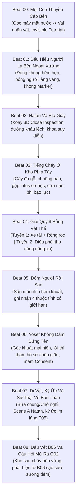

# 07 • Kịch bản Phân cảnh Vertical Slice 3A — Prologue Q01, Chapter Q03 & Legend L01

**Tác phẩm:** *Unsealed Witness: Legacy of the Covenant (Chứng Nhân: Di Sản Giao Ước)*  
**Phân đoạn:** Bộ Kịch Bản Phân Cảnh Chi Tiết Trục Mở Màn & Cổng Hồi I (Prologue Q01, Chapter Q03, Legend L01)  
**Thời lượng dự kiến:** 90 phút gameplay khám phá liền mạch (Vertical Slice Specification)  
**Chuẩn mực thiết kế:** One-Shot Camera (góc máy điện ảnh liền mạch, không cắt cảnh đen), Khảo cổ Hiện trường Đa tầng (Multi-layered Physical Archaeology), Không chiến đấu lấy mạng (Zero-Combat Tension), Tương tác Vật thể & Cơ học Thực tế, Canon Lock 100%.

---

## 1. Thiết lập Bối cảnh & Định hướng Đạo diễn (Director's Vision)

### 1.1. Không gian & Thời gian
* **Địa điểm:** Cảng Sebastos (Xêdarê Maritima) — kỳ quan cảng nhân tạo La Mã bên bờ Địa Trung Hải.
* **Thời điểm:** Một buổi chiều muộn cuối thập niên 50 sau Công nguyên (~58–60 AD). Ánh nắng vàng rực của hoàng hôn Địa Trung Hải rọi nghiêng qua những trụ đá vôi xói mòn bởi muối biển, đổ bóng dài lên các tháp tời bốc dỡ hàng hóa, đường ray gỗ con lăn và những kho hàng phân tầng nồng mùi hắc ín, mạt cưa và cá khô.
* **Tôn chỉ Mở màn:** **Tuyệt đối không sử dụng đoạn chơi thử 6 phút của chương Biển Đỏ (L01) ở đầu game.** Việc mở màn bằng một lát cắt lịch sử hoành tráng sẽ làm phân tán và loãng đi trọng tâm tâm lý cốt lõi của tác phẩm: sự dằn vặt của Người Chứng về cái chết của người cha vừa qua đời và món nợ lương tâm của chính bản thân.

### 1.2. Trạng thái Tâm lý & Xuất phát điểm Nhân vật
* **Nhân vật chính (The Witness / Người Chứng):** Một người chuyển thư trẻ tuổi thuộc tầng lớp bình dân. Vừa rời con thuyền cập bến sau chuyến hải trình dài, trở về quê nhà sau khi nhận tin cha mình — Haddai — đã chết vì bạo bệnh trong cảnh bị bêu riếu vì cáo buộc ký khống hồ sơ thất thoát hàng hóa tại kho cảng.
* **Tảng đá trong tâm thức (T05):** Nhân vật không phải là một người quan sát vô can. Ký ức đau xót nhất đang dày vò Người Chứng là nhiều năm trước, chính mắt nhân vật đã thấy cha ký biên nhận "đã nhận đủ" khi hàng hóa chưa được kiểm tra xong; nhưng vì sợ cha mất việc và gia đình lâm vào cảnh khốn cùng, Người Chứng đã chọn im lặng.

### 1.3. Ngôn ngữ Điện ảnh & Giao diện (Cinematic & UX Rules)
1. **One-Shot Camera:** Toàn bộ Prologue từ lúc con thuyền cập bến đến khoảnh khắc nhìn ra vịnh sương đêm được ghi lại qua một cú máy duy nhất bám sát nhân vật (Over-The-Shoulder / Third-Person Immersive), không một lần cắt cảnh đen (no hard black cuts) hay nhảy góc máy kiểu phim truyền hình (no disjointed shot-reverse-shot cuts).
2. **Invisible Diegetic Tutorial:** Loại bỏ hoàn toàn pop-up hướng dẫn dạng chữ nổi, thanh máu hay vệt sáng dẫn đường (floating GPS waypoint marker). Mọi kỹ năng di chuyển, xoay góc nhìn, kiểm tra vật phẩm và tương tác vật lý đều được hướng dẫn thông qua kiến trúc không gian, âm thanh môi trường và phản xạ hành vi tự nhiên của các nhân vật phụ (NPC).
3. **Observation-First Investigation:** Nghiêm cấm cơ chế "giác quan thám tử" (Detective Vision / Eagle Vision) làm nổi màu đồ vật. Người chơi chỉ có thể phát hiện bất thường qua ánh sáng xiên, âm thanh cót két, độ nghiêng sàn nhà và vết rách cơ học thực tế.

---

## 2. Kịch bản Phân cảnh Chi tiết 9 Nhịp (Beats 00–08)



---

### Phân cảnh 00: Một Con Thuyền Cập Bến (Góc máy Liền mạch & Hướng dẫn Ẩn)
* **Thời lượng:** ~3–4 phút
* **Không gian:** Cầu tàu số 4, Cảng Sebastos.
* **Hình ảnh & Âm thanh mở màn:**
  Khung hình mở ra ở tầm cực thấp, sát mặt nước biển biếc xanh đang dập dềnh phản chiếu ráng chiều Địa Trung Hải. Không có âm nhạc dàn dựng phô trương; không gian chỉ tràn ngập âm thanh thực địa sống động: tiếng sóng vỗ ì oạp vào chân kè đá vôi phủ rêu, tiếng gỗ mạn thuyền va chạm êm ái vào thanh chắn cảng, tiếng dây neo thừng lớn căng kẽo kẹt rợn người khi thủy thủ quăng dây vào cọc bích bằng đá.
* **Chuyển giao điều khiển tức thì:**
  Mũi thuyền chầm chậm chạm gờ bến. Tiếng "rầm" chắc nịch của tấm ván gỗ lớn được hai thủy thủ hạ xuống mặt cầu đá. Máy quay từ mặt nước lướt mượt mà hướng lên, lượn ra sau lưng Người Chứng khi nhân vật nhấc bước chân đầu tiên đạp lên tấm ván. Ngay giây phút mũi hài chạm vào mặt đá ướt của bến cảng, quyền điều khiển hoàn toàn thuộc về người chơi. Không có màn hình tải, không có cắt cảnh.
* **Cơ chế làm quen chuyển động (Diegetic Onboarding):**
  * *Xoay góc nhìn (Camera Control):* Người chơi tự nhiên đưa mắt quan sát khi nghe tiếng hò hét vang dội của các phu khuân vác đang vác các bao ngũ cốc lớn từ boong tàu xuống, và những cánh tay chỉ trỏ của đốc công cảng.
  * *Di chuyển & Điều hướng (Locomotion):* Lối đi thẳng phía trước bị một kiện hàng gỗ cẩu dở che khuất; người chơi tự động học cách luồn lách qua khe hẹp giữa các kiện hàng, lách qua tốp thợ đang cuộn lưới, nhìn theo tấm biển gỗ khắc ký hiệu xưởng mộc của Natan treo nghiêng ở đầu con hẻm lát đá dẫn vào thị trấn cảng.

---

### Phân cảnh 01: Dấu Hiệu Người Lạ Bên Ngoài Xưởng (Quan sát Không gian 3D)
* **Thời lượng:** ~3 phút
* **Không gian:** Hẻm Thợ Mộc nối cầu tàu và xưởng đóng tàu nhỏ.
* **Điểm nhấn thị giác tự nhiên:**
  Rẽ vào con hẻm đá hẹp dốc nhẹ lên trên, hai bờ tường đá vôi cao vút tạo thành hiệu ứng đóng khung thị giác (visual framing). Ánh hoàng hôn hắt nghiêng tạo mảng sáng tối tương phản gay gắt. Ngay trước lối vào xưởng Natan, một bóng người lạ mặt — khoác áo choàng len thô màu tro sẫm, trùm kín đầu — đang đứng bất động, chăm chú dò xét cánh cửa gỗ và cấu trúc khóa của xưởng.
* **Phản ứng AI và Giới hạn Thông tin:**
  Khoảnh khắc tâm nhìn (reticle/camera focus) của người chơi hướng thẳng về phía bóng người lạ và bước chân tiến lại gần khoảng 8 mét, nhân vật này khẽ giật mình, liếc mắt nhìn lại rồi lập tức quay ngoắt bước nhanh lẩn vào dòng người đang đổ xô ra chợ cá.
  * *Nguyên tắc thiết kế:* **Tuyệt đối không xuất hiện icon dấu hỏi, vệt đỏ hay marker xác nhận "Kẻ phóng hỏa / Địch thủ".** Người chơi chỉ biết đây là một người có hành vi lấm lét bất thường.
* **Quyền tự do phản ứng của người chơi (Player Agency):**
  * *Lựa chọn A (Bám theo):* Người chơi có thể chạy vội theo vài mét đến ngã rẽ góc tường, kịp nhìn thấy dáng đi vội vã hơi khập khiễng của hắn trước khi bị đám đông thương nhân che khuất hoàn toàn.
  * *Lựa chọn B (Điều tra tại chỗ):* Người chơi dừng lại bắt chuyện với hai người thợ đang cưa thân gỗ bá hương cạnh đó: *"Người lúc nãy là ai thế?"* — Thợ cảng gạt mồ hôi đáp: *"Chẳng biết, nhưng hắn lảng vảng quanh xưởng bác Natan từ trưa đến giờ, cứ ngó nghiêng mấy cái then cửa."*

---

### Phân cảnh 02: Natan Và Bìa Giấy (Tương tác Vật chứng Xúc giác)
* **Thời lượng:** ~5 phút
* **Không gian:** Bên trong xưởng mộc Natan — không gian mờ tối, ấm áp, nồng đượm mùi mạt cưa thông và dầu thắp ô-liu.
* **Cuộc gặp tại xưởng gỗ:**
  Người Chứng bước qua ngưỡng cửa gỗ thấp. Natan — người bạn thợ lâu năm của người cha quá cố Haddai — đang ngồi trầm ngâm bên bàn thợ, tay vân vê một chiếc bào gỗ đã sứt mẻ. Nghe tiếng bước chân, ông ngẩng đầu lên, ánh mắt đượm vẻ xót xa nhưng đầy cảnh giác.
  Natan đứng dậy, không vội vàng ôm ấp than khóc, mà bước tới một hốc tường bí mật sau giá gỗ, rút ra một cuốn sổ bọc da dê bị quăn mép: cuốn sổ ghi chép hộ gia đình của Haddai.
  * NATAN: *"Cha con bảo giao lại cuốn này tận tay con nếu ông ấy không kịp qua mùa gió bấc. Cầm lấy đi. Giữ cho kỹ, đừng để ai thấy con mang nó ra khỏi cửa này."*
* **Giải đố Quan sát Vật lý (Tactile 3D Close Inspection):**
  Hệ thống kích hoạt góc nhìn cận cảnh vật thể 3D tương tác tự do:
  * Người chơi dùng tay xoay cuốn sổ dưới ánh sáng xiên hắt vào từ khung cửa sổ nhỏ.
  * *Cảm nhận xúc giác:* Bìa da phía sau có mảng ẩm lạnh và bị biến màu do ngấm nước biển lâu ngày.
  * *Phát hiện vật lý:* Khi xoay gáy sổ về phía nguồn sáng, người chơi phát hiện một đường chỉ cước gai khâu lại bị xô lệch bất thường — các lỗ đục cũ vẫn còn dấu vết sợi chỉ tơ đỏ bị cắt đứt vội vàng trước khi bị đè lên bởi một đường khâu thô ráp mới.
  * *Cơ chế ghi nhận (Observation Lock):* Nhật ký chỉ ghi lại sự kiện khách quan: *"Đường chỉ khâu gáy sổ bị lệch và có dấu chỉ bị thay mới."* **Khóa chặt tuyệt đối không cho phép nhân vật tự suy diễn hay kết luận** rằng cuốn sổ đã bị đánh cắp ruột hay làm giả tại thời điểm này (manh mối này chỉ được giải mã hoàn toàn ở Q10 khi có phương pháp bảo tồn và đối chiếu mẫu chỉ).

---

### Phân cảnh 03: Tiếng Cháy Ở Kho Phía Tây (Bùng phát Biến cố)
* **Thời lượng:** ~4 phút
* **Không gian:** Lối thông từ xưởng Natan sang kho bến phía tây (West Harbor Warehouse).
* **Chuyển nhịp khẩn cấp (Pacing Shift):**
  Ngay khi Người Chứng cất cuốn sổ vào túi ngực, một tiếng "RẮC... RẦM!" xé toạc bầu không khí từ hướng bến cảng, tiếp nối là tiếng đà gỗ lớn gãy đổ, tiếng chuông đồng báo động dập dồn và tiếng thét hoảng loạn: *"LỬA! Lửa cháy ở kho phân tầng phía tây rồi!"*. Khói đen mù mịt mang theo mùi dầu hắc cháy khét lẹt cuồn cuộn bốc lên che khuất cả bầu trời hoàng hôn.
* **Sự xuất hiện của Titus (Companion Mechanics Introduction):**
  Người Chứng lao ra khỏi xưởng. Giữa đám đông đang chạy ngược chiều tán loạn, **Titus** — người thợ cơ khí phụ trách hệ thống cáp trục và ròng rọc của cảng — đang cố sức chặn một toán thợ lại:
  * TITUS: *"Kho chưa kiểm hết người! Còn lão Simeon và thằng bé học việc bị kẹt trên sàn gác lửng tầng hai! Cầu thang chính bị xà gãy đè sập rồi! Này anh bạn trẻ, lại đây giúp tôi một tay!"*
* **Định hướng Đạo diễn:**
  **Kiên quyết loại bỏ mọi yếu tố chiến đấu giả tạo (No Combat).** Không có kẻ địch nào nhảy ra chặn đường rút kiếm. Căng thẳng tột độ được tạo nên hoàn toàn từ hiểm họa môi trường: sức nóng của lửa, khói ngạt làm mờ tầm nhìn, và thời gian trôi qua đè nặng lên sinh mạng của người mắc kẹt.

---

### Phân cảnh 04: Giải Quyết Bằng Vật Thể (Gameplay Môi trường Đa tuyến)
* **Thời lượng:** ~8–10 phút
* **Cấu trúc Hiện trường 4 Tầng v6.0 (Four-Layer Physical Archaeology):**
  Kho phía tây được thiết kế theo cấu trúc không gian ba chiều La Mã thực tế gồm 4 lớp cao độ:
  1. `C0 · Cầu cảng:` Dốc xe hàng Q01.LOAD, đường bánh xe, thợ bốc dỡ.
  2. `C1 · Kho phía tây (Tầng trệt & Gác lửng):` Ngăn chứa ngổn ngang kiện hàng và thùng dầu, gác lửng gỗ bị lửa bao vây cục bộ có Simeon và phụ việc mắc kẹt.
  3. `C-1 · Rãnh bảo trì ngầm:` Rãnh tiêu nước hư cấu có cửa kiểm tra nối sang khu kho lân cận, bùn nước đọng và vết xước vật nặng (lối thoát phụ có thể khảo sát).
  4. `C+1 · Sàn tời và Sân mái (Roof Terrace):` Giàn gỗ chịu tải, trục quay đối trọng, cầu thang 18 bậc dẫn ra sân mái lộng gió.
  
  Khói đen dày đặc cuộn tròn sát trần nhà, buộc người chơi phải cúi thấp người để quan sát và di chuyển. Lối cầu thang chính lên gác lửng bị một thanh đà chịu lực bằng gỗ sồi đang cháy sém đè ngang.

```
       [C+1: SÀN TỜI & SÂN MÁI]  <--- Quan sát bóng người tháo chạy (Beat 05)
               ^
         [CẦU THANG GỖ 18 BẬC]
               ^
  +-------------------------------+
  |   C1: GÁC LỬNG TẦNG HAI       |  <--- Người mắc kẹt (Simeon & phụ việc)
  +-------------------------------+
       /                     \
  [TUYẾN 1: CƠ HỌC]        [TUYẾN 2: SỨC NGƯỜI]
  Tháo chốt xe hàng nặng    Gọi 2 thợ cảng
  Lợi dụng sàn nghiêng      Hợp lực đòn bẩy gỗ
  Kích hoạt ròng rọc        Dọn thanh xà chắn
       \                     /
  +-------------------------------+
  |   C0: TẦNG TRỆT KHO BẾN       |  <--- Bắt đầu cứu hộ cùng Titus
  +-------------------------------+
               |
  [C-1: RÃNH BẢO TRÌ NGẦM TIÊU NƯỚC] <--- Lối ngầm nối sang khu cảng (v6)
```

* **Tuyến giải quyết 1 — Tương tác Cơ học & Đối trọng (Phối hợp cùng Titus):**
  * Người chơi quan sát độ dốc 5 độ của mặt sàn kho lát đá hướng về phía khung cửa sập phụ.
  * Tiếp cận chiếc xe thồ bánh sắt chất đầy bao cát dằn tàu: người chơi dùng xà beng nạy chốt hãm bánh xe gỗ.
  * Tận dụng gia tốc trọng trường, Người Chứng và Titus cùng dùng vai tì đẩy chiếc xe lao xuống rãnh trượt, chèn cứng chiếc xe vào khung cửa đang có nguy cơ sập, tạo thành một bệ đỡ chịu lực kiên cố.
  * Titus móc sợi dây cáp tời vào dầm trên, người chơi kéo ròng rọc dây thừng kéo tung cửa thoát hiểm phụ dẫn thẳng lên chiếu nghỉ cầu thang gác lửng.
* **Tuyến giải quyết 2 — Điều phối Sức người & Đòn bẩy (Social/Manual Coordination):**
  * Thay vì vận hành ròng rọc, người chơi quay ra cửa ngách hô hoán, dùng uy tín gia đình Haddai để thuyết phục hai người phu khuân vác đang chần chừ chạy vào trợ giúp.
  * Ba người cùng lách qua làn khói, dùng một thanh gỗ chốt dài luồn dưới thanh xà đang đè, cùng ghé vai hô nhịp *"Một... Hai... Nâng!"* để nhấc bổng thanh đà nghiêng sang một bên, giải phóng lối đi cầu thang bộ.
* **Kết quả:** Cả hai phương án đều giải cứu thành công người thợ già và đứa bé thoát ra hành lang thông lên sân mái mà không bên nào bị thương tổn.

---

### Phân cảnh 05: Đốm Người Rời Sân (Góc nhìn Giới hạn Từ Sân Mái)
* **Thời lượng:** ~3 phút
* **Không gian:** Sân mái hở (Roof Terrace) nhìn bao quát ra con hẻm phía sau kho bến và khu bến thuyền nhỏ.
* **Khoảnh khắc trên cao:**
  Đẩy cánh cửa gỗ bung ra sân mái lộng gió biển, làn không khí mát lạnh xua tan khói ngạt. Người già và đứa trẻ được Titus dìu xuống cầu thang đá an toàn ngoài trời.
  Người Chứng tiến lại gần lan can đá ở mép sân mái nhìn xuống con hẻm khuất phía sau kho chứa ngay trước khi tiếng chuông đội cứu hộ dập lửa của cảng xông tới.
* **Ghi nhận Hiện trường Khách quan (Limited Field Observation):**
  Từ độ cao 8 mét, nhìn xuyên qua làn khói xám bốc nghi ngút và ánh lửa bập bùng:
  * Một bóng người đang vội vã chạy lướt qua góc hẻm, trèo qua hàng rào cọc gỗ dẫn ra phía mạn tàu nhỏ của đội thuyền tuần.
  * **Sự thật nền ngầm (Backing Truth):** Đây là người của Rufus vừa thực hiện thu hồi vội vã các cuộn hồ sơ kiểm kê có chữ ký giả nhưng sơ suất làm đổ đèn dầu gây cháy.
  * **Giới hạn nhận thức người chơi:** Trò chơi không hiện tên thủ phạm, không có "phân tích khuôn mặt". Người chơi chỉ có thể ghi lại vào sổ tay bốn thuộc tính quan sát có giới hạn:
    1. *Hướng di chuyển:* Thoát về phía bến tàu tuần phía bắc.
    2. *Thời điểm rời đi:* Ngay trước khi đội chữa cháy xông vào cửa trước 2 phút.
    3. *Trang phục:* Áo choàng ngắn viền da thuộc của nhân viên hành chính cảng, không phải y phục phu khuân vác.
    4. *Tầm nhìn bị nhòe:* Khoảng cách xa và khói mù khiến không thể nhận diện khuôn mặt hay độ tuổi chính xác.

---

### Phân cảnh 06: Yosef Không Dám Đứng Tên (Hạt mầm của Cơ chế Consent)
* **Thời lượng:** ~4 phút
* **Không gian:** Chân cầu thang ngoài nhà kho, mặt đất ẩm ướt đầy tro tàn và vũng nước cứu hỏa.
* **Hậu quả hiện trường:**
  Người Chứng bước xuống mặt đất. Đám cháy đã được đội dập lửa của cảng khống chế cục bộ, nhưng khu vực kho phía tây vẫn ngổn ngang tro bụi, lính tuần tra cảng bắt đầu chăng dây cô lập hiện trường. Phu khuân vác và thợ thuyền đứng xì xầm to nhỏ trong tâm trạng căng thẳng, đưa những ánh mắt dò xét lẫn nhau.
* **Cuộc tiếp xúc kín đáo:**
  Giữa đám đông đang lộn xộn, **Yosef** — một phu khuân vác với đôi bàn tay chai sần rớm máu — len lén bước tới gần Người Chứng, nép mình vào bóng tối dưới mái hiên của xưởng thuộc da:
  * YOSEF (thì thầm gấp gáp, mắt đảo quanh đầy sợ hãi): *"Cậu... cậu là con trai của bác Haddai đúng không? Bác ấy mất rồi... nhưng chuyện ở bến này chưa hết đâu."*
  * NGƯỜI CHỨNG: *"Anh biết chuyện gì vừa xảy ra trong kho?"*
  * YOSEF: *"Đám cháy này không phải do tàn thuốc. Có những cuộn hồ sơ kiểm kho... những kẻ ngồi trên lầu cao kia tuyệt đối không bao giờ muốn ai mở ra xem lại. Bác Haddai năm xưa cũng vì đụng vào những cuộn ấy mà..."* (Yosef khựng lại, hoảng hốt khi thấy một toán lính tuần đi ngang).
  * YOSEF (nắm chặt cổ tay Người Chứng, khẩn thiết): *"Tôi nói cho cậu vì mang ơn bác Haddai từng chia bánh cho mẹ tôi. Nhưng xin cậu... lạy Chúa tôi van cậu, đừng bao giờ xướng tên tôi ra trước quan chức hay giữa đám đông! Chúng mà biết tôi hé răng, ngày mai xác tôi sẽ nổi ở ngoài đê chắn sóng!"*
* **Ý nghĩa Hệ thống (Systemic Seed):**
  Đây là **hạt mầm đầu tiên của Cơ chế Đồng thuận (Witness Consent Contract)** xuyên suốt game: Người chơi thu thập được một đầu mối thông tin cực kỳ quan trọng, nhưng đồng thời bị trói buộc bởi trách nhiệm đạo đức và tính mạng của nhân chứng — tuyệt đối không được tự tiện công khai tên họ Yosef nếu chưa có phương án bảo hộ an toàn.

---

### Phân cảnh 07: Di Vật, Ký Ức Và Sự Thật Về Bản Thân (Cao trào Nội tâm)
* **Thời lượng:** ~6–8 phút
* **Không gian:** Xưởng Natan lúc nửa đêm — ngọn đèn dầu liu riu, gió biển rít qua khe cửa gỗ.
* **Quản lý Sinh hoạt & Quyết định Tài nguyên (Lodging vs Meal):**
  Trước khi bước vào cuộc trò chuyện cuối ngày, người chơi phải đưa ra lựa chọn phân bổ sinh hoạt thiết yếu (mở ra callback cho các chương sau):
  * *Lựa chọn `lodging`:* Trả tiền thuê một góc bàn riêng tại quán trọ gần cảng để có nơi an toàn sao chép tài liệu và phân loại hồ sơ (tạo lợi thế nghiên cứu cho Q03).
  * *Lựa chọn `meal`:* Đóng góp phần tiền mua dầu và bánh dự trữ cho bếp chung của xóm thợ nghèo, chấp nhận ngủ tạm trên sàn rơm của xưởng Natan (tạo mối liên kết cộng đồng, có người hỗ trợ canh gác ở Q04).
* **Đối diện Quá khứ tại Xưởng Natan (Diễn xuất Cận cảnh — Cảnh thoại Mẫu A):**
  Natan rót một chén rượu hạt thông nhỏ, ngồi đối diện Người Chứng. Ngọn đèn dầu hắt bóng hai người lên vách gỗ sực mùi mạt cưa. Natan nhìn sâu vào mắt nhân vật chính:
  
  > **NATAN**  
  > *(ngón tay chai sần chạm nhẹ vào cuộn dây thừng bện ba tao trên bàn)*  
  > Cha con sửa dây neo hai lần, kể cả khi người khác bảo đã chặt. Nhưng có một thứ ông ấy đã ký quá sớm.  
  >  
  > **NGƯỜI CHỨNG**  
  > *(khựng lại, ánh mắt phản chiếu ngọn đèn dầu chập chờn)*  
  > Chú... chú biết chuyện ấy?  
  >  
  > **NATAN**  
  > *(ngước lên nhìn thẳng, giọng trầm và chắc nịch)*  
  > Chú chỉ biết thứ ông ấy để lại ở đây. Phần còn lại, chú không thể nói thay người đã thấy.  

* **Nỗi đau của Sự Im lặng (Core Revelation — Không Twist Giả tạo):**
  Trò chơi không hề "lừa dối" người chơi bằng một màn lật kèo tréo ngoe của kịch bản phim hạng B. Ngay tại phân cảnh này, hồi ức chân thực nhất của Người Chứng được mở ra:
  * Nhân vật nhớ lại chính xác buổi chiều định mệnh 3 năm trước: Cha mình — già yếu và mỏi mệt — run rẩy cầm que lau chấm mực ký vào bản biên nhận *"Đã tiếp nhận đủ hàng"* khi các bao tải ngoài bến còn chưa được tháo niêm kiểm kê.
  * Người Chứng khi ấy đã đứng ngay cạnh cha, nhìn thấy rõ sự vội vã bất thường đó nhưng đã chọn **giữ im lặng** vì sợ cha bị cắt hợp đồng khuân vác của cảng.
  * Điều duy nhất Người Chứng chưa biết: Số hàng bị thất thoát ấy thực sự đã đi đâu, và ai là kẻ hưởng lợi sau lưng bức màn giấy tờ đó?

---

### Phân cảnh 08: Dấu Vết B06 Và Câu Hỏi Mở Ra Q02 (Trạng thái Thế giới Bền vững)
* **Thời lượng:** ~4 phút
* **Không gian:** Hiện trường kho phía tây lúc rạng sáng, khi tàn tro đã nguội.
* **Trạng thái Thế giới Bền vững (Persistent World State):**
  Nhà kho không hề bị reset hay biến mất. Khi người chơi quay trở lại hiện trường, thế giới 3D giữ nguyên vẹn mọi dấu vết vật lý từ vụ cứu hộ ở Beat 04:
  * Chiếc xe hàng bánh sắt vẫn nằm chèn cứng ở khung cửa ngách.
  * Cột xà gãy cháy sém nằm nghiêng đúng vị trí đã bị đòn bẩy nhấc qua.
  * Mặt sàn đá loang lổ vết bồ hóng đen và những vũng bùn tro đã đông cứng.
* **Phát hiện Vật chứng Chuyển tiếp (Evidence Inspection):**
  Người chơi soi đèn dầu vào góc bàn kiểm nhận bị lửa táp sém một góc. Dưới đáy một khay gỗ bị lật úp, người chơi tìm thấy một mảnh giấy da ghi nhận xuất kho mang mã hiệu **B06**:
  * Mặt giấy có vết cạo cơ học rõ rệt: con số lượng hàng đã bị cạo mỏng bề mặt bột đá vôi để viết đè lên.
  * *Giới hạn chứng cứ:* Chưa thể xác định ai là người cạo sửa, và chưa có bất kỳ cơ sở nào để quy kết nó liên quan tới vụ án lô G17 ở các chương sau. Mảnh giấy chỉ xác nhận: *Việc gian lận giấy tờ ở kho này là có thật.*
* **Khép lại Trường đoạn (Cinematic Outro):**
  Máy quay từ từ nâng cao dần, lướt qua khung vì kèo mái kho bị cháy thủng toang hoác, bay vút lên bầu trời đêm lộng gió nhìn bao quát toàn cảnh vịnh cảng Sebastos. Cảng biển chìm dần vào làn sương đêm tĩnh mịch, chỉ còn le lói ánh đuốc của đội lính gác La Mã đi tuần dọc theo bờ kè đá.
  Âm thanh lắng lại chỉ còn tiếng chuông xa xăm và câu hỏi trọng tâm dẫn dắt bước sang Q02:  
  **"Ai đang làm hồ sơ thay đổi, và vì sao nhân chứng sợ nói?"**

---

## 3. Hệ Thống 5 Định Hướng Chiến Lược Toàn Diện (Systemic Upgrades)

Phân đoạn mở màn Prologue Q01 là nền móng chuẩn mực cho toàn bộ 5 trụ cột chiến lược xuyên suốt chiến dịch 12 chương:

### 3.1. Khảo Cổ Hiện Trường Đa Tầng (Multi-Layered Physical Archaeology)
* **Q01–Q04 (Cảng Sebastos):** Mê cung hạ tầng cảng La Mã với hệ thống rãnh thoát nước ngầm, tháp tời đối trọng gỗ, và kho chứa phân tầng. Người chơi giải mã vụ cháy kho qua vết cạo sửa cơ học và hướng khói thực tế thay vì đọc biên bản giấy thụ động.
* **Q03 & Q08 (Tuyến Antipatris & Hẻm Đá Wadi):** Thử thách sinh tồn địa hình 3D thực tế: đo độ lún vệt bánh xe theo tải trọng (24 bao vs 18 bao), đo khổ trục xe qua khe đá hẹp 1.05m vs 1.75m, vận dụng dây neo và cọc tời để vượt lũ quét cứu người và bảo vệ trang sổ E07.
* **Q09–Q10 (Khu Lưu Trữ Giêrusalem):** Pháo đài thủ tục hành chính cổ đại: thâm nhập xưởng làm giấy papyrus, khu đóng dấu niêm sáp, phân tích chất liệu mực chì và đất sét để phân biệt bản sửa thật (E08) và bản sửa ngụy tạo (E11).

### 3.2. Cơ Chế Khám Phá Đồng Hành (Companion-Driven Traversal)
Không có combat, chiều sâu phối hợp gameplay được trao trọn cho 4 nhân vật đồng hành:
* **Titus — Cơ học & Kết cấu:** Cùng vận hành hệ thống đối trọng, kích đòn bẩy, sửa trục cầu cạn, giải phóng các chốt khóa nặng tại kho cảng Xêdarê và sân phụ Galilê.
* **Lea — Giám định Hiện trường:** Đối chiếu vi mô chất liệu bao bì sợi gai thô, nhận diện kỹ thuật khâu bìa sách của Natan, đối chiếu quy chuẩn văn thư hành chính của Thư ký Varro.
* **Damar — Địa hình & Thâm nhập:** Đọc luồng tuần tra của đội lính canh Rufus, tìm gờ đá leo trèo khuất tầm nhìn, đọc vết trượt cát đá trên các sườn núi dốc.
* **Miriam — Điểm tựa Cộng đồng & Hậu cần:** Cầu nối tiếp cận các khu bếp chung, xưởng dệt và xóm chài khép kín; tạo lập sự tin cậy để nhân chứng bình dân chịu mở lời.

### 3.3. Sự Cộng Hưởng Cơ Chế Chơi (Mechanical Resonance: Legends → Mortal)
Mỗi chương Legends không chỉ kể chuyện Kinh Thánh mà trực tiếp huấn luyện người chơi một "ngôn ngữ cơ học môi trường" (Mechanical Language) tuân thủ Canon Lock 100%:
* **L01 (Xuất Hành 14 — Biển Đỏ) → Q04 & Q08:** Học cách đọc hướng gió đêm, cự ly đèn hiệu, xử lý xe lún bùn nước → Vận dụng trực tiếp vào việc điều phối dây neo vượt dòng lũ quét Wadi ở Q08 để bảo toàn E07.
* **L02 (1 Samuel 24 — Hang Đavít) → Q06 & Q07:** Học cách định vị âm học từ vách đá dội lại và di chuyển theo bóng râm → Trở thành kỹ năng cốt lõi vượt qua hành lang lính gác sân phụ ban đêm và đối chất kiềm chế cùng Lea.
* **L04 (Gioan 21 — Rạng Đông Mặt Hồ) → Q11 & Q12:** Nhịp điệu lao động tĩnh lặng trên thuyền chài lúc rạng đông và góc máy cận cảnh giàu cảm xúc → Định hình ngôn ngữ điện ảnh cho trường đoạn quay về bến cảng Xêdarê, buông bỏ ám ảnh tự vệ để can đảm làm chứng.

### 3.4. Hệ Thống World Callback Động Theo Áp Lực Hành Chính
Thế giới 3D biến đổi hữu cơ theo 3 nấc Milestone Pressure:
1. *Hồ sơ đang bị rà soát (Hồi I):* Cảng mở cửa bình thường, các hoạt động bốc dỡ nhộn nhịp.
2. *Tuyến chuyển thư bị đóng (Hồi II):* Cổng chính bị niêm phong bằng niêm chì, trạm kiểm soát của Rufus mọc lên ở các ngã ba đường, buộc người chơi phải leo qua đường mái nhà hoặc đi qua rãnh thoát nước ngầm từ Hồi I.
3. *Cuộc tiếp nhận chứng cứ sắp diễn ra (Hồi III):* Bến cảng trong tình trạng thiết quân luật cục bộ; các lựa chọn đối xử với Yosef ở Q02 hay phân bổ lương thực ở Q04 sẽ quyết định việc các thợ cảng có lén mở cửa ngách giúp đỡ hay quay lưng ở Q11.

### 3.5. Đạo Diễn Chương Cuối (Q12) Thành Interactive Set-Piece Đa Tuyến
Q12 không phải là bảng ghép nối thẻ tĩnh (Evidence Board), mà là một trường đoạn hành động thời gian thực phối hợp suy luận:
* **Điều phối Không gian:** Người chơi trực tiếp di chuyển qua bến cảng đang sôi sục căng thẳng, ra hiệu cho Titus dùng xà chốt chặn cửa ngăn đội tay sai Rufus, hướng dẫn Damar che chắn cho các nhân chứng chưa đồng thuận ký tên lánh vào hầm an toàn.
* **Đối chất Điện ảnh Liền mạch:** Bước vào sảnh tiếp nhận hồ sơ công khai; mỗi mệnh đề P01–P05 được đưa ra kèm vật chứng thực địa sẽ kích hoạt máy quay chuyển mượt từ góc nhìn thám hiểm sang cận cảnh ánh mắt dao động của Hanan, vẻ mặt nghiêm nghị của Varro và giọt mồ hôi của các nhân chứng.

---

## 4. Hợp Đồng Đo Lường & Tiêu Chí Nghiệm Thu Vertical Slice (Slice Contract)

### 4.1. Hợp đồng Kỹ thuật & Trải nghiệm
* **Tỷ lệ Khám phá / Thoại:** Tối thiểu 70% thời lượng người chơi trực tiếp tương tác vật lý trong không gian 3D (di chuyển, kiểm tra vật phẩm, đẩy đòn bẩy, định hướng). Không vượt quá 30% thời lượng cho hội thoại tĩnh.
* **Seamless Streaming:** Chuyển dịch liền mạch giữa ngoại cảnh cầu tàu -> nội thất xưởng Natan -> nội thất kho cháy -> sân mái với độ trễ khung hình (0 hitching).
* **Kiểm soát Tương tác:** Không có quick-time-event (QTE) bấm nút vô nghĩa; mọi hành động cứu người đều dựa trên logic vật lý (đòn bẩy, trọng tâm, đối trọng).

### 4.2. Tiêu chí Playtest Đạt chuẩn
1. **P01 (Tự nhiên nhận thức):** 100% người chơi thử nghiệm tìm được đường tới xưởng Natan thông qua biển báo và tiếng gọi của thợ cảng mà không cần minimap hay mũi tên định vị.
2. **P02 (Cảm nhận xúc giác):** Người chơi phát hiện được đường chỉ khâu lệch trên bìa sổ bằng cách xoay vật thể 3D dưới nguồn sáng xiên.
3. **P03 (Tôn trọng nhân chứng):** Sau cuộc gặp ở Beat 06, người chơi hiểu rõ lý do vì sao Yosef không dám công khai tên họ và có ý thức giữ kín danh tính của anh.
4. **P04 (Hiểu rõ động lực nhân vật):** Người chơi nắm được sự thật: người cha Haddai đã ký biên nhận vội, chính Người Chứng từng im lặng, và mục tiêu tiếp theo là điều tra vì sao hồ sơ bị cạo sửa tại Q02.
